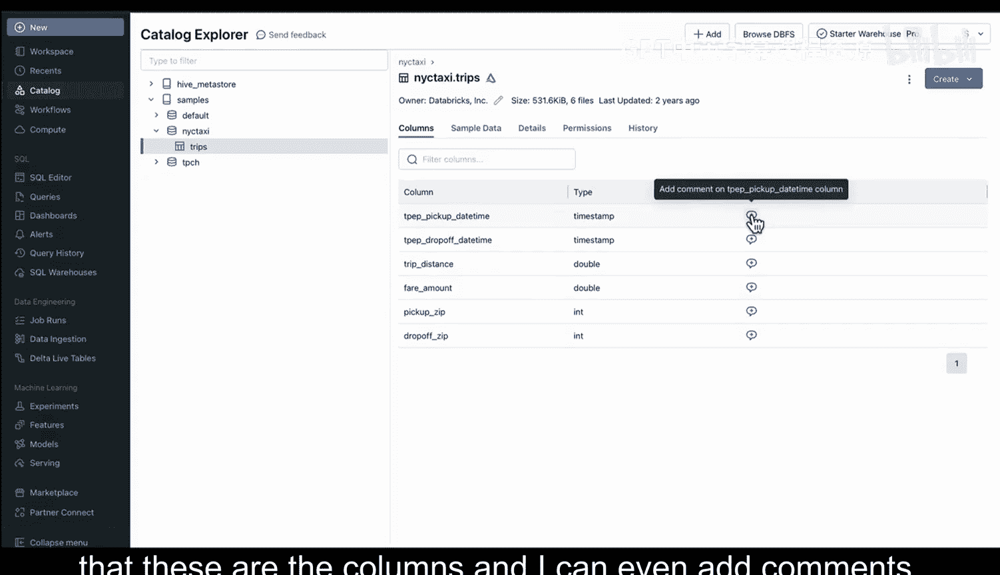
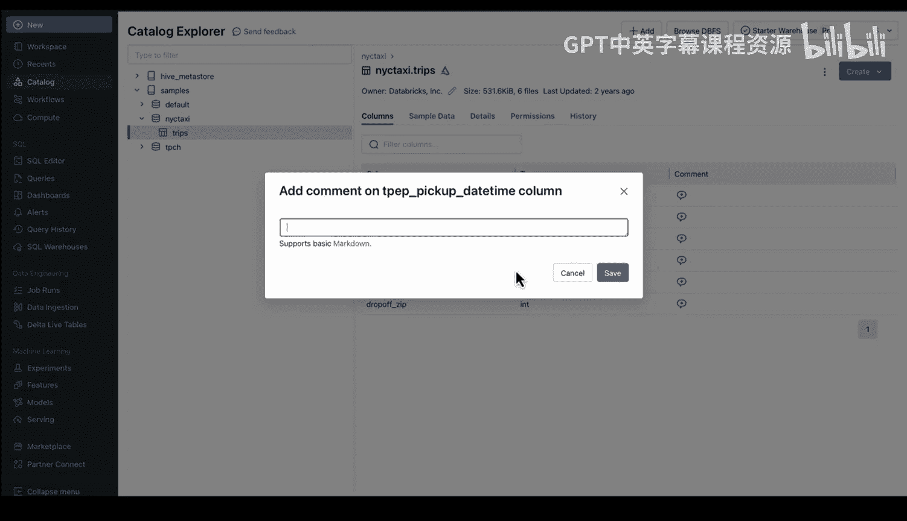
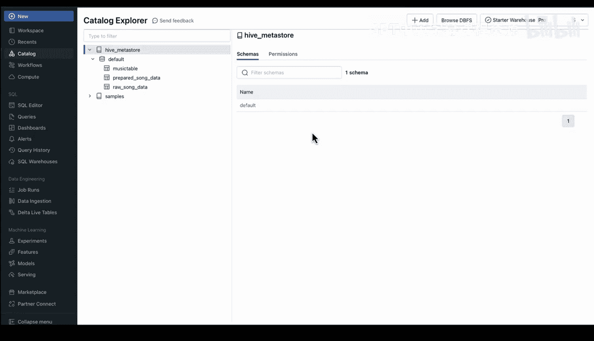

# 大型语言模型实践（高级数据工程、AWS、Databricks和本地LLM）：P120：19_01_03_使用目录浏览器


在本节课程中，我们将学习如何使用Databricks中的目录浏览器。目录浏览器是一个用户界面，它允许你浏览、搜索、管理和组织Databricks工作空间中的不同数据对象，例如表、视图和仪表板。通过本教程，你将了解如何利用这个工具高效地探索和管理你的数据。

## 🗂️ 目录浏览器简介与核心功能

目录浏览器提供了一个集中式的门户，用于搜索、筛选和浏览数据表、仪表板及模型。你可以为对象添加标签、管理访问权限，并查看数据表中的底层数据。这是一个非常便捷的数据探索工具。

以下是目录浏览器的一些核心功能：
*   **集中浏览与搜索**：在一个界面中查找所有数据资产。
*   **对象标记与管理**：为数据对象添加标签和注释，便于团队协作。
*   **权限控制**：管理谁可以访问哪些数据。
*   **数据预览**：无需编写代码即可查看数据样本和详细信息。



## 🔍 探索数据表



现在，让我们通过一个具体例子来看看目录浏览器的实际应用。假设我们有一个名为 `samples.nyctaxi.trips` 的数据表。

点击这个数据表后，界面会自动展示其列结构。你可以为列添加注释，这对于团队协作非常有用。例如，你可以添加注释：“此列数据需要清理”。


此外，你还可以查看数据的描述性样本，这让你无需编写任何代码就能了解数据概貌。同时，可以查看详细信息，例如数据在磁盘上的实际存储位置。了解这一点很有用，因为你可能想对这些数据执行其他操作。

## 💻 查询与操作数据

在目录浏览器中，你可以直接对数据执行操作。一个很好的起点是运行查询。

例如，你可以创建一个查询：
```sql
SELECT * FROM samples.nyctaxi.trips LIMIT 100;
```
按 `Shift + Return` 执行查询。系统内置了保护机制，默认将查询结果限制在1000行以内，以防止意外拖慢系统。执行后，你可以看到返回了100行数据，耗时仅385毫秒。这是一个非常高效的功能。

## 📊 创建可视化与仪表板

除了查询，你还可以快速创建可视化图表。点击界面上的“+”号，选择“可视化”。

例如，你可以创建一个散点图，选择 `trip_distance` 作为X轴，`fare_amount` 作为Y轴。这样，你就得到了一个直观的图表。

你还可以继续构建，例如添加过滤器。这使你能够创建与数据关联的存储视图或仪表板。当团队其他成员查看此数据集时，他们可以立即看到这些预设的分析视角，从而快速理解数据。

## 🔄 与SQL编辑器的交互

另一个重要的功能是目录浏览器与SQL编辑器之间的无缝切换。你可以在SQL编辑器中编写复杂查询，然后轻松切换回目录浏览器查看数据对象的结构和详情。

很多时候，你可能先在目录浏览器中浏览数据，当需要修改或深入分析时，再切换到SQL编辑器。两者之间的这种交互极大地提升了工作效率。

## 📁 深入Databricks文件系统

目录浏览器还有一个强大的功能，就是可以直接深入Databricks文件系统。

例如，在“文件存储”部分，你可能会看到一些尚未创建元数据表的数据文件。之后，如果你想为这些数据创建元数据，可以回到Databricks文件系统，找到对应的路径，然后在目录浏览器中为其创建表。创建完成后，你就可以像之前一样对这部分数据执行查询或创建可视化图表。



## 🎯 本节总结


本节课我们一起学习了Databricks目录浏览器的核心用法。目录浏览器是管理Databricks文件系统上元数据的起点。通过它，你可以轻松浏览、查询、可视化数据，并与SQL编辑器协同工作。如果你能为常用数据集设置好自动化的可视化和描述性统计，将能为团队节省大量时间，并让其他成员立即开始从数据中获取价值。