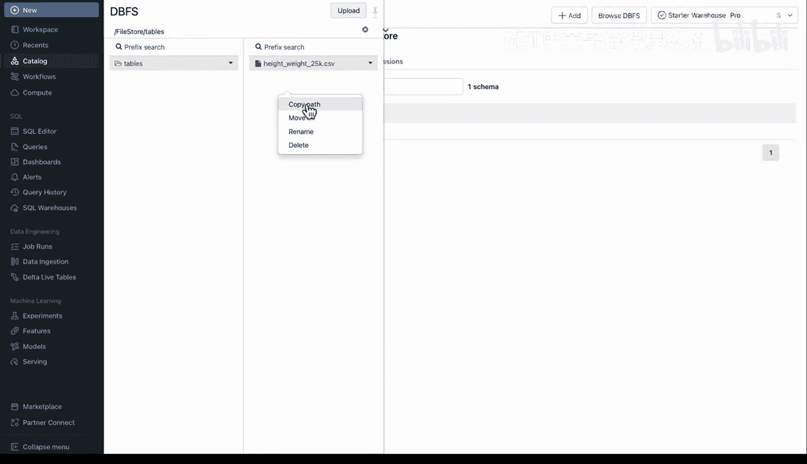
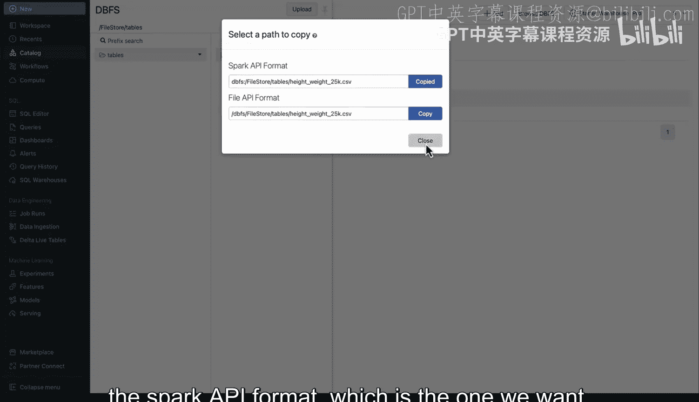
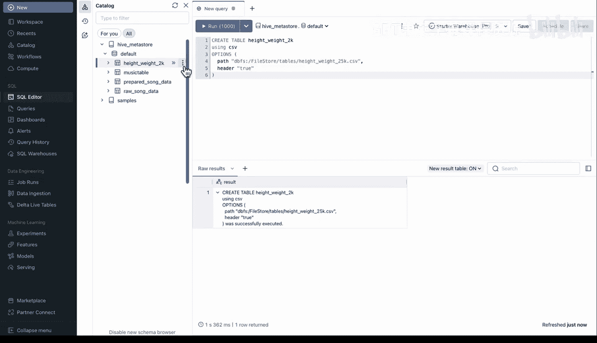
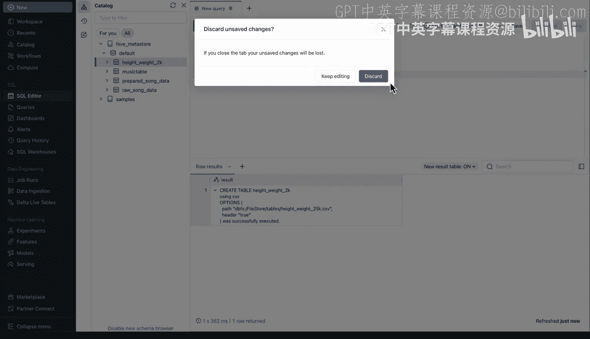
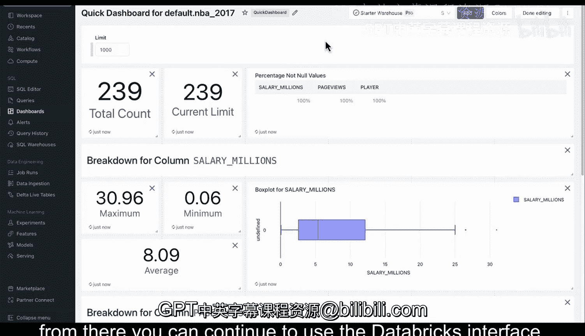

# 大型语言模型实践（高级数据工程、AWS、Databricks和本地LLM）：P121：从文件创建表 📁


在本节课中，我们将要学习如何在Databricks中完成一个常见但可能令人困惑的任务：如何手动将数据添加到Databricks文件系统（DBFS），并基于这些文件创建可供查询的表。我们将介绍两种主要方法：使用SQL编辑器直接创建表，以及通过Catalog Explorer界面直观地上传数据并自动建表。

## 查看DBFS中的数据



首先，我们需要了解如何查看已存在于DBFS中但尚未在Catalog中注册为表的数据。通过导航到DBFS，我们可以浏览文件系统并找到目标数据文件。例如，我们可能发现一个CSV文件存储在路径 `dbfs:/FileStore/tables/height_weight.csv` 中，但它尚未出现在Catalog Explorer的列表里。



上一节我们介绍了如何定位DBFS中的文件，本节中我们来看看如何将这些文件注册为正式的表。

## 方法一：使用SQL编辑器创建表

如果数据文件已存在于DBFS中，我们可以通过执行SQL `CREATE TABLE` 语句来手动创建表。以下是具体步骤：

1.  打开Databricks工作区中的SQL编辑器。
2.  编写一个创建表的SQL查询。关键是指定正确的文件路径和格式。





以下是创建表的核心SQL语法示例：
```sql
CREATE TABLE height_weight_25k
USING CSV
OPTIONS (
  path “dbfs:/FileStore/tables/height_weight.csv”,
  header “true”
)
```
在这个代码中：
*   `CREATE TABLE height_weight_25k` 指定了新表的名称。
*   `USING CSV` 声明了数据源格式为CSV。
*   `OPTIONS` 子句用于提供具体参数：
    *   `path` 指向DBFS中CSV文件的确切位置。
    *   `header “true”` 告知系统将文件第一行作为列名处理。

执行此查询后，系统会读取指定路径的数据并创建一个名为 `height_weight_25k` 的表。之后，你可以在Catalog Explorer的“default”数据库下找到这个新创建的表，并查看其列信息和数据预览。

## 方法二：通过Catalog Explorer上传并创建表

对于需要从零开始上传数据的情况，Databricks提供了更直观的图形界面操作方式。

以下是使用Catalog Explorer上传文件并创建表的流程：

1.  在Databricks侧边栏导航至“Catalog”。
2.  点击“添加数据”或类似按钮。
3.  在打开的界面中，点击“浏览”选择本地计算机上的数据文件（例如一个名为“nba_2017.csv”的文件）。
4.  系统会提供数据预览。确认无误后，你可以直接在此界面创建新表。
5.  为表命名（例如 `nba_2017`），然后点击“创建表”。

使用这种方法，Databricks会自动处理文件上传（将其保存到DBFS）和表的注册过程。创建完成后，你可以立即在Catalog Explorer中看到新表，浏览其样本数据，甚至利用这些数据快速创建可视化仪表板来分析内容，例如球员薪资与维基百科页面浏览量的关系。

## 总结



本节课中我们一起学习了在Databricks中从文件创建表的两种核心方法。第一种是通过SQL编辑器手动编写DDL语句，适用于管理已存在于DBFS中的文件。第二种是通过Catalog Explorer的图形化界面直接上传文件并自动建表，这种方式对于新数据导入更为便捷。掌握这两种方法，你就能灵活地将各种数据源引入Databricks环境，为后续的数据处理、分析和机器学习任务做好准备。