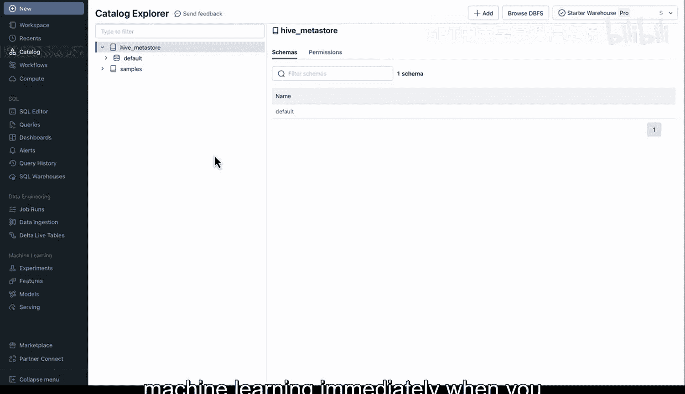

# 大型语言模型实践（高级数据工程、AWS、Databricks和本地LLM）：P122：21_01_05_查询外部数据源

在本节课中，我们将学习如何在Databricks平台中查询外部数据源。我们将探讨多种集成外部数据的方法，包括通过界面直接添加、利用原生集成以及通过合作伙伴进行数据摄取。

## 🗂️ 添加外部数据源

上一节我们介绍了Databricks的基本概念，本节中我们来看看如何将外部数据引入系统。

在Databricks目录（Catalog Explorer）中，点击“添加”（Add）按钮，可以看到一个专门用于添加外部数据的区域。这是开始查询外部资源最简单的方法之一。例如，你可以将数据文件放入Blob存储中，然后直接将其集成到你的工作区。

## 🔗 原生集成选项

除了直接添加，Databricks还支持与多种数据库和服务的原生集成。

以下是支持的部分数据源列表：
*   **数据库**：Cassandra、Snowflake、MySQL、PostgreSQL。
*   **数据流与搜索**：Kafka、Elasticsearch。
*   **文档存储**：MongoDB。
*   **云存储**：DBFS（Databricks文件系统本身）。
*   **应用与服务**：Google Drive、Salesforce。

可以看到，我们有许多不同的方式可以从外部源添加数据。

## 🤝 通过合作伙伴摄取数据

另一种集成外部数据的方式是通过“合作伙伴”（Partner）进行数据摄取。这与直接添加略有不同。

通过此方式，你可以直接从这些合作伙伴资源中获取数据集。例如，选择“5t”这个集成，进入高级选项，数据将直接存入你的DBFS，之后便可使用。

## 🛠️ 丰富的数据应用生态

Databricks的集成能力不仅限于数据接入，还覆盖了完整的数据工作流。

以下是其他可连接的集成类型：
*   **商业智能与可视化**（BI and visualization）
*   **数据准备与转换**（Data preparation, transformation）
*   **机器学习**（Machine learning），例如Data I/O, Labelbox
*   **安全与数据治理**（Security, data governance）

因此，连接外部数据源的方式远不止从当前界面直接添加这一种。你还可以通过“通过合作伙伴摄取”（Ingest via partner）功能与众多服务提供商连接。

## 📝 总结与后续步骤

本节课中我们一起学习了在Databricks中查询外部数据源的多种途径。总的来说，Databricks提供了丰富的资源集合，能够将各类数据轻松拉取到你的系统中。

当数据就绪后，你可以立即利用所有现有接口开展工作，例如：
*   创建新的Notebook进行分析。
*   在SQL编辑器中直接查询数据。
*   直接进入机器学习流程，运行自动化实验。

