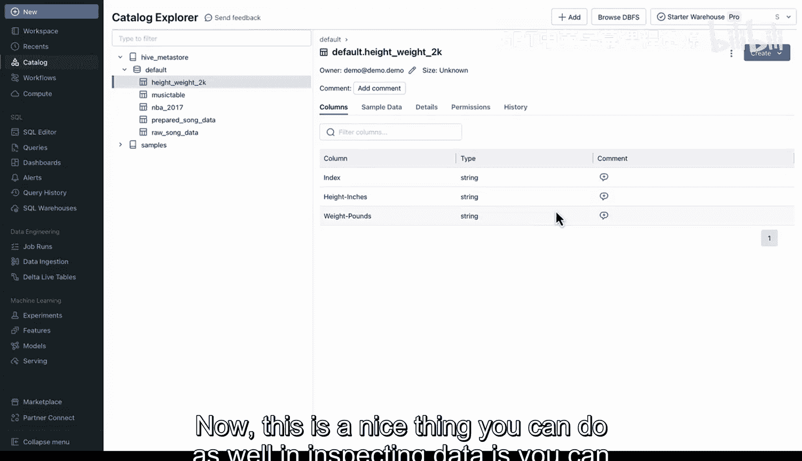
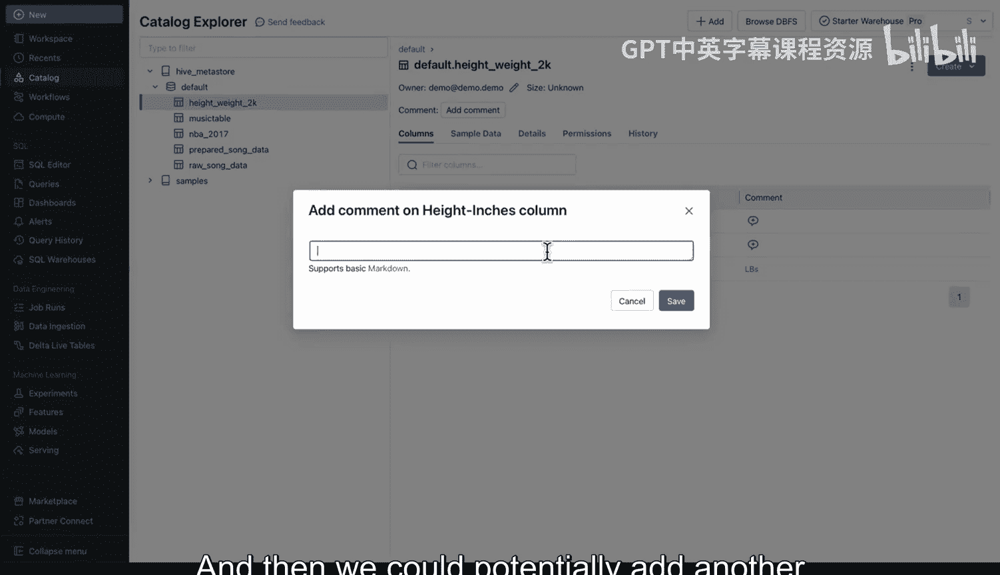
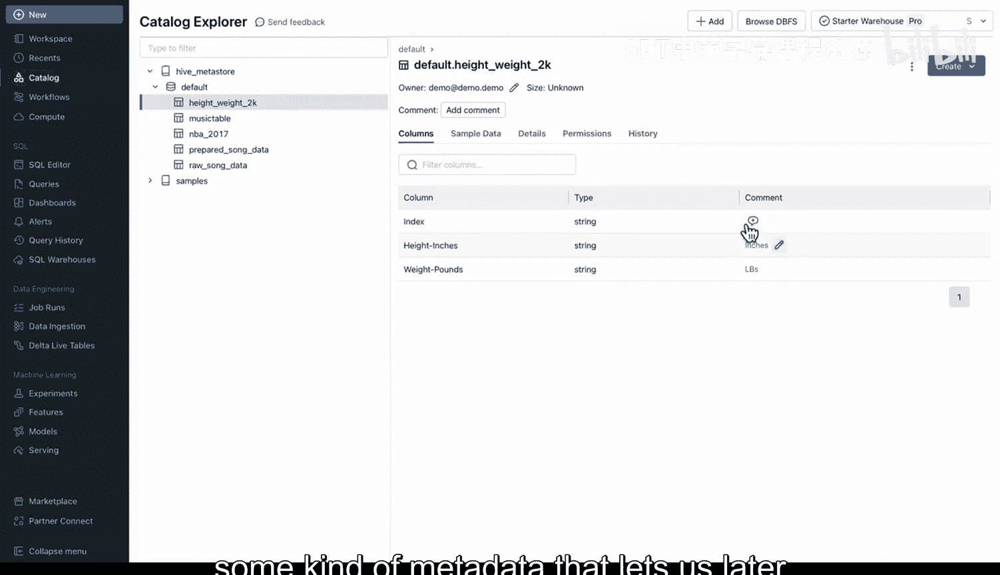
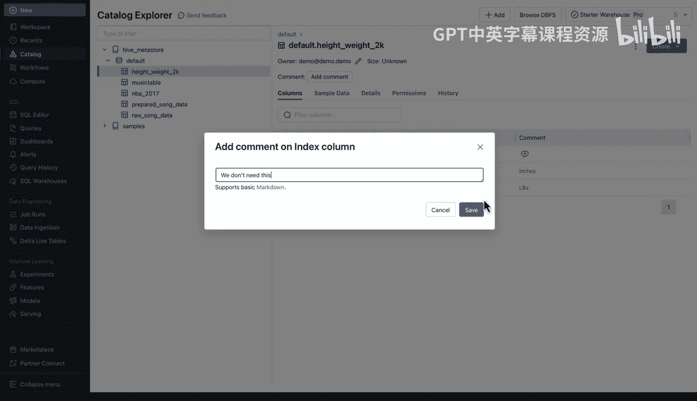
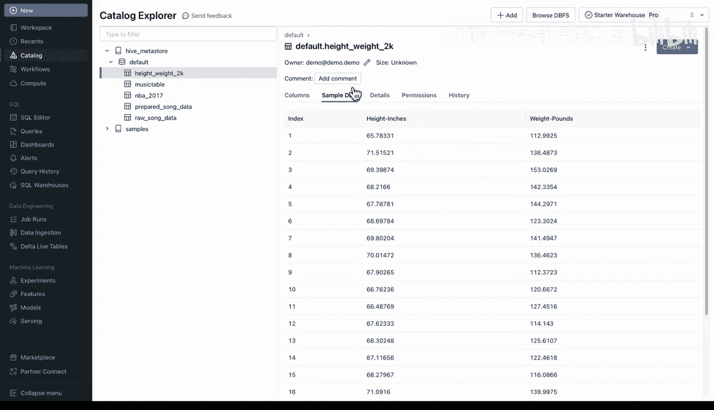
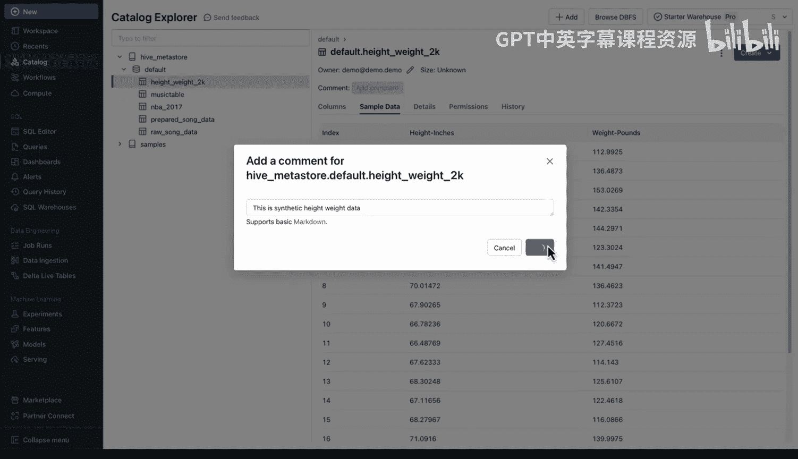
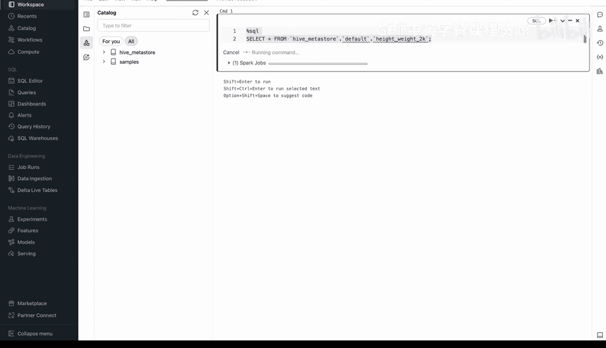

# 大型语言模型实践（高级数据工程、AWS、Databricks和本地LLM）：P123：检查表结构 📊

在本节课中，我们将学习如何在 Databricks 中检查数据表的结构和元数据。我们将了解如何访问 Catalog Explorer、查看表的基本信息、列定义、样本数据，以及如何为表和列添加注释。

---

上一节我们介绍了 Databricks 的基本环境，本节中我们来看看如何具体地检查和理解一个数据表。

首先，进入 Catalog Explorer。Catalog Explorer 需要一个正在运行的仓库，以便你能够实际检查表。

在这里，我们可以看到 `hive_metastore`，这是用户上传数据保存的地方，同时还有 `samples` 等默认目录。

例如，如果我们想查看 `trips` 表，可以注意到其所有者是 `databricks`。这让我们能看到该表最初创建时的情况。

Databricks 在两年前创建了它，我们看到其大小为 531 KB。我们也可以在这里查看列信息。

我们还可以获取一些样本数据，这能很好地概述表内的情况。

此外，我们可以查看详细信息，这里显示了数据在磁盘上的存储位置。这在执行某些操作时可能很有用，比如你想将某些内容复制到该位置。

我们还可以查看权限设置以及历史记录。不过，对于默认数据，历史记录可能帮助不大。

如果我们查看一些我上传的数据，例如 `height_weight_2000` 表，可以看到其所有者是 `demo`（一个虚构的电子邮件地址）。

我们还可以看到可用的列：`index`、`height`、`weight`。

检查数据时一个很好的功能是，你可以为列添加注释。

例如，我们可以为 `weight` 列添加注释，说明其单位是磅（LBs）。

同样，我们也可以为 `height` 列添加注释，说明其单位是英寸（inches）。

这相当于添加了一种元数据，让我们以后能获取关于这些列的更多信息。

我们甚至可以添加其他信息，例如，我们不需要这个（指代某个操作）。

这使我们能够对表进行注释和检查。

我们同样可以再次查看样本数据、详细信息、历史记录等。

你甚至可以直接在表本身添加注释，例如：“这是合成的身高体重数据”。

因此，如果你想检查 Databricks Catalog 内部的情况，Catalog Explorer 是你的首选工具。你可以操作表、检查它、查看其周围的元数据、添加自己的元数据。

最后，如果你愿意，还可以直接进入查询笔记本，甚至创建仪表板。

如果我们快速查看这个笔记本，其中一个方便的功能是它会自动提供我们想要运行的查询语句，这实际上非常有用。

如果我们在这里连接到一个集群，其好处在于，如果你想快速获取一个表的大量信息，它可以成为一站式解决方案。

你可以从这里出发，转向不同的解决方案，例如，在实际的笔记本中开始查询，并围绕它启动 Spark 作业。

---

本节课中，我们一起学习了如何使用 Databricks 的 Catalog Explorer 来全面检查数据表。我们掌握了查看表的基本属性、列信息、样本数据和存储位置的方法，并学会了如何通过添加注释来丰富表的元数据。这些技能是进行有效数据管理和分析的基础。