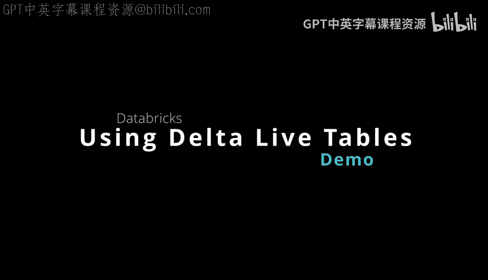
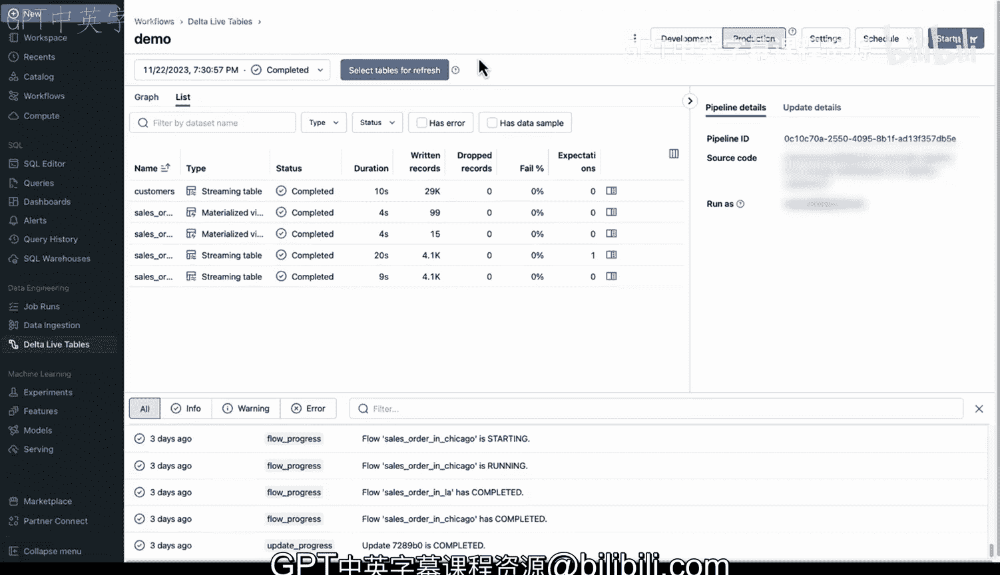

# 大型语言模型实践（高级数据工程、AWS、Databricks和本地LLM）：P124：23_01_07_使用Delta Lake构建可靠数据管道 🚀

在本节课中，我们将学习如何使用Delta Live Tables来构建和调度可靠的数据管道。Delta Live Tables是一种新的工作流调度方式，它集成了Delta Lake的高级功能，让复杂数据管道的构建变得简单直观。

## 创建新管道

首先，我们来看如何创建一个新的Delta Live Tables管道。创建过程非常直接，你只需选择“创建”即可。

以下是创建管道时需要配置的几个关键选项：
*   **管道名称**：你需要为管道指定一个名称。
*   **产品类型**：你可以选择产品类型，例如“高级版”、“核心版”或“专业版”。界面上通常会提供相关文档，帮助你做出选择。
*   **执行模式**：你需要在“持续”模式和“触发”模式之间做出选择。两者的区别在于，**持续模式**会持续不断地处理到达的流式数据，而**触发模式**则是在特定事件发生时才会执行。
*   **源代码路径**：你需要传入源代码的存储路径。例如，可以是你工作站上连接的代码仓库，这是一个存放源代码的好地方。
*   **目标目录**：你可以选择目标目录，例如Unity Catalog。
*   **计算配置**：你需要选择运行管道所需的计算集群类型。

## 管道演示与监控

我已经有一个正在运行的管道，让我们通过这个演示来深入了解。在这个Delta Live Tables的界面中，我们可以看到几个关键组件。

以下是当前管道中的数据流视图：
*   一个名为`customers`的流式表。
*   另一个流式表。
*   这些数据经过一些ETL操作后，会流入一个名为`sales_order_clean`的合并表中。
*   此外，还有两个物化视图。

这个界面的一个实用之处在于，我们可以切换视图并获取更多详细信息。

例如，我们可以查看以下信息：
*   任务是否完全执行成功。
*   实际运行的任务类型是什么，例如是否是流式任务。
*   写入了多少条记录。
*   是否有记录被丢弃。在处理来自互联网（如API）的数据时，可能会出现数据丢弃或失败的情况。

能够在一个视图中看到所有这些信息非常方便。同样，我们也可以直接定位源代码的位置，只需点击相应的链接即可。

如果我点击那个源代码链接，你会看到这里有一个笔记本，里面包含了所有的流式处理代码。我们也可以直接在这里对代码进行修改。这样就在实时代码和自动化管道之间建立了一个良好的交互界面。

## 模式切换与调度

最后，还有一点可能很重要，那就是你可以在不同模式之间切换。在**开发模式**下，你可以让一切正常运行并进行测试。之后，你可以切换到**生产模式**。

最后，你还可以按一定的时间间隔来调度这个管道。因此，Delta Live Tables提供了许多功能，使得构建复杂的数据管道变得相当简单直接。

## 总结

本节课中，我们一起学习了Delta Live Tables的核心功能。我们了解了如何创建和配置一个新的管道，包括设置名称、产品类型、执行模式、源代码路径和目标。我们通过演示查看了管道的运行状态、数据流和监控信息，并了解了如何直接访问和修改源代码。最后，我们知道了可以在开发和生产模式间切换，并能按计划调度管道。这些特性共同使得Delta Live Tables成为构建可靠、复杂数据管道的强大工具。

