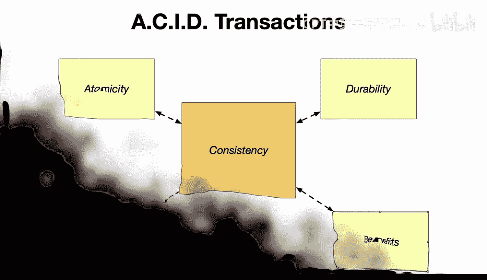

# 大型语言模型实践（高级数据工程、AWS、Databricks和本地LLM）：P125：24_01_08_ACID事务

## 概述

在本节课中，我们将要学习ACID事务。ACID是数据库事务的四个关键特性的缩写，它确保了数据操作的可靠性和一致性。理解ACID对于在数据工程和LLM应用中维护高质量数据至关重要。

## 什么是ACID事务？

ACID代表原子性（Atomicity）、一致性（Consistency）、隔离性（Isolation）和持久性（Durability）。这四个特性共同定义了一种独特的事务类型，旨在保证数据操作的完整性和可靠性。

## ACID的四个核心特性

上一节我们介绍了ACID事务的基本概念，本节中我们来看看构成ACID的四个具体特性。

以下是ACID事务的四个核心组成部分：

1.  **原子性**
    原子性确保一个事务中的所有操作作为一个不可分割的单元执行。这意味着所有操作要么全部成功，要么全部失败，不存在部分成功、部分失败的中间状态。这是一个“全有或全无”的操作。

    **核心概念**：`事务 = 全部成功 OR 全部失败`

2.  **一致性**
    任何ACID事务都会将数据库从一个**有效状态**转换到另一个**有效状态**。这确保了数据的内部规则和约束在事务前后都得到遵守。例如，在传统SQL系统中，相关数据（如表之间的外键关系）在事务完成后将保持一致。这与NoSQL数据库的“最终一致性”模型有显著区别。

3.  **隔离性**
    隔离性意味着并发执行的事务和查询不会相互干扰。例如，一个事务在提交前的未提交更改或中间状态，对其他并发事务是不可见的。这些更改在提交前将保持隔离状态。

4.  **持久性**
    持久性是指一旦一个事务被提交，其所做的更改就会被持久化地保存下来。这些更改能够经受住系统故障的考验，确保已提交的数据永远不会丢失。

## ACID事务的优势与考量

了解了ACID的四个特性后，我们来看看采用ACID事务能带来哪些好处，以及需要考虑的方面。

以下是采用ACID事务的主要优势：

*   **数据完整性**：保障批处理和流处理场景下的数据完整性。
*   **一致性查询**：能够通过快照进行一致性查询。
*   **容错性**：得益于持久化日志，系统具备容错能力。
*   **可靠的数据交付**：确保数据交付的可靠性。

在数据质量方面，ACID事务被视为黄金标准。

然而，采用ACID事务也需要付出一些代价。例如，由于强一致性的要求，其在可扩展性方面会受到一定限制。

## 总结

本节课中，我们一起学习了ACID事务。我们详细探讨了其原子性、一致性、隔离性和持久性这四个核心特性，它们共同确保了数据库操作的可靠性和数据的高质量。虽然ACID事务可能在可扩展性上有所妥协，但它为需要强数据一致性和完整性的应用场景提供了坚实的基础。

