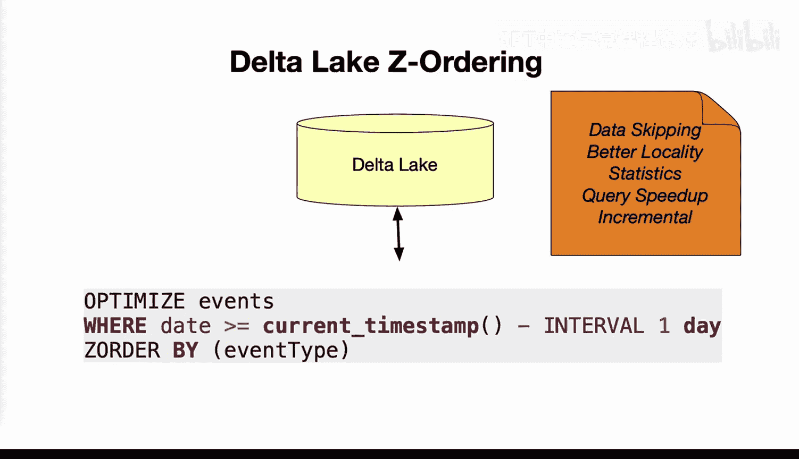
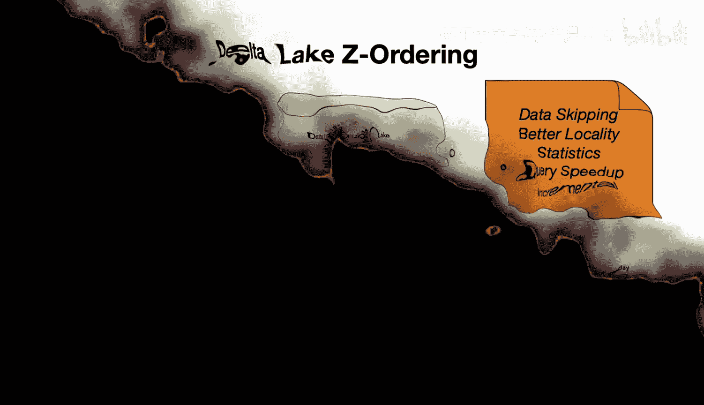

# 大型语言模型实践（高级数据工程、AWS、Databricks和本地LLM）：P126：Z-Order排序优化


## 概述
在本节课中，我们将要学习Delta Lake中一项重要的性能优化技术——Z-Order排序。这项技术通过优化数据的物理存储布局，可以显著提升查询效率并降低成本。

## 什么是Z-Order排序？🔍
Z-Order排序是Delta Lake中的一项重要技术。它的核心作用是将相关的信息整理到同一组文件中。

这种数据共位性会被Databricks上的Delta Lake数据跳过算法自动利用。这意味着，它可以极大地减少Databricks上的Delta Lake需要读取的数据量。

## 如何使用Z-Order排序？💻
以下是使用Z-Order排序的基本语法。你可以在`ZORDER BY`子句中指定要排序的列。

```sql
OPTIMIZE events WHERE date >= current_timestamp() - INTERVAL 1 DAY
ZORDER BY event_type
```

通过这个例子，我们可以看到Z-Order排序的强大之处。接下来，让我们深入了解它的工作原理和优势。

## Z-Order排序的关键特性✨
上一节我们介绍了Z-Order的基本用法，本节中我们来看看它的核心特性。以下是Z-Order排序的几个关键优势：

### 1. 自动数据跳过
这意味着Delta Lake会在写入时收集最小值和最大值统计信息，以实现谓词下推。这个过程是透明的，无需额外配置，并且在查询时会自动跳过与查询无关的数据扫描。

### 2. 更好的数据局部性
这项特性意味着它将相关的列值共置于同一个数据文件中。这极大地提升了数据跳过的有效性。你可以通过`ZORDER BY`子句指定你想要优化的列。

### 3. 灵活的统计信息收集
Delta Lake提供了可配置的统计信息收集功能。默认情况下，它会收集表中前32列的统计信息。但你可以通过`columns`属性来自定义，从而避免对高基数的文本列进行不必要的统计。

### 4. 显著的查询加速
由于需要扫描的数据量大大减少，查询速度得到显著提升。这对于特定的、尤其是具有高选择性的查询特别有效。

### 5. 降低总体拥有成本
查询效率的提升直接转化为更低的计算资源消耗和总体拥有成本。

### 6. 增量式优化
Z-Order排序支持增量式重新优化。你可以在完成主要的数据回填后应用Z-Order排序，也可以在数据分布发生重大变化时重新运行它。你甚至可以测试查询来量化性能提升。





## 总结
本节课中，我们一起学习了Delta Lake中的Z-Order排序优化技术。我们了解到，它通过将相关数据共置来优化存储，并利用自动数据跳过机制来减少I/O，从而显著提升查询性能并降低成本。当你在Databricks平台上使用Delta Lake时，掌握这项技巧将非常有用。