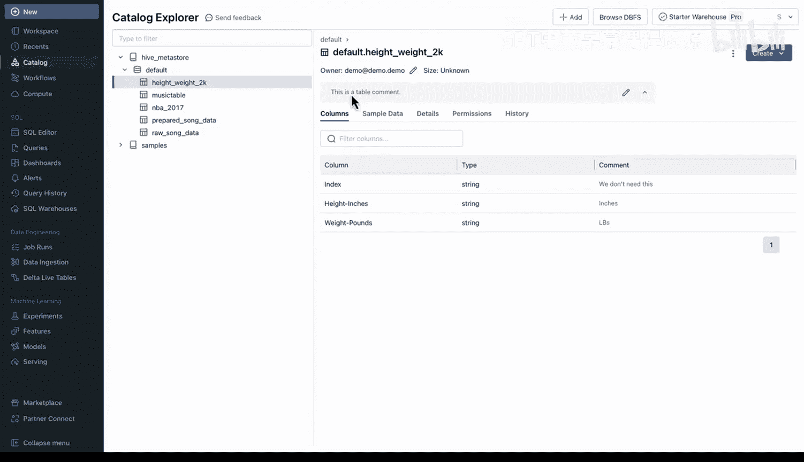
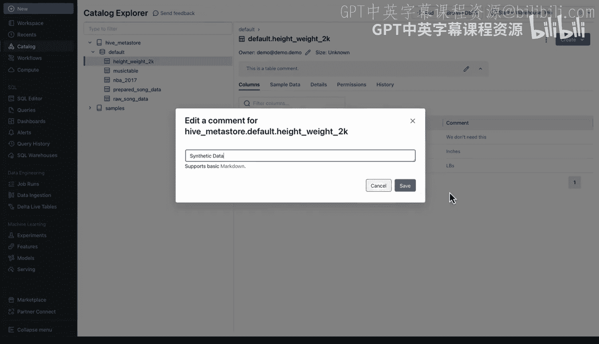
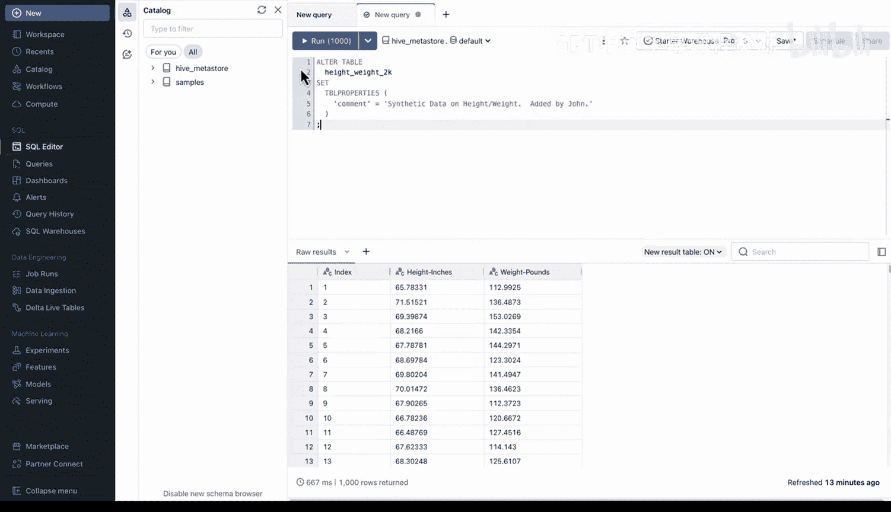
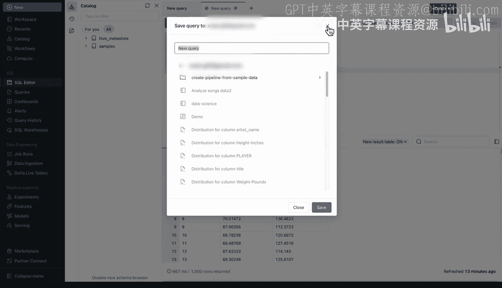
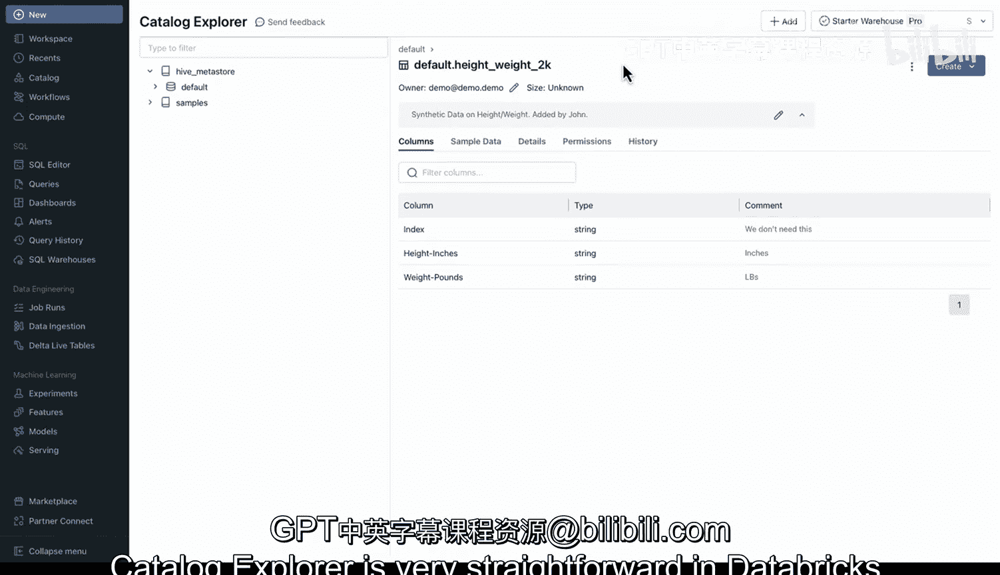

# 大型语言模型实践（高级数据工程、AWS、Databricks和本地LLM）：P127：26_02_02_表文档化


在本节课中，我们将学习如何在Databricks中为数据表添加和更新文档。我们将探索两种主要方法：通过图形界面（Catalog Explorer）和通过编程方式（使用SQL语句）。掌握这些技能有助于维护清晰的数据资产文档。

## 通过Catalog Explorer添加文档



上一节我们介绍了课程概述，本节中我们来看看如何通过图形界面为数据表添加注释。



首先，我们打开Catalog Explorer。这里有一个名为“height_weight”的表格，其当前注释显示为“this is a table comment”。我们将修改这个注释。

以下是操作步骤：
1.  在Catalog Explorer中找到目标数据表。
2.  点击表格的注释区域进行编辑。
3.  将注释内容修改为“synthetic data”。
4.  保存更改。

通过上述步骤，我们成功更新了表格的注释信息。

## 通过SQL编程方式添加文档

虽然图形界面操作简便，但很多时候我们需要以编程方式与数据表进行交互。接下来，我们将学习如何使用SQL语句来实现相同的文档化目标。

我们可以在Databricks中创建一个SQL查询来修改表格属性。具体方法是使用 `ALTER TABLE` 语句来设置表格的注释属性。





以下是实现此操作的SQL代码示例：
```sql
ALTER TABLE catalog.schema.height_weight
SET TBLPROPERTIES ('comment' = 'synthetic data on height weight added by John');
```
在这段代码中，`catalog.schema.height_weight` 是目标表格的完整名称。`SET TBLPROPERTIES` 子句用于设置表格属性，我们将 `comment` 属性的值更新为新的描述文本。执行此查询后，表格的注释就被成功修改了。

## 验证文档更改

在通过编程方式更新了表格注释后，我们需要验证更改是否已生效。我们可以使用SQL命令来查看表格的详细信息。

为了查看更新后的表格属性，包括我们刚刚添加的注释，可以使用 `DESCRIBE EXTENDED` 命令。

以下是验证更改的SQL代码：
```sql
DESCRIBE EXTENDED catalog.schema.height_weight;
```
执行此命令后，返回的详细信息中会包含一个“Comment”字段，其中显示了我们通过 `ALTER TABLE` 语句设置的新注释内容。这证实了我们的更改已成功应用。

此外，我们也可以返回到Catalog Explorer界面，在图形化视图中直观地确认注释已被更新。

## 总结



本节课中我们一起学习了在Databricks中为数据表添加文档的两种方法。我们首先介绍了如何使用Catalog Explorer进行可视化操作，然后讲解了如何通过编写 `ALTER TABLE` SQL语句以编程方式更新表格注释，最后学习了如何使用 `DESCRIBE EXTENDED` 命令来验证更改。无论选择哪种方式，在Databricks中维护清晰的数据表文档都是一个直接且简单的过程。