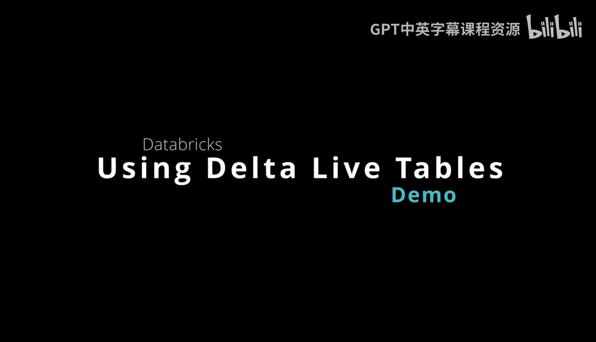
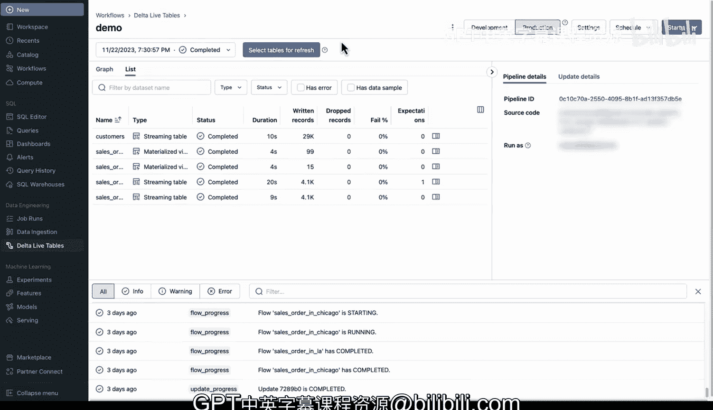

# 大型语言模型实践（高级数据工程、AWS、Databricks和本地LLM）：P128：27_02_03_使用Delta Live Tables构建自动化管道 🚀

在本节课中，我们将学习如何使用Delta Live Tables来构建和管理自动化数据管道。Delta Live Tables是一种调度工作流的新方法，它集成了Delta Lake的高级特性，能够简化复杂数据管道的创建与运维。

## 创建新管道

上一节我们介绍了Delta Live Tables的概念，本节中我们来看看如何创建一个新的管道。

创建新管道时，只需选择“创建”选项。你需要为管道指定一个名称。接着，你可以选择产品类型，例如“高级版”、“核心版”或“专业版”。界面上通常会提供相关文档链接，帮助你做出合适的选择。

以下是创建管道时需要配置的几个关键选项：

*   **管道模式**：你可以选择“持续”模式或“触发”模式。两者的区别在于，“持续”模式会持续不断地处理新到达的流式数据；而“触发”模式则基于特定事件来运行。
*   **源代码路径**：你需要传入源代码的存储路径。这通常是你工作站连接的代码仓库，是存放源代码的理想位置。
*   **目标目录**：你可以选择目标目录，例如Unity Catalog。
*   **计算配置**：你需要选择运行管道所需的计算集群类型。

## 管道演示与监控

现在我们已经了解了如何创建管道，接下来通过一个演示来查看其运行状态。

在这个Delta Live Tables的演示视图中，我们可以看到多个组件。这里有一个名为`customers`的流式表，以及另一个流式表。这些数据经过一些ETL操作后，会流入一个名为`sales_order_clean`的合并表中。此外，视图中还展示了两个物化视图。

这个界面的实用之处在于，我们可以切换视图并获取更多详细信息。

以下是我们可以查看的一些关键信息：

*   **运行状态**：检查任务是否完全成功完成。
*   **任务类型**：确认正在运行的任务类型，例如是否为流式任务。
*   **记录统计**：查看写入了多少条记录，以及是否有记录被丢弃。这在处理来自互联网（如API）的数据时尤为重要，因为可能会发生数据丢失或处理失败。
*   **源代码定位**：通过选择相应链接，可以直接定位到源代码所在位置。

如果点击源代码链接，我们会跳转到一个笔记本，其中包含了所有的流式处理代码。我们也可以在此直接修改代码。这就在实时代码和自动化管道之间建立了一个良好的交互界面。

## 模式切换与调度

最后，我们来了解一下管道的模式切换与调度功能，这对于管道的生命周期管理至关重要。

在开发模式下让管道正常工作后，你可以将其切换到生产模式。此外，你还可以按一定的时间间隔来调度这个管道。

Delta Live Tables提供了丰富的功能，使得构建复杂的数据管道变得相当直观。以上内容概述了Delta Live Tables的基本特性。

---

本节课中，我们一起学习了如何使用Delta Live Tables构建自动化数据管道。我们涵盖了从创建管道、配置选项，到监控运行状态、查看源代码，再到切换开发/生产模式以及设置调度任务的全过程。这些功能共同使得在Databricks平台上管理数据工作流变得更加高效和可靠。

