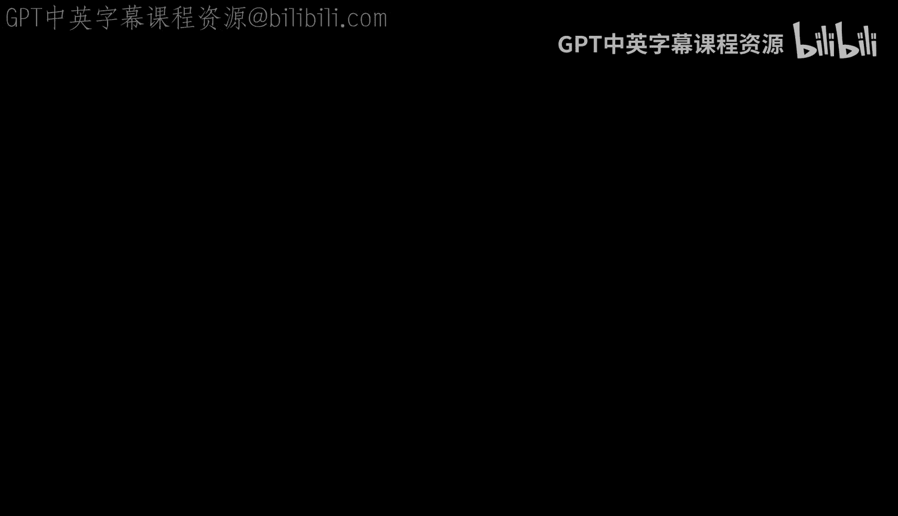
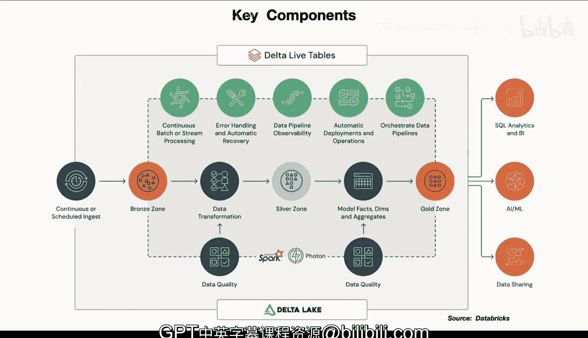

# 大型语言模型实践（高级数据工程、AWS、Databricks和本地LLM）：P129：28_02_04_Delta Live Tables组件解析 🧩

在本节课中，我们将要学习Delta Live Tables的核心组件。我们将通过一个架构图，了解如何从数据摄入的青铜层，逐步演进到具备自动化部署与运维能力的黄金层，并分析每一层的关键功能与业务价值。

---

上一节我们介绍了Delta Live Tables的整体演进路径，本节中我们来看看其具体的核心组件构成。

以下是Delta Live Tables的关键组件。可以看到，随着最佳实践的融入，数据管道可以从青铜层演进到白银层，最终到达黄金层。各层之间的区别在于：例如，在白银层，你能够在数据管道末端实现完整的可观测性；而在黄金层，你能够实现自动化的部署与运维，即MLOps或DataOps，并且能够编排你的数据管道。这最终会为SQL分析、BI、AI/ML以及数据共享带来更好的结果。

---

## 高效数据摄入 📥

首先，高效的数据摄入是Delta Live Tables的一个重要组成部分。AutoLoader组件支持增量数据着陆，这属于青铜层。它可以从云存储、变更数据捕获或消息总线等多种来源摄取数据。整个数据团队，从SQL用户到工程师，都能以非常简单的方式加载数据。

## 智能数据转换 ⚙️

接下来是智能数据转换。这意味着使用流表和视图来简化架构，并具备数据质量强制实施的能力。它支持灵活、持续或触发的管道执行，并且可以借助Spark结构化流处理的性能优化。

## 简化的管道管理 🛠️

第三步是简化的管道管理。这包括处理编排、监控、故障恢复、持续集成与持续交付、版本控制，以及通过基础设施即代码来自动扩展基础设施。它允许团队专注于业务逻辑，而非仅仅是运维操作。

## 湖仓平台集成 🏠

最后是湖仓平台集成。Unity Catalog可用于数据发现和治理，而Delta Lake则是可靠的存储层，可在多云环境中工作。在业务影响方面，你将能够获得更快的开发速度，轻松扩展以管理不断增长的数据量，并加速整个组织内的洞察获取时间。

本质上，这意味着你能够通过自动化来降低数据管道的总体拥有成本。这正是最终的黄金层所实现的目标。

---

本节课中我们一起学习了Delta Live Tables的四大核心组件：高效数据摄入、智能数据转换、简化管道管理以及湖仓平台集成。我们了解了数据管道如何从青铜层演进至具备自动化能力的黄金层，并理解了每一层为数据团队和业务带来的具体价值。