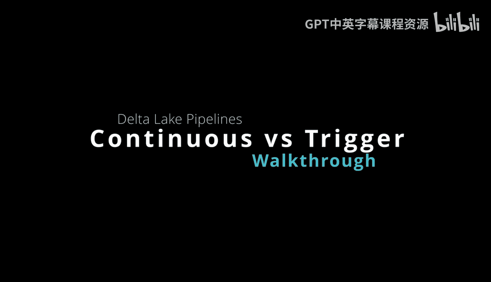
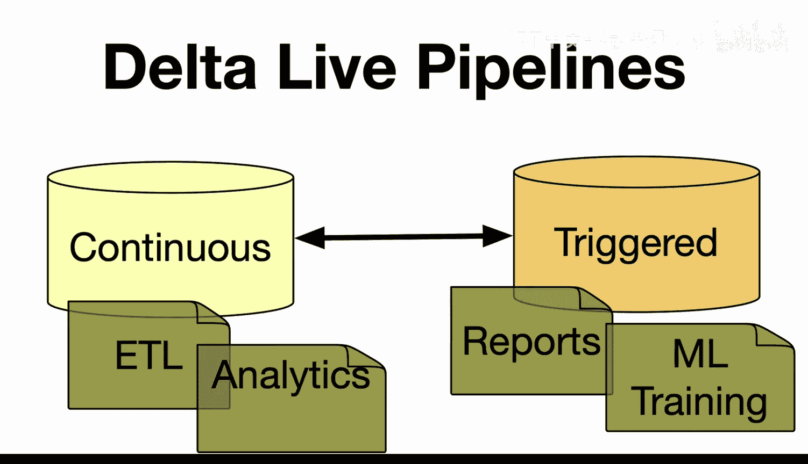

# 大型语言模型实践（高级数据工程、AWS、Databricks和本地LLM）：P130：29_02_05_持续管道与触发式管道对比

在本节课中，我们将要学习两种不同的Delta Live管道：持续管道与触发式管道。我们将探讨它们的工作原理、适用场景以及各自的优缺点，帮助你理解如何根据实际需求选择合适的管道类型。

## 持续管道 🔄

首先，我们来看看持续管道。持续管道的核心思想是，数据在到达源头时被持续不断地处理，即流式数据处理。

新插入和更新的数据会增量同步到目标表中。这种模式支持实时ETL（提取、转换、加载）和实时分析。

以下是持续管道的一些典型应用场景：

*   **指标仪表盘**：例如，如果你希望按小时甚至实时了解收入生成情况，持续管道是理想选择。
*   **实时欺诈检测**：如果你需要实时查看正在输入的虚假信用卡号码，可以通过持续管道构建欺诈检测系统。

## 触发式管道 ⏰

上一节我们介绍了持续管道，本节中我们来看看触发式管道。触发式管道与持续管道有所不同，其数据处理发生在预定的时间窗口内，而非持续进行。

这意味着，例如，你可以每天执行一次操作。这些时间窗口可以通过CRON调度来安排。这种方式允许以逻辑方式（如每小时、每天、每周）进行批处理或周期性处理。

以下是触发式管道的一些典型应用场景：

*   **聚合报告**：生成每日或每周的汇总报告。
*   **机器学习模型训练**：例如，每天获得数据更新后，重新运行一个小型机器学习模型，这个过程可以通过这种触发式窗口完成。

## 对比与选择 ⚖️

现在，我们来对比一下这两种管道。你可以认为持续管道具有更低的延迟，但需要更多的计算资源，因此成本可能更高。而对于基于批处理的工作负载，触发式管道则更具成本效益。

你可以根据观察到的数据消费模式来组合使用这两种方法。你也可以更新管道配置，尝试一种版本与另一种版本的对比。这两种都是优秀的技术，关键在于你如何根据最佳用例来应用它们，同时监控其对你组织的成本和效益。

本节课中我们一起学习了持续管道与触发式管道的核心区别。持续管道适用于需要低延迟和实时处理的场景，而触发式管道则更适合周期性的批处理任务，成本效益更高。理解它们的特点有助于你为不同的数据处理需求选择最合适的解决方案。