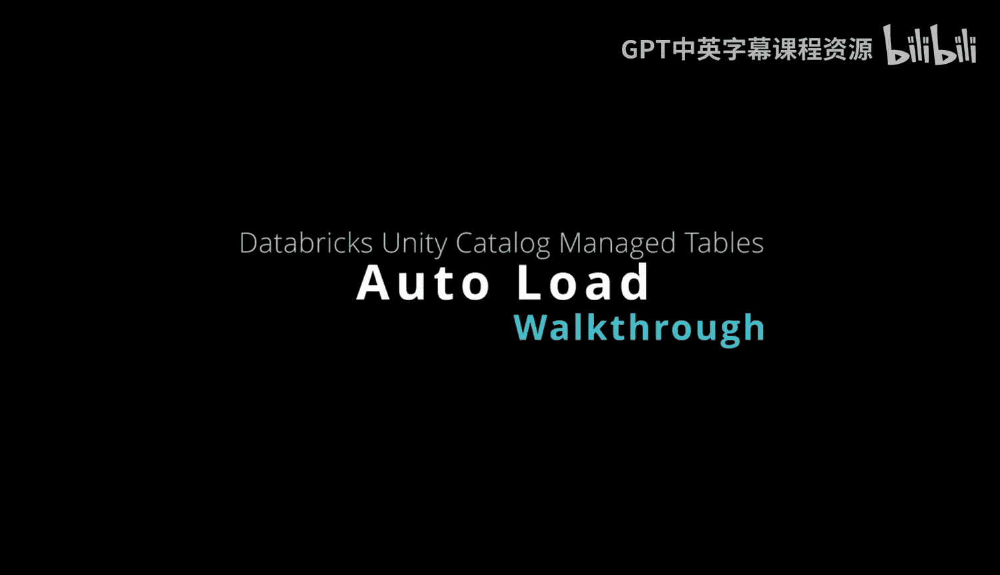
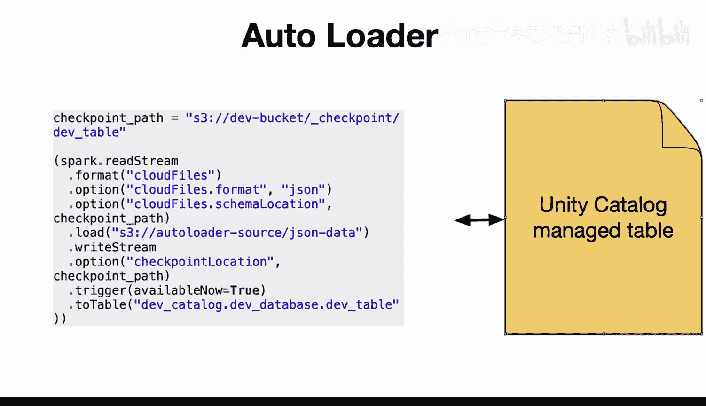

# 大型语言模型实践（高级数据工程、AWS、Databricks和本地LLM）：P131：30_02_06：配置自动加载器 🚀



在本节课中，我们将要学习如何配置自动加载器。自动加载器允许你安全地从外部位置摄取数据。我们将了解其核心配置、数据处理能力以及监控与调度功能。

## 核心概念与源配置 ⚙️

上一节我们介绍了自动加载器的基本作用，本节中我们来看看其核心配置项。自动加载器支持从多种源系统安全地摄取数据，前提是你拥有Unity Catalog。

以下是自动加载器源配置的关键点：
*   **支持多种云存储、数据库和消息系统**。
*   **支持多种数据格式**，例如 `JSON`、`Parquet`、`CSV`。
*   **提供凭证管理功能**，以确保连接的安全性。

## 增量数据加载与转换处理 🔄

了解了数据来源后，我们来看看如何处理数据流。增量数据加载是自动加载器的另一个重要特性，因为它会持久化每个数据源的游标状态。

这意味着：
*   系统**只会拉取最新的插入和更新数据**。
*   对于需要全量加载的转换任务，这种方式**更快速、更高效**。

在数据转换方面，自动加载器提供了强大的处理能力：
*   你可以在源系统上**执行查询**。
*   可以**应用过滤、聚合和转换**操作。
*   为了确保可靠性，还可以将数据**转换为Delta格式**。

## 监控、调度与代码示例 📊

处理数据之后，确保管道健康运行至关重要。在监控方面，自动加载器提供了完善的工具：
*   可以通过**仪表板跟踪管道健康状况**。
*   可以**设置警报**。
*   提供**详细的调试日志**以供排查问题。

在调度执行方面，自动加载器同样灵活：
*   可以使用 **`cron`表达式、触发器或连续执行模式**来设置计划。
*   具备**跨作业的内置依赖关系管理**功能。

构建这样的数据处理管道代码非常直观。以下是一个简单的Python代码示例，只需几行即可实现：

```python
# 示例：使用自动加载器读取数据流
streaming_df = spark.readStream.format("cloudFiles") \
    .option("cloudFiles.format", "json") \
    .load("s3://your-source-path/")
```

通过这种方式，你就能利用Unity Catalog的高级功能来管理数据表。

## 总结 📝



本节课中我们一起学习了自动加载器的配置与使用。我们了解了其如何安全地从多种外部源摄取数据，支持增量加载以提高效率，并提供了数据转换、监控告警以及灵活调度的能力。通过简洁的代码，即可利用Unity Catalog高效地管理数据管道。