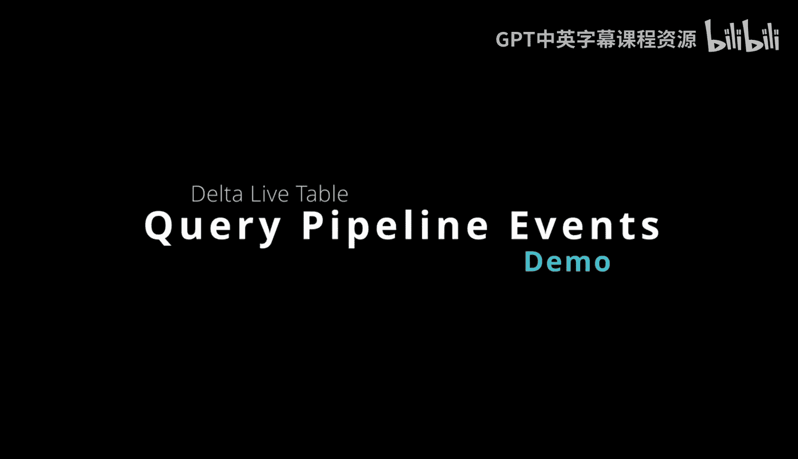
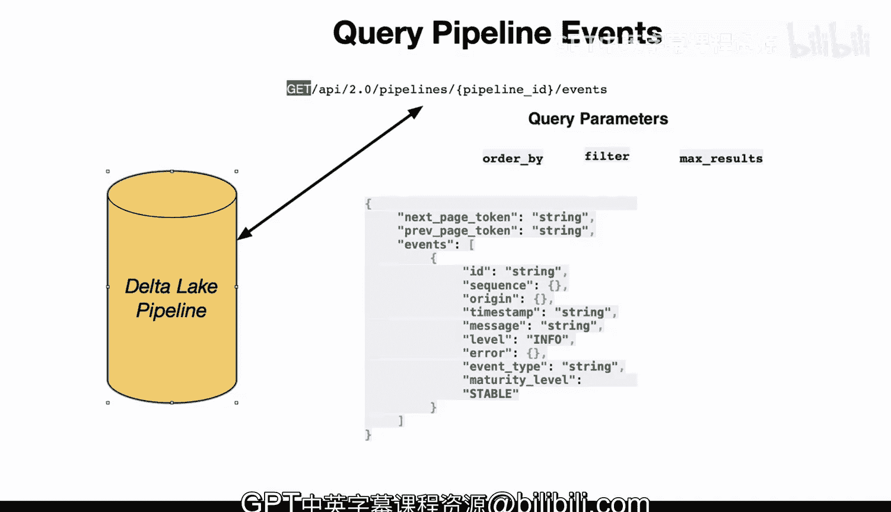

# 大型语言模型实践（高级数据工程、AWS、Databricks和本地LLM）：P132：31_02_07_查询管道事件



在本节课中，我们将学习如何通过API查询Delta Live Tables管道的事件，并了解Databricks文件系统（DBFS）相关的API操作。这些知识对于监控和管理数据管道至关重要。

## 查询管道事件API

上一节我们介绍了Delta Live Tables的基本概念，本节中我们来看看如何通过API与其进行交互。

Databricks为Delta Live Tables管道提供了完整的CRUD（创建、读取、更新、删除）API。要查询特定管道的事件，你需要向一个特定的API端点发送HTTP GET请求。

**API请求格式示例：**
```
GET /api/2.0/pipelines/{pipeline_id}/events
```

以下是该API支持的主要查询参数：
*   **`order_by`**: 用于指定事件返回的排序方式。
*   **`filter`**: 用于根据条件筛选特定事件。
*   **`max_results`**: 用于限制单次请求返回的最大事件数量。

API的响应是一个结构化的JSON负载，其中包含了管道的事件列表及相关元数据。

## API的通用能力与DBFS操作

了解了管道事件查询后，我们来看看这些API共有的特性以及DBFS相关的API。

Databricks的API设计遵循了通用标准，具备以下核心能力：
*   **精细化的验证与错误处理**：API会返回明确的状态码和错误信息。
*   **结构化的请求与响应**：使用JSON格式，便于程序解析。
*   **标准的HTTP状态码**：例如200表示成功，404表示资源未找到。
*   **通过令牌（Token）支持分页**：便于处理大量数据的返回结果。

这些特性使得API能够轻松地与各种编程语言集成，并融入自定义的CI/CD工作流或自动化工具中。

对于Databricks文件系统（DBFS），其API模式与管道API相似，主要提供以下操作：
*   **基本的文件系统操作**：如创建、读取、更新、删除文件和目录。
*   **文件上传与下载**。
*   **列出文件及目录内容**。
*   **设置访问控制列表（ACL）和权限**。
*   **从作业中编程访问DBFS**。

---



本节课中我们一起学习了如何通过API查询Delta Live Tables管道的事件，了解了相关查询参数和响应格式。同时，我们也认识了Databricks API的通用特性以及DBFS文件系统的基本API操作。掌握这些API是构建自动化监控和管理流程的基础。