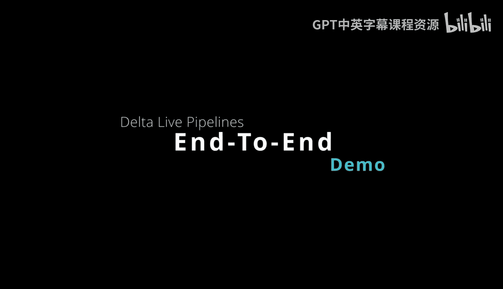

# 大型语言模型实践（高级数据工程、AWS、Databricks和本地LLM）：P133：32_02_08_Delta Live端到端示例

在本节课中，我们将通过一个端到端的示例，学习如何在Databricks工作流界面中使用Delta Live表。我们将重点关注其数据质量监控、管道可观测性以及调度功能。

## 工作流界面中的Delta Live表示例

上一节我们介绍了Delta Live表的基本概念，本节中我们来看看一个具体的运行示例。

这里展示的是一个在工作流界面中运行的Delta Live表端到端示例。请注意，界面上有一些初始组件，它们显示了管道当前正在执行的操作。

## 数据质量监控

以下是关于数据质量监控的详细信息。

在数据质量方面，我们可以看到代码执行率为100%。向下切换至下一部分，同样显示有4000个数据项，处理完成率也是100%。

我们也可以在此处查看数据质量详情，并观察数据期望值。虽然这里有一些数据下降的情况，但并没有出现失败记录。

## 管道可观测性与检查

一个集成化管道的优势在于，我们可以检查管道的每个部分，并获得细粒度的能力来审视数据质量、查看详细信息、检查数据模式、观察数据流，甚至可以在开发环境和生产环境之间进行切换。

我们同样可以从这个菜单中看到管道的状态。它会显示管道何时启动、何时运行、何时完成，并且我们也能看到更新信息。

因此，一个集成化的解决方案为管道提供了大量的监控和可观测性功能。当处理非常复杂的任务时，这可能是无价的。例如，管道中间部分可能出现问题，但有了这些监控，你就能知道它是否失败了。

## 与传统脚本方式的对比

这相对于将一堆脚本拼凑在一起的方式是一个改进，因为在纯脚本方式中，你无法清楚地知道正在发生什么。所以，数据管道的可观测性是Delta Live表的主要优势之一。

## 操作与调度

你不仅可以在界面内完成所有这些操作，还可以为管道安排未来的执行计划，或者根据需要随时手动启动它。

## 总结

本节课中我们一起学习了Delta Live表在工作流界面中的实际应用。我们重点探讨了其强大的数据质量监控面板、细粒度的管道可观测性功能，以及如何通过界面进行调度和按需启动。这些特性使得管理和维护复杂的数据管道变得更加清晰和可靠。