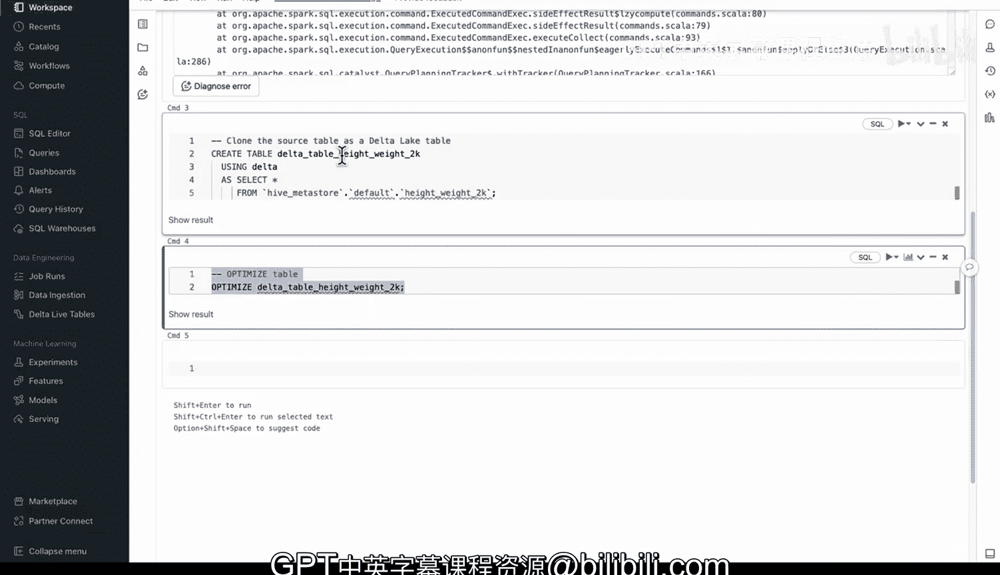

# 大型语言模型实践（高级数据工程、AWS、Databricks和本地LLM）：P134：33_02_09_Vacuum与垃圾回收 🧹


在本节课中，我们将要学习Delta Lake中的Vacuum（清理）与垃圾回收（Garbage Collection）操作。这些是管理Delta表、优化存储和性能的重要维护任务。

---

## 概述：Vacuum与垃圾回收

Delta Lake的Vacuum操作会根据保留策略，删除表中不再需要的旧版本数据，从而节省存储成本。此操作可以自动执行。垃圾回收则负责删除任何快照都不再引用的底层数据文件。这些操作的好处包括降低存储成本（因为删除了未使用的表版本和数据文件）以及提升性能。

上一节我们介绍了Delta Lake的基本特性，本节中我们来看看如何进行表维护。

---

## 识别Delta Lake表

首先，我们需要区分一个表是否为Delta Lake表。以下是如何在Databricks界面中进行识别。


观察一个非Delta Lake表的详细信息。其“类型”显示为“外部”。这表明它不具备Delta Lake的高级功能。

现在，观察一个已复制并转换为Delta Lake的表的详细信息。其“类型”显示为“托管”。默认情况下，托管表就是Delta Lake表。这意味着它拥有诸如时间旅行等高级功能，但也需要我们对其进行Vacuum和垃圾回收等管理操作。

---

## 将现有表转换为Delta Lake表

如果有一个现有的非Delta表，我们无法直接对其执行`OPTIMIZE`或`VACUUM`命令。尝试对非Delta表运行`OPTIMIZE`命令会导致错误。

以下是将现有表转换为Delta Lake表的方法。我们可以创建一个新表作为原表的副本。

```sql
CREATE TABLE delta_table_height_weight_2k
USING DELTA
AS SELECT * FROM `/path/to/original/table`;
```

执行上述SQL语句后，我们就创建了一个Delta Lake表。之后，便可以对该表执行`OPTIMIZE`和`VACUUM`等Delta Lake表操作。

以下是转换步骤的关键点：
*   使用 `CREATE TABLE ... USING DELTA AS SELECT ...` 语句。
*   源表路径需正确指定。
*   新创建的表将具备所有Delta Lake功能。

---

## 执行维护操作

成功创建Delta Lake表后，就可以执行维护命令了。以下是两个核心操作：

1.  **OPTIMIZE**：此命令会进行垃圾回收，对小文件进行合并（Compaction），以优化查询性能。
    ```sql
    OPTIMIZE delta_table_height_weight_2k;
    ```

2.  **VACUUM**：此命令根据保留策略删除旧版本的数据文件。**注意**：默认保留期为7天，7天内的数据无法通过`VACUUM`删除，这是为了保障时间旅行功能。
    ```sql
    VACUUM delta_table_height_weight_2k;
    ```
    若要清理7天前的所有数据（谨慎使用），可以指定保留0小时：
    ```sql
    VACUUM delta_table_height_weight_2k RETAIN 0 HOURS;
    ```

---

## 总结

本节课中我们一起学习了Delta Lake的维护操作。我们首先了解了如何区分Delta表与非Delta表。接着，掌握了通过创建副本将现有表转换为Delta Lake表的方法。最后，我们学习了两个核心维护命令：`OPTIMIZE`用于优化性能和垃圾回收，`VACUUM`用于根据保留策略清理旧数据以节省存储空间。定期执行这些操作是管理Delta Lake表、保证其高效运行的重要环节。



