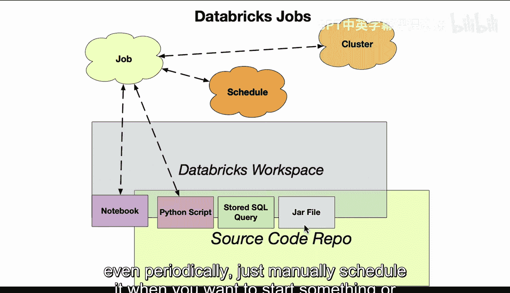
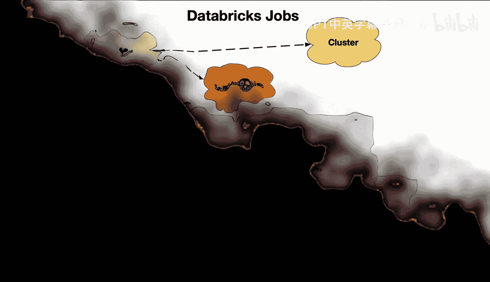

# 大型语言模型实践（高级数据工程、AWS、Databricks和本地LLM）：P135：34_02_03_使用作业编排工作负载

在本节课中，我们将要学习如何在Databricks中使用作业功能来编排和自动化工作负载。我们将了解作业的典型用途、如何设置作业，以及作业可以执行的不同任务类型。

## 作业概述

上一节我们介绍了Databricks的基本概念，本节中我们来看看作业功能。作业是Databricks中用于编排和自动化工作负载的核心工具。

这里展示的是Databricks作业的概览界面。让我们来看一个典型作业的样子。

假设我需要与一个笔记本进行交互。这个笔记本可以执行多种任务。

例如，它可以执行ETL操作，或者创建一些新表或数据。

它甚至可以自动创建一个仪表板。虽然手动完成这些工作也不错，但如果能实现自动化，效果会更好。

这就是作业发挥作用的地方。我可以在这里设置一个新作业，然后将它与我已在源代码仓库中创建好的笔记本关联起来。

## 作业设置与最佳实践

以下是设置作业时需要考虑的关键步骤。

首先，注意这里我们有能力查看Databricks工作区。这是一个默认的位置。但我也可以将作业指向源代码仓库。

这将成为一项最佳实践。我会将那个笔记本签入源代码仓库。同样，这个笔记本可能会创建一些新表和数据，或许还会创建一个仪表板。

最后，我将安排这个作业按计划运行。例如，每天运行一次。这可能是向业务团队提供报告的绝佳方式。

## 计算资源配置

接下来需要做的是决定执行所有计算需要涉及什么样的集群。

这将是一个临时作业，它会在作业启动时创建一个集群，作业完成后，集群会自动关闭。

## 作业的多种任务类型

除了非常有用的笔记本之外，作业还可以执行其他类型的任务。

你可以将作业指向一个Python脚本。同样，这个脚本应该存放在源代码仓库中，但它也可以存放在Databricks工作区。

你还可以构建一个非常复杂的SQL查询，在组织中执行一系列不同的操作。同样，将其签入源代码仓库，或者直接指向Databricks工作区，你可以保存之前的SQL查询并指向它。

最后可以指出的一点是，你也可以使用一个JAR文件。Java具有可移植的运行时能力，你可以创建这个JAR文件，让它随时待命，并执行ETL操作。

## 总结与灵活性

因此，作业提供了极大的灵活性。在设置Databricks作业时，甚至还有超出这些目标的其他目标。但最棒的是，你能够将所有内容整合到一个统一且自动化的生态系统中。

这样，你就能查看作业运行时发生的一切，进行调试，按计划调度它，或者甚至在你想要启动某项任务或构建基于批处理的操作时，定期手动调度它。

本节课中我们一起学习了Databricks作业的核心功能。我们了解了作业如何将笔记本、脚本、SQL查询或JAR文件等任务自动化，并通过配置计算资源和调度，构建出一个统一、可管理的工作负载编排系统。这为实现数据工程的自动化流程奠定了坚实基础。