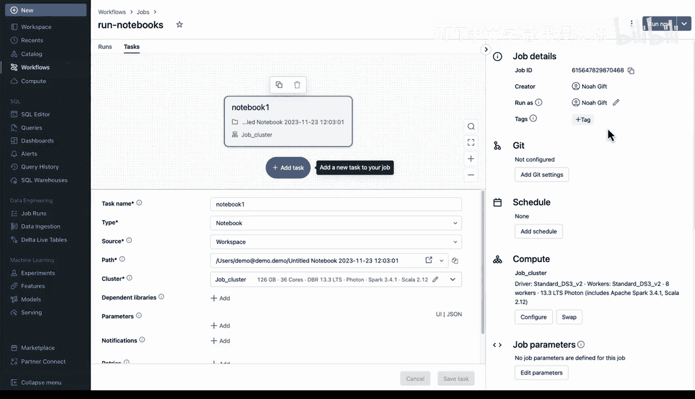
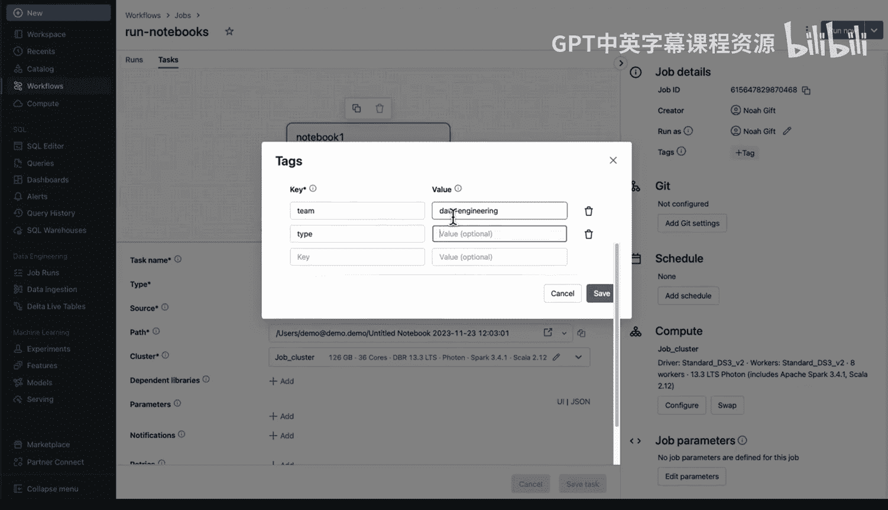
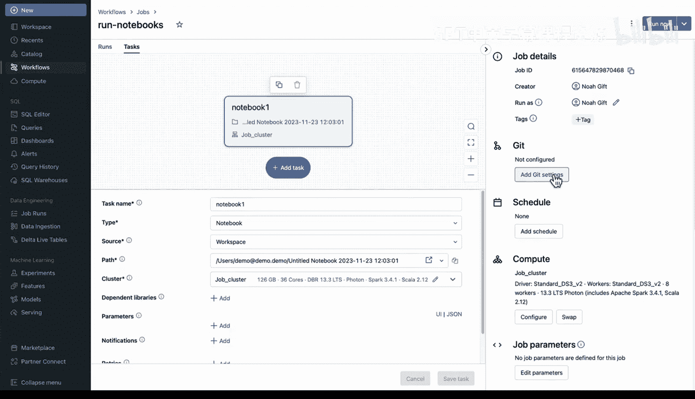
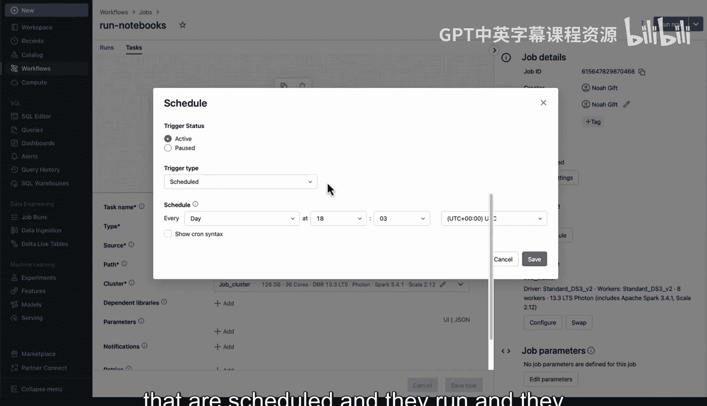
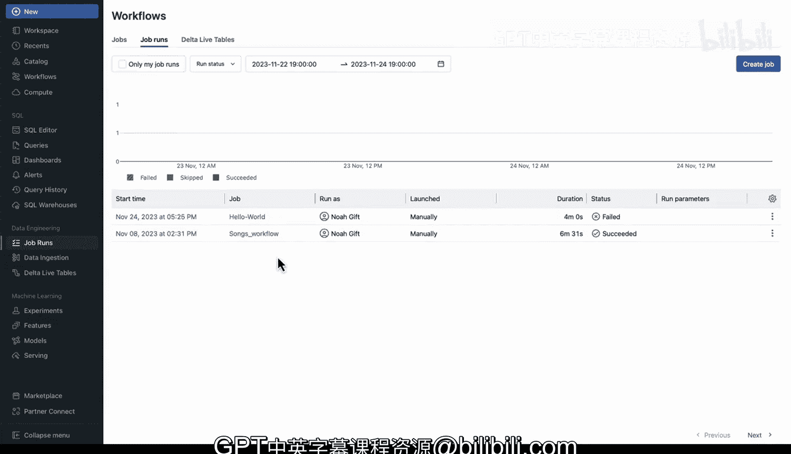

# 大型语言模型实践（高级数据工程、AWS、Databricks和本地LLM）：P136：35_02_04_Databricks作业演示 📊

在本节课中，我们将要学习如何在Databricks平台中创建和管理作业。作业是自动化执行任务（如运行笔记本或脚本）的核心工具，对于构建可靠的数据管道至关重要。

## 作业界面概览与创建 🚀

上一节我们介绍了Databricks的基本概念，本节中我们来看看如何创建一个新的Databricks作业。

我们首先进入主界面，然后导航到“工作流”部分。在工作流界面中，可以看到已经存在的多个作业。如果需要在上千甚至上万个作业中进行筛选，可以使用搜索功能。例如，输入“hello”可以快速定位相关作业。这对于大型组织管理海量作业非常有帮助。

要创建一个新作业，只需点击“创建作业”按钮。点击后，会进入一个新的配置界面。

## 配置作业任务 ⚙️

现在我们可以为作业命名，例如将其命名为“运行笔记本”。这个界面允许我们进行任务级的设置，可以创建初始任务，并链接第二个、第三个甚至更多任务。作业名称“运行笔记本”意味着我们将运行多个笔记本。

我们将第一个任务命名为“笔记本一”。接下来需要选择任务类型。在“类型”下拉菜单中，可以看到多种选项，包括：
*   **笔记本**
*   **Python脚本**
*   **Python wheel**
*   **SQL**
*   **Delta Live Tables管道**
*   **DBT**
*   **Jar**
*   **Sp提交**
*   **运行作业**
*   **If Else条件**

其中，**If Else条件**在需要等待特定资源或满足某些条件时非常有用。我们选择“笔记本”类型。

在“源”设置中，需要指定笔记本的来源。它可以是Git提供商（如GitLab、GitHub、Bitbucket、AWS CodeCommit），也可以直接位于Databricks工作空间内部。大多数成熟的组织倾向于指向Git提供商。

选定来源后，需要提供笔记本的路径。例如，可以选择一个数据科学笔记本或演示笔记本。我们这里选择一个演示笔记本。

## 配置计算集群与高级选项 🔧

接下来是集群配置。可以选择使用**默认作业集群**，也可以使用**现有的通用集群**。两者的区别在于：通用集群可能已经在运行数据分析任务，可以直接复用；而作业集群是临时性的，它会在任务启动时创建，任务完成后自动终止，这有助于控制成本。我们可以保留默认的作业集群设置。

此外，还可以添加其他配置，例如**通知设置**和**重试策略**。在作业界面中工作时，有很多选项可供调整。

第一个任务创建完成后，可以继续添加第二个、第三个任务，并将它们依次链接起来。

## 作业详情、标签与调度 📅

现在，让我们看看作业的其他设置。在“作业详情”部分，可以为作业添加标签。例如，可以添加一个“团队”标签，值为“数据工程”；还可以添加一个“类型”标签等。这些标签在后续筛选和分类作业时非常有用。

也可以将作业配置与Git集成，确保复杂的调度配置被版本控制管理。

在“触发器类型”中，可以选择“计划”或“连续”触发。如果选择“计划”，可以使用**Cron语法**来设置具体的运行时间。这对于数据工程师构建定时运行的管道非常常见，例如每天在特定时间执行某些操作。

配置完成后，可以点击“立即运行”来手动触发作业。

## 监控与诊断历史作业运行 🔍

最后，我们来看看如何监控历史作业运行。进入“之前的作业运行”界面，可以看到所有作业运行的概览。在大型组织中，这里会显示大量运行记录。可以通过状态进行筛选，例如筛选出“失败”的作业。

如果我们查看一个失败的作业，可以深入分析原因。例如，界面可能显示“在等待就绪时被终止”，这可能是由于该作业的集群配额不足导致的。通过这个界面，我们可以诊断并解决问题。

这个界面不仅用于创建作业，还能查看历史作业，确保你了解哪些作业失败了、哪些被跳过了、哪些成功了。在大型组织中，需要一个这样的作业管理框架，以便可靠地编排数据管道的各个部分。如果没有作业工作流的自动化，完成任何任务都将极其困难。在更复杂的组织中，你既需要自动化和调度这些作业，也需要能够监控和观察其运行状态。

## 总结 📝

本节课中我们一起学习了Databricks作业的完整管理流程。我们了解了如何从主界面进入工作流并创建新作业，详细配置了作业的任务类型、源代码路径以及计算集群。我们还探讨了如何为作业添加标签、设置计划触发器，并最终通过运行历史界面来监控作业状态和诊断失败原因。掌握作业的创建、调度与监控，是构建自动化、可靠数据管道的关键技能。