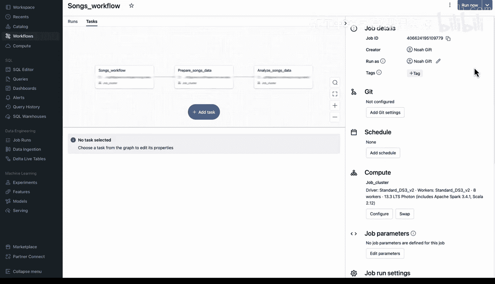
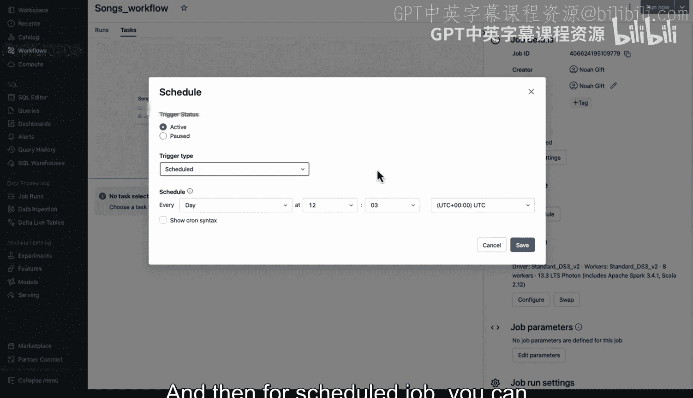
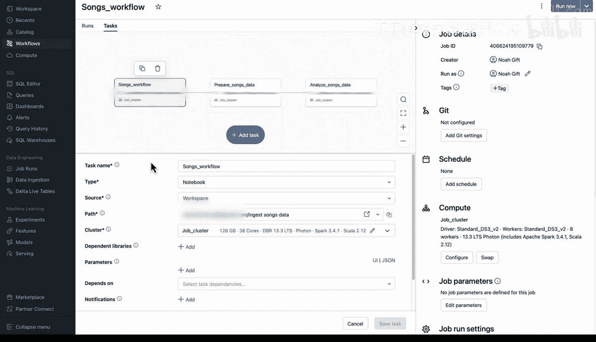
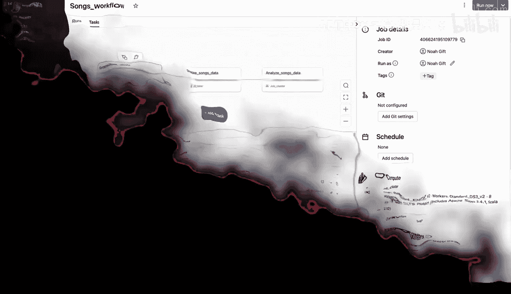

# 大型语言模型实践（高级数据工程、AWS、Databricks和本地LLM）：P137：36_02_05_多任务工作流 📊

在本节课中，我们将要学习如何在Databricks工作流界面中设置和管理一个多任务工作流。我们将了解如何将复杂的数据处理流程分解为独立的、可调度的任务，并探讨这种架构的优势。

## 工作流界面概览

现在，我们正位于工作流界面中。可以看到，这里已经设置好了多个任务。

以下是当前配置的任务列表：
*   **数据摄取**：负责获取原始数据。
*   **数据准备**：对摄取的数据进行清洗和转换。
*   **数据分析**：对准备好的数据执行分析操作。

目前共有三个不同的任务。如果需要，我们也可以在此添加更多任务。

## 任务调度设置

进入这个多任务界面后，另一项可以进行的操作是添加调度计划。

调度计划主要有两种类型：
*   **持续运行作业**：这种作业会一直运行，通常用于仪表板或流式数据处理场景。
*   **周期性调度作业**：可以按固定的时间间隔（例如每小时、每天）触发作业，并且可以在Cron语法和Databricks的简化调度器之间切换。

## 多任务架构的优势

多任务设置的主要优势在于，你可以将整个处理流程分解为多个独立的模块。

让我们以一个具体的任务为例来查看其配置。在这个任务中，我指向了我的Notebook文件所在的路径。接着，我将其指向了作业集群。此外，我还可以在这里切换不同的任务类型。

当前，我们使用的是 **Notebook** 类型。但任务类型也可以是：
*   **Python脚本**
*   **Jar文件**
*   **Delta Live Tables管道**

通过将复杂问题分解为多个独立的环节，无论是在运行时进行调试，还是在编写解决方案代码时，都会变得容易得多。

## 总结

本节课中，我们一起学习了Databricks多任务工作流的构建与管理。我们了解了如何在工作流界面中配置多个顺序执行的任务，如何为工作流设置不同的调度策略（持续运行或周期性运行），以及将流程模块化带来的调试和开发便利性。这种架构是构建健壮、可维护数据管道的关键实践。