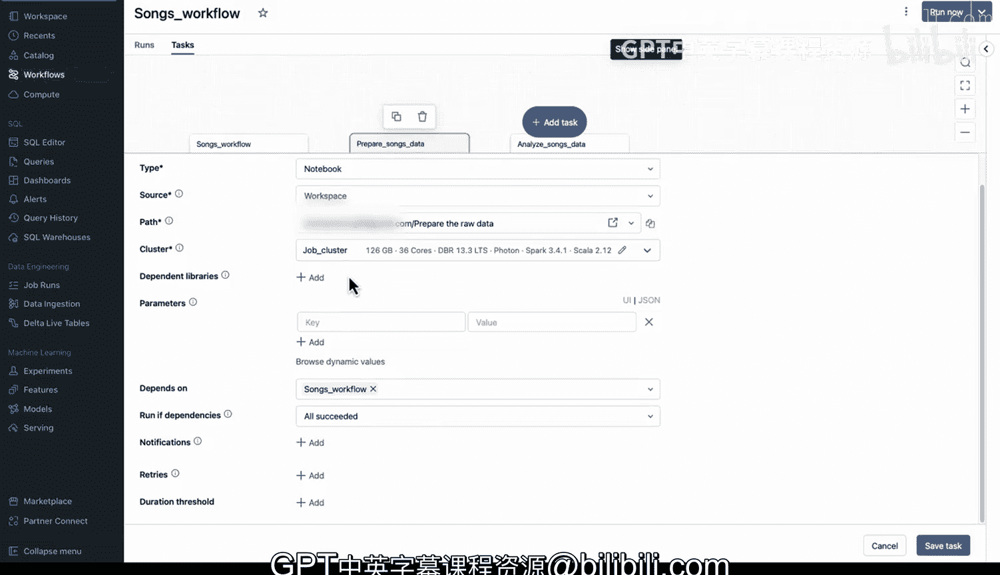

# 大型语言模型实践（高级数据工程、AWS、Databricks和本地LLM）：P138：任务依赖关系 📊

在本节课中，我们将学习如何在工作流中管理多个任务之间的依赖关系。理解并正确配置任务依赖是构建可靠、自动化数据处理管道的关键。

## 概述

工作流通常包含多个按顺序执行的任务。每个任务的成功执行可能依赖于前一个任务的完成，也可能依赖于特定的运行环境，如软件库、集群配置或参数。本节将详细探讨这些依赖关系及其配置方法。

## 多步骤任务管道

上一节我们介绍了工作流的基本概念，本节中我们来看看如何构建一个包含多个步骤的任务管道。

我们有一个名为“songs”的工作流，它包含两个任务：“prepare songs data”（准备歌曲数据）和“analyze songs data”（分析歌曲数据）。这些任务之间存在明确的依赖关系。

以下是任务依赖的核心表现：

*   **顺序依赖**：每个任务都依赖于其前一个任务的完成。例如，“analyze songs data”任务必须等待“prepare songs data”任务成功完成后才能开始执行。
*   **成功状态依赖**：后续步骤仅在前驱步骤“成功完成”后才会被触发。如果前一个任务失败，依赖它的任务通常不会运行。

这种设计确保了数据处理的正确性和流程的完整性。

## 超越任务本身的依赖

除了任务之间的直接顺序依赖，我们还需要关注其他可能影响任务执行的关键依赖项。配置这些依赖项时需格外仔细，否则可能导致作业失败。

以下是几种常见的非直接任务依赖：

*   **库依赖**：任务运行时可能需要特定的软件库。例如，你的代码可能需要加载一个名为 `pandas` 的库。这个库必须被预先安装并自动附加到运行集群上，否则任务会因找不到库而失败。在代码中，这通常表现为 `import pandas` 语句。
*   **参数依赖**：任务可能需要接收外部传入的参数才能正确运行。这些参数可以在任务配置时添加，例如，一个控制数据处理范围的日期参数 `date=‘2023-10-01’`。
*   **集群配置依赖**：任务对运行环境有特定要求。集群本身可能就是一个重要的依赖项，它需要满足以下条件：
    *   **硬件要求**：例如，某些机器学习任务可能需要GPU来加速计算。
    *   **软件运行时版本**：任务代码可能依赖于特定版本的运行时环境，例如 `Spark 3.5`。如果集群配置的Spark版本不匹配，任务可能会报错或行为异常。

因此，在审查任务依赖时，必须深入检查任务本身、所需的库以及集群运行时环境等所有方面。

## 总结

本节课中我们一起学习了工作流中任务依赖关系的重要性与类型。我们了解到，构建稳健的管道不仅需要设置任务间的**顺序依赖**，还必须周全地考虑**库依赖**、**参数依赖**和**集群配置依赖**。忽略其中任何一点都可能导致作业失败。正确管理这些依赖是确保复杂数据处理流程自动化、可靠运行的基础。