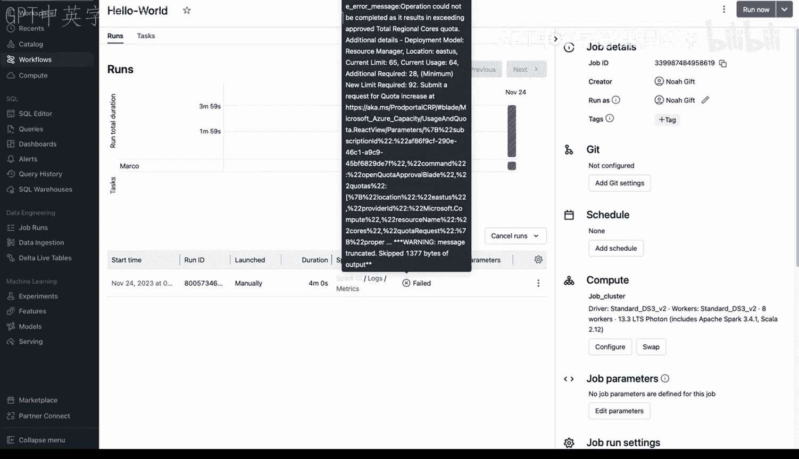

# 大型语言模型实践（高级数据工程、AWS、Databricks和本地LLM）：P139：38_02_07_查看作业历史 📊

在本节课中，我们将学习如何在Databricks平台中监控和管理作业的运行历史。这对于识别和调试失败的作业至关重要。

## 概述

通过工作流界面，我们可以快速概览所有作业的最后一次运行状态。每个作业都会显示其最近一次执行是成功还是失败。

## 通过工作流界面查看作业状态

上一节我们介绍了作业监控的重要性，本节中我们来看看具体如何操作。首先，我们可以导航到“Workflows”（工作流）区域。在这里，所有已配置的作业都会列出，并直观地显示其最后一次运行的结果状态（成功或失败）。这个界面非常有用，我们可以快速浏览并定位出有问题的作业。

例如，在列表中，我们可能会发现一个作业因配额问题导致集群意外终止而失败。这提示我们需要进行调试。

## 使用“作业运行”界面进行深入分析

虽然工作流界面很方便，但“Job Runs”（作业运行）界面提供了更全面的视图。我们可以在此界面根据状态（如失败、活跃、已完成）来筛选和排序作业。这对于每天有数百个作业运行的大型组织尤其有用。

以下是查看作业运行状态的步骤：

1.  导航到“Job Runs”界面。
2.  利用状态筛选器（如 `status == ‘FAILED’`）来快速定位问题作业。
3.  点击特定的作业运行，查看其详细日志和错误信息。

通过这种方式，我们可以高效地集中处理所有失败的作业，查看其失败日期和具体状态信息。

## 推荐的调试工作流程

结合以上两个界面，可以形成一个高效的作业监控与调试流程。

以下是推荐的步骤：

1.  **初步概览**：首先在“Workflows”界面查看所有作业的“最后运行”状态，获得整体情况。
2.  **问题聚焦**：当需要基于状态进行深入排查时，切换到“Job Runs”界面。
3.  **筛选排查**：筛选出所有失败状态的作业。
4.  **深入调查**：点击具体的失败作业，查看运行详情。
5.  **分析日志**：仔细阅读状态信息或日志（例如，错误消息 `Cluster terminated unexpectedly due to quota limit`），定位根本原因。
6.  **解决问题并迭代**：根据错误信息进行修复，然后继续处理下一个问题。

通过执行这些步骤，你可以系统地诊断问题并实施解决方案。

## 总结

本节课中我们一起学习了在Databricks中监控作业历史的两种主要方法：通过“Workflows”界面快速概览，以及通过“Job Runs”界面进行基于状态的深入分析和调试。掌握这些工具和方法，能帮助你有效地管理和维护自动化作业的稳定运行。