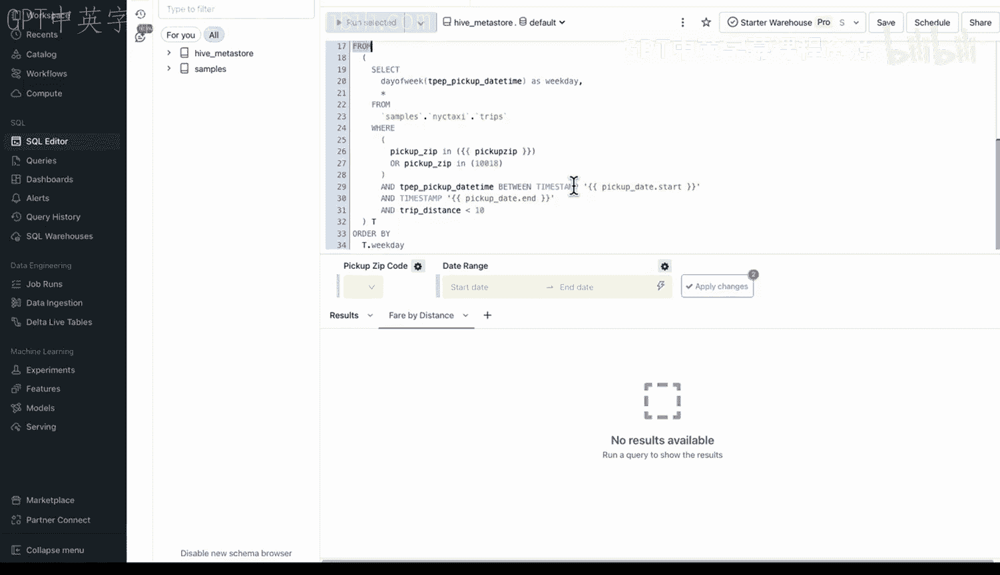

# 大型语言模型实践（高级数据工程、AWS、Databricks和本地LLM）：P140：39_02_08_使用仪表板 📊

在本节课中，我们将学习如何使用Databricks的仪表板功能来创建、分享和更新数据可视化报告。仪表板是数据分析和数据科学中一个强大的工具，它允许用户无需编写代码即可与数据进行交互，并获取最新的信息。

## 仪表板界面概览

我们这里展示的是“纽约市出租车行程分析仪表板”，它使用了Databricks提供的纽约市出租车行程样本数据集。

请注意，这个仪表板位于一个专门的界面中。接下来，我们将指出此类工具的一些优势。

## 仪表板的优势

如果你是一名数据分析师或数据科学家，需要与组织内的同事分享重要信息，那么分享这样的仪表板会非常方便。它的优点在于：

*   **提供最新信息**：你可以为他人提供按你设定的任何时间间隔更新的最新信息。
*   **无需技术背景**：用户无需了解SQL或任何编程知识，因为他们可以通过切换和搜索不同的日期范围或邮政编码来查看数据，这赋予了用户探索数据的能力。
*   **数据民主化**：这极大地促进了数据科学和数据分析的民主化，让更多人能够接触和理解数据。

## 数据的实时性与调度

现在请注意这里显示“5分钟前更新”。仪表板在5分钟前被更新，原因是我选择了刷新。

如果我再次选择刷新，你会看到仪表板会立即更新。因此，你可以拥有不同的数据状态。是否获取最新更新完全取决于用户，他们可以随时点击刷新。

同样地，当你将其创建为定时任务时，你可以点击“添加计划”，并设置例如每小时更新一次，这对大多数人来说可能就足够了。

你还可以使用Cron语法来设置更复杂的调度。你甚至可以添加订阅者，仪表板的快照将会被发送给这些订阅者。这里提供了一个非常便捷的调度界面。

## 分享与编辑功能

显然，你可以分享这个仪表板。

最后，如果你点击这里的“刷新”按钮，它将刷新仪表板内的每一个窗口，这同样非常有用。你可以看到它正在刷新，并且显示“刚刚更新”。

如果你拥有管理员权限，你可以点击菜单并选择“编辑”。这意味着你可以实际添加新的内容，例如：

*   添加一个文本框。
*   添加一个过滤器（例如，这里已经有一个过滤器）。
*   添加一个可视化图表。
*   设置不同的颜色。

## 从仪表板中学习

我认为另一个非常有用的功能是，你也可以从这些仪表板中学到很多东西。

如果我选择这里的某个可视化图表，比如这个显示车费金额与行程距离关系的小图表，你可以看到它们之间存在线性关系。

但是，这个SQL查询是如何生成的呢？其实很容易弄清楚。我只需选择这个图表，然后就可以查看它背后的查询语句本身，这非常棒。当然，我也可以下载CSV文件，这可能会有用。

让我们继续查看这个查询。😊

## 查看与编辑底层查询

现在看看这个，我进入了一个查询编辑器，也就是SQL查询编辑器。我们可以看到它写着 `use catalog samples; select ...`，并且我们能够浏览所有不同的SQL查询。如果我愿意，我还可以修改它。

因此，这是一个绝佳的学习方式。当你的组织内有人为你创建了一个仪表板时，你可以通过查看其查询来学习。同时，如果你有相应的权限，也可以直接编辑它。

## 总结

本节课中，我们一起学习了Databricks仪表板界面的强大功能。仪表板不仅能够以直观的方式呈现最新数据，实现数据分析和探索的民主化，还提供了灵活的调度、分享和编辑选项。通过查看仪表板背后生成的SQL查询，用户还能从中学习并进一步定制分析。请务必充分利用Databricks这一强大的仪表板功能。