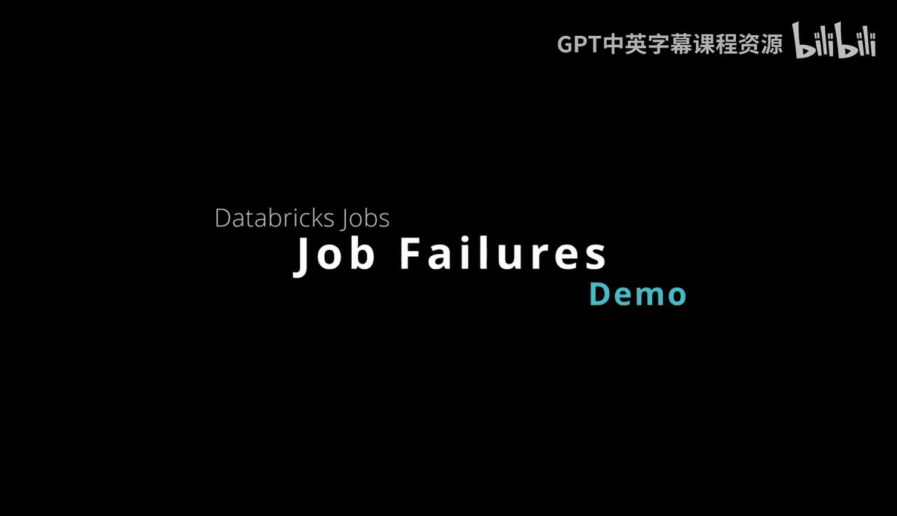
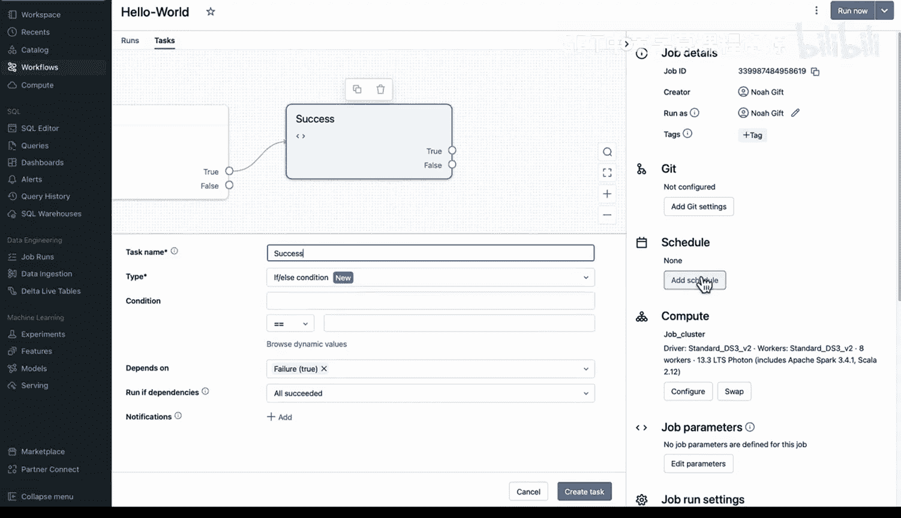

# 大型语言模型实践（高级数据工程、AWS、Databricks和本地LLM）：P141：故障处理 🐛

在本节课中，我们将学习如何在数据工程工作流中处理失败的作业运行。我们将探讨如何利用任务依赖和条件逻辑，以编程方式诊断问题、执行清理操作并发送通知，从而实现更健壮和自动化的故障处理流程。

调试失败的作业运行可能很棘手。在工作流界面中，我们看到这里有一个问题：这个作业在此处运行失败。

我们可以查看最后一次运行记录，尝试找出失败原因。界面会提供错误信息，我们可以深入查看更多细节。

然而，这并没有解决“接下来我该做什么”以及“我能否以编程方式解决此问题”的情况。

因此，如果我们回到作业本身，查看其任务，可以看到这个笔记本任务相当简单。但或许我们可以在这里添加一些逻辑来处理特定的失败条件。

我们可以添加另一个任务，这个任务可以是一个条件判断任务，例如处理失败情况。这个条件任务可以在依赖任务失败时运行。我们可能需要执行一些清理操作，或在这里进行其他处理。

具体来说，我们可以设置任务在“所有依赖项失败”时运行。这样，如果这个作业失败，我们就可以执行一些清理逻辑。

此外，我们还可以添加一个通知任务。这个通知可以发送到电子邮件、Teams、PagerDuty、Slack等渠道，告知相关人员作业已失败，并且已运行了清理作业，但需要他们知晓此事。

能够在任务级别进行自定义，是处理此类失败的一个绝佳方式。我们既可以处理失败条件，也可以处理成功条件。

如果我们创建了这个失败处理任务，我们还可以在此处添加另一个任务来处理成功情况。这样，我们就能基于这个作业界面深入管理，实现在失败时进行导航和清理，在成功时（例如）将数据加载到数据库，然后发送通知告知一切已成功加载。

总而言之，如果能够以编程方式解决问题，通常是最佳方案。通过灵活的任务编排，我们有许多不同的方法来处理工作流中可能出现的问题。

本节课中，我们一起学习了如何为数据工程作业配置故障处理逻辑。我们了解了如何利用条件任务在作业失败时自动执行清理或补救操作，以及如何设置通知来及时告警。掌握这些方法，能帮助我们构建更可靠、自动化程度更高的工作流系统。