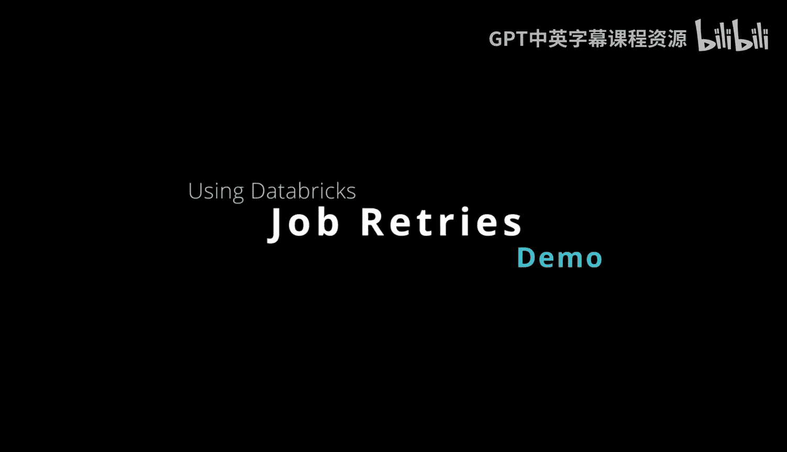
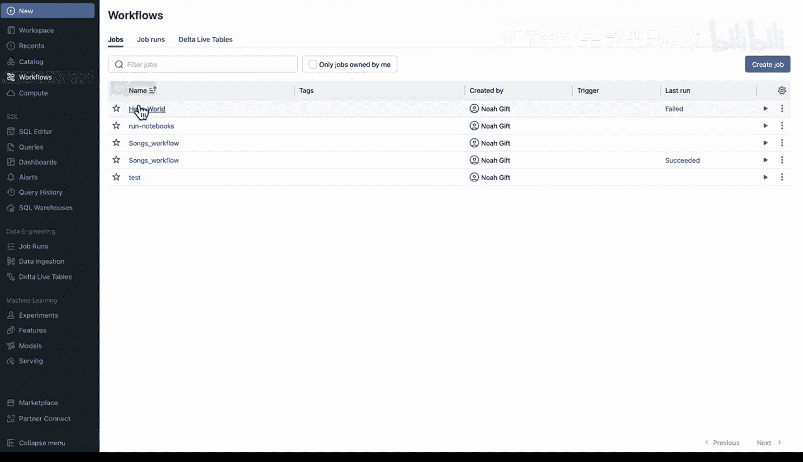
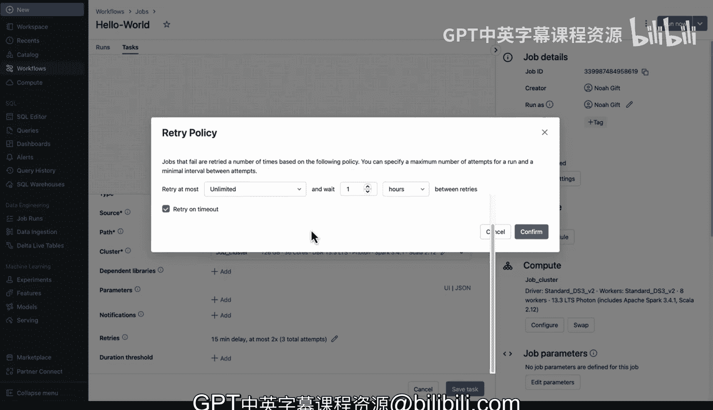

# 大型语言模型实践（高级数据工程、AWS、Databricks和本地LLM）：P142：配置重试机制 🔄

在本节课中，我们将学习如何在数据处理任务中配置重试机制。重试机制是处理临时性故障（如网络错误或API超时）的重要策略，它能提高数据管道的鲁棒性，避免因偶发问题导致整个作业失败。

## 识别失败作业与重试需求

上一节我们介绍了作业监控，本节中我们来看看如何为失败的作业设置重试。

我们首先看到一个处于失败状态的作业。作业失败可能由多种问题导致。我们可以为作业启用重试功能。

以下是可配置的重试参数：
*   **最大重试次数** (`max_retries`)：定义任务失败后尝试重新执行的最大次数。
*   **重试延迟** (`retry_delay`)：定义两次重试尝试之间的最小等待间隔。
*   **触发重试**：可以配置在特定条件下触发重试。
*   **重试监控**：对重试行为进行监控和记录。

## 在任务中配置重试参数

接下来，我们进入具体的任务设置界面来配置这些参数。

在任务设置中，可以看到“重试尝试次数”和“尝试之间的最小间隔”选项。这用于在任务失败时控制重试行为。

如果我们选择启用，可以这样配置：将最大重试次数设置为**3**，因为可能存在网络错误或其他临时性问题。同时，将每次重试的间隔设置为**15**分钟。

确认设置后，我们可以看到配置生效：最多重试3次，每次间隔15分钟。这是一种处理潜在问题的有效方法，尤其适用于那些你无法控制的资源。

## 重试策略的应用场景与高级配置

上一节我们配置了基础的重试，本节中我们来看看更灵活的重试策略及其适用场景。

对于像外部API这类你无法控制的资源，配置重试可以避免临时性问题导致整个数据管道崩溃。通过重试，有机会让任务恢复正常工作。

另一个要点是，如果你对某个任务的运行有充分信心，且该任务需要频繁执行，你甚至可以选择“无限重试”选项。

例如，这可能是一个你想每小时运行一次的网页爬虫工具。网页爬虫本身具有不确定性且容易超时。在这种情况下，你可能希望任务在失败后无限次地重试，但需要在每次重试之间等待较长时间，并且即使在超时后也继续重试。

本节课中我们一起学习了如何为数据处理作业配置重试机制。我们了解了设置最大重试次数和重试延迟的方法，并探讨了针对不同场景（如调用外部API或执行网页爬虫）选择合适的重试策略。合理配置重试能显著增强数据管道对临时性故障的容错能力。