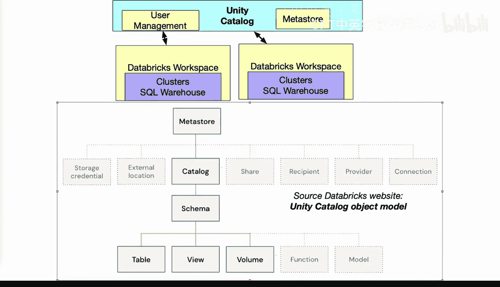

# 大型语言模型实践（高级数据工程、AWS、Databricks和本地LLM）：P143：42_02_02_使用Unity Catalog实现统一数据访问 🗂️

在本节课中，我们将学习Databricks Unity Catalog的核心概念与架构。Unity Catalog是一个统一的数据治理解决方案，它提供了跨多个Databricks工作区的集中式访问控制、审计、数据血缘和数据发现能力。

## 概述与核心价值

Databricks Unity Catalog提供了跨一个甚至多个Databricks工作区的集中式访问控制、审计、数据血缘和数据发现能力。

首先，让我们看看Unity Catalog的架构。它内部包含用户管理和元存储，并连接到多个Databricks工作区。这些工作区内有集群和SQL仓库。其核心理念是**一次定义，处处安全**。这实现了全面的数据治理。

此外，您可以拥有一个符合标准的安全模型。该模型基于**ANSI SQL**，允许管理员使用熟悉的语法在现有数据湖中授予权限。这意味着可以对目录、数据库、表和视图进行权限管理。

它还具有内置的审计和血缘功能，因此您可以捕获用户级审计日志。数据发现功能允许您标记事物、记录数据资产，甚至可以查看系统表，例如审计日志、计费使用情况等。

## Unity Catalog对象模型

上一节我们介绍了Unity Catalog的核心价值，本节中我们来看看其对象模型的具体构成。

您可以看到，元存储是元数据的顶级容器。它公开了一个三级命名空间：**目录 -> 模式 -> 表**，用于组织数据。

在数据目录中，我们拥有对象层次结构的第一层，它用于组织数据资产。模式（在Databricks中也称为数据库）是对象层次结构的第二层，包含表和视图。当然，您可以使用SQL或Catalog Explorer来创建这些表和视图。

最后，在最低层级的表、视图和卷中，您可以对非表格数据进行治理。

总而言之，Unity Catalog的五个关键特性如下：

以下是Unity Catalog的五个关键特性：

1.  **集中式元数据存储**：捕获技术元数据。
2.  **统一访问控制**：允许您使用SQL设置细粒度的访问控制。
3.  **数据血缘跟踪**：在查询时自动捕获端到端的血缘关系，实现数据治理。
4.  **发现与组织**：提供可搜索的目录，便于数据发现，并支持浏览器和REST API。
5.  **多云友好**：您甚至可以跨多个云供应商实现此功能，并进行联合以实现统一访问。

## 总结

本节课中我们一起学习了Databricks Unity Catalog。我们了解了它作为统一治理层，如何通过集中式元数据存储、基于SQL的细粒度访问控制、自动数据血缘跟踪以及强大的数据发现功能，实现跨工作区甚至跨云环境的安全、可审计和高效的数据管理。其核心对象模型（目录、模式、表/视图）为组织数据资产提供了清晰的结构。