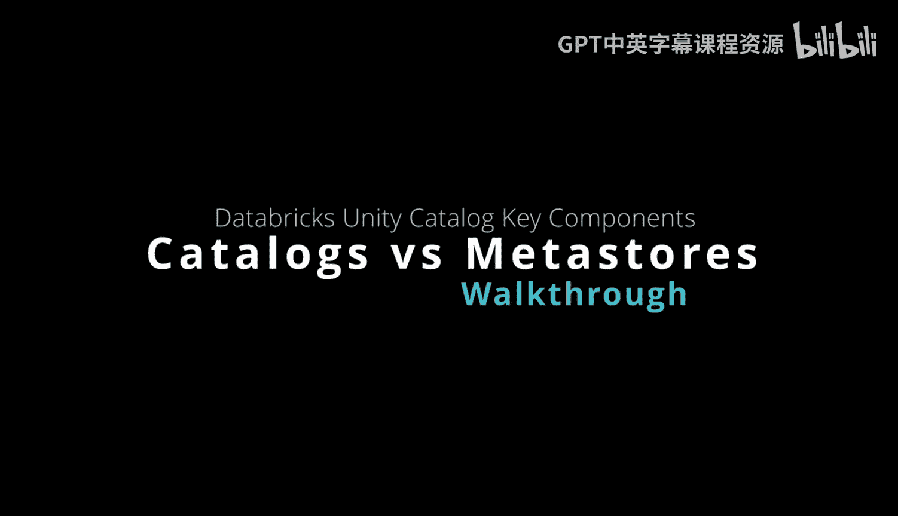
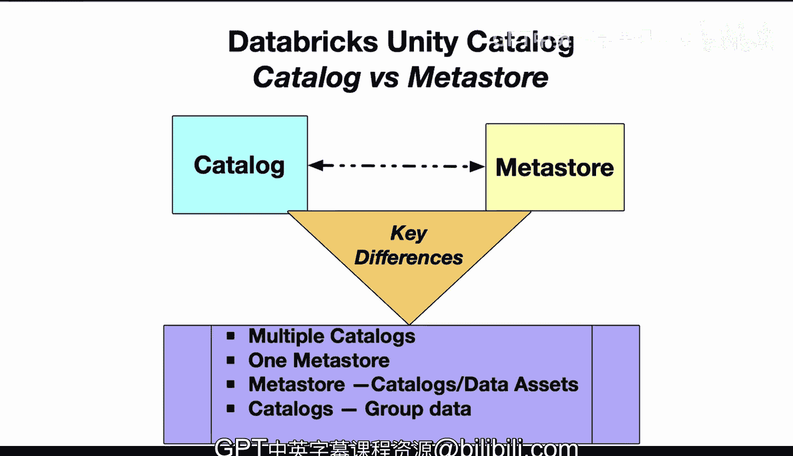

# 大型语言模型实践（高级数据工程、AWS、Databricks和本地LLM）：P144：43_02_03_目录与元存储对比 📚

在本节课中，我们将学习Databricks Unity Catalog中的两个核心概念：**元存储**与**目录**。我们将了解它们的定义、层级关系以及关键区别。

---

## 元存储概述 🗃️

首先，我们来介绍元存储。元存储是元数据的顶级逻辑容器。它存储有关数据资产（如表或模型）的信息，并定义目录的命名空间层级。同时，它还负责处理访问控制策略和审计。

**元存储的核心功能**可以概括为：
*   `元存储 = 元数据容器 + 命名空间定义器 + 治理层`

---

## 目录概述 📂

上一节我们介绍了元存储，本节中我们来看看目录。目录是元存储内的第一级组织单元，用于对相关的数据资产（如表、视图等）进行分组。访问控制可以在目录级别进行定义。

**目录的核心功能**可以概括为：
*   `目录 = 数据资产分组单元`

---

## 关键区别与关系 🔄

以下是元存储与目录之间的主要区别和关系：

*   **数量关系**：一个元存储内可以包含多个目录，但每个Databricks部署只能有一个元存储。
*   **包含关系**：元存储包含所有目录和数据资产的元数据。
*   **组织方式**：目录帮助根据应用程序、团队等因素对数据对象进行分组和组织。

总而言之，**元存储**是Unity Catalog中总揽全局的元数据存储和根数据治理层，而**目录**则在元存储内部提供第一级的组织和边界划分。

---

本节课中我们一起学习了Databricks Unity Catalog中元存储与目录的概念、功能及它们之间的区别。理解元存储作为顶层容器和目录作为组织单元的角色，是有效使用Unity Catalog进行数据治理的基础。