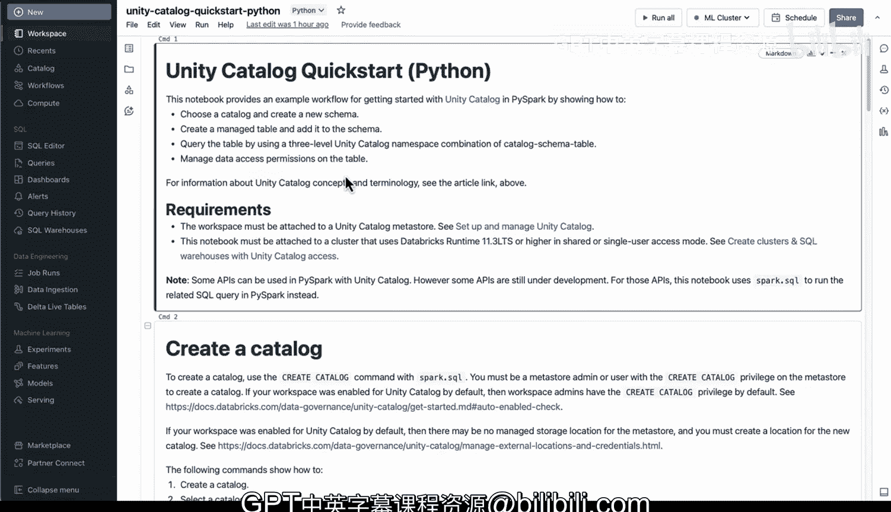

# Unity Catalog 快速入门（Python版）：P145：44_02_04_Unity Catalog快速入门（Python版）


## 概述
在本节课程中，我们将学习如何在纯Python环境中快速开始使用Unity Catalog。我们将涵盖工作空间设置、目录创建、模式管理、表操作以及如何通过Pandas API on Spark与Unity Catalog进行交互。

## 工作空间设置
首先，您需要准备一个已启用Unity Catalog元存储的工作空间。该工作空间必须支持11.3或更高版本的运行时环境。

## 代码结构概览
以下是本教程将涵盖的核心步骤。您可以通过查看笔记本的目录来清晰地了解代码的组织结构，这对于包含多个单元格、内容复杂的笔记本尤其有用。

*   **创建目录**
*   **创建托管模式（数据库）**
*   **创建托管表**
*   **在Spark的Pandas API中使用Unity Catalog**

## 创建目录
上一节我们介绍了准备工作，本节中我们来看看如何创建目录。

以下是创建目录的代码步骤：

1.  执行Spark SQL语句来创建目录（如果尚不存在）。
    ```sql
    CREATE CATALOG IF NOT EXISTS quick_start_catalog;
    ```
2.  设置当前使用的目录。
3.  显示所有可用的目录。
4.  授予创建和使用该目录的权限。
5.  验证权限设置是否生效。

## 创建与管理模式
目录创建完成后，接下来我们需要在目录中创建和管理模式（相当于数据库）。

以下是创建和管理模式的步骤：

1.  在指定目录下创建模式（如果尚不存在）。
2.  显示该目录下的所有模式。
3.  授予在模式上创建表和读取数据的权限。

## 管理表
模式准备就绪后，我们可以在其中创建和管理表。

以下是管理表的操作步骤：

1.  使用之前创建的模式。
2.  显示当前数据库。
3.  在目录中创建一个托管的Delta表。
4.  授予对该表的读写权限。
5.  显示该模式下的所有表。
6.  向表中插入几行数据。
7.  查询并显示表中的数据。
8.  显示所有可用的表。

## 使用Pandas API on Spark
对于大多数Python程序员来说，最感兴趣的部分可能是如何通过熟悉的接口来使用Unity Catalog。幸运的是，Spark提供了Pandas API。

以下是使用Pandas API的步骤：

1.  导入`pyspark.pandas`模块。
    ```python
    import pyspark.pandas as ps
    ```
2.  此API的使用方式与标准的Pandas库非常相似。
3.  读取Unity Catalog中的表。
4.  将数据写回Unity Catalog。
5.  授予相应的权限。
6.  展示表格数据。



## 总结
本节课中，我们一起学习了Unity Catalog的Python快速入门流程。我们从工作空间设置开始，逐步完成了目录、模式和表的创建与管理，最后演示了如何通过Spark的Pandas API与Unity Catalog进行交互。您可以在Databricks的官方文档中找到此快速入门指南，它是熟悉这些操作并在代码中切换关键步骤的绝佳方式。