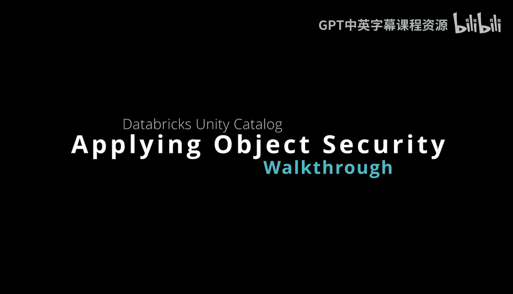
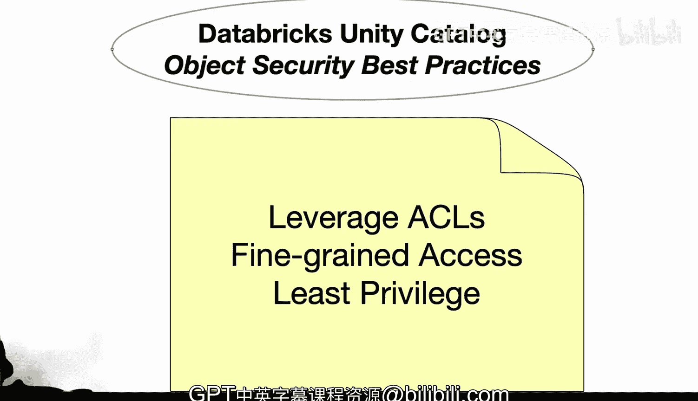

# 大型语言模型实践（高级数据工程、AWS、Databricks和本地LLM）：P146：45_02_05_应用对象安全策略

在本节课中，我们将学习如何在Unity Catalog系统中应用对象安全的最佳实践。我们将重点了解访问控制列表（ACL）的作用、细粒度权限控制的重要性，以及“最小权限原则”的核心概念。

## 应用Unity Catalog对象安全最佳实践

应用Unity Catalog系统的对象安全最佳实践涉及几个关键特性。

上一节我们介绍了对象安全的重要性，本节中我们来看看具体如何实现。

### 利用访问控制列表（ACL）

首先，我们需要利用访问控制列表（ACL）。ACL允许对可安全对象（如表、视图等）上的特定用户和组授予或限制访问权限。它们还提供细粒度控制，因此您可以保护对敏感数据的访问。

### 实施细粒度访问控制

除了基本的ACL，您还可以对对象实施更细粒度的访问控制。这意味着您可以拥有数据库模式级别的权限，可以保护对单个表的访问，也可以保护对管道和工作流的访问，但所有这些权限都仅基于任务的实际需要。您甚至可以有针对性地控制读取、写入和管理权限。

### 遵循最小权限原则

最后，所有这些实践都归结为遵循“最小权限原则”。最小权限原则的核心思想是：只提供所需的最低限度访问权限。不要授予用户他们不需要的能力，因为这会造成安全漏洞。

以下是应用最小权限原则的几个关键点：

*   **按需授权**：例如，如果某人只需要查看仪表板，您就不应授予他们修改或删除仪表板的权限。
*   **避免使用宽泛的组**：除非有硬性要求，否则不要使用像“所有用户”这样的宽泛组。
*   **及时撤销权限**：一旦目的达成，就应撤销访问权限，而不是让权限不断累积。
*   **定期审查策略**：定期审查安全策略的相关性，确保它们仍然适用。

## 总结

本节课中我们一起学习了在Unity Catalog中应用对象安全最佳实践的核心方法。

总结来说，采用这种最佳实践技术的关键好处在于：
1.  **增强数据安全性和合规性**。
2.  **通过精确的ACL避免不必要的广泛访问**。
3.  **在凭据或策略泄露时控制影响范围**。因为您只授予了人们必要的权限。如果您拥有管理员权限，并且每个人都拥有访问一切的权限，那么一旦出现问题，就可能引发巨大的安全问题。

