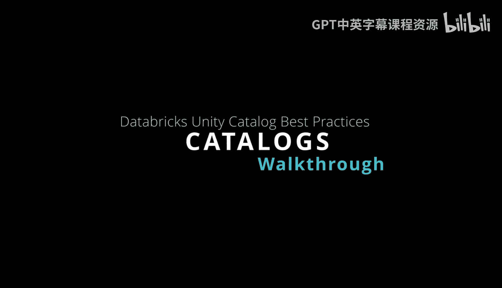
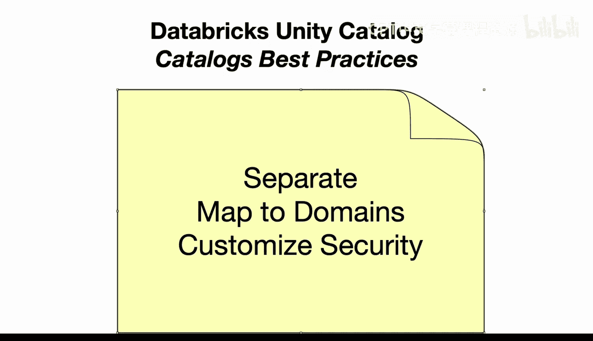
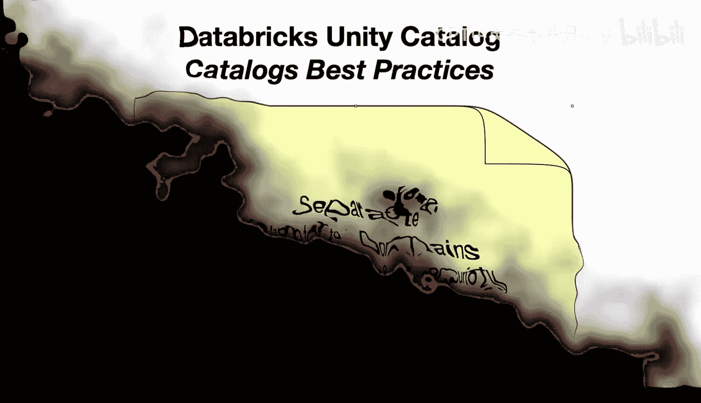

# 大型语言模型实践（高级数据工程、AWS、Databricks和本地LLM）：P147：46_02_06_目录最佳实践

在本节课程中，我们将学习使用 Databricks Unity Catalog 系统时的目录最佳实践。这些实践旨在帮助您构建一个结构清晰、安全且易于管理的元数据架构。

## 概述

Databricks Unity Catalog 提供了一个统一的治理层。为了高效地使用它，遵循一些最佳实践至关重要。本节课我们将探讨如何通过创建独立的目录、映射业务域以及实施精细化的安全策略来优化您的目录结构。

## 目录最佳实践详解

上一部分我们介绍了 Unity Catalog 的基本概念，本节中我们来看看具体有哪些最佳实践可以遵循。

### 1. 创建独立目录以实现松耦合

首先，建议为不同的业务功能或团队创建独立的目录。这样做可以实现松耦合，意味着您可以在一个目录中进行更改，而无需担心对其他目录产生影响。同时，您可以在目录级别管理访问权限和合规性要求。

以下是实施此实践的具体好处：
*   **分离业务功能与团队**：为每个业务单元或团队分配专用目录。
*   **集中管理访问权限**：在目录层级设置和管理访问控制。
*   **独立合规性控制**：针对每个目录实施特定的合规策略。
*   **变更影响隔离**：修改一个目录的内容或结构不会波及其他目录。

### 2. 将目录映射到业务域

在创建了独立目录之后，下一步是合理地规划它们的边界。最佳做法是将目录的边界与业务域或具体应用程序对齐。

例如，您可以创建以下目录：
*   `marketing_analytics`：用于市场营销数据分析。
*   `human_resources`：用于人力资源相关数据。
*   `pipeline_observability`：用于监控数据管道的可观测性数据。

通过这种映射，您可以将安全策略、治理规则作为该目录的组成部分，从而能够深入特定业务域，精确管理其中发生的一切。

### 3. 实施基于目录的定制化安全策略

最后，安全是目录管理的核心。您需要为每个目录创建定制化的安全策略。

这意味着：
*   **创建特定的访问控制组和规则**：针对每个目录定义谁可以访问。
*   **精细调整读写权限**：独立地授予读取、写入等权限。在许多场景下，例如面向仪表板，您可能只想授予读取权限，而非修改权限。
*   **自定义设置**：配置资源配额等设置。
*   **定期清理规则**：在一定时间后清理过时的访问规则。

为每个目录实施精细化的策略是一项最佳实践，它能让您在获得最佳功能的同时，也享有最高级别的安全保障。

## 总结

本节课我们一起学习了 Databricks Unity Catalog 的目录管理最佳实践。我们主要探讨了三点：**为松耦合创建独立目录**、**将目录结构映射到业务域**，以及**为每个目录实施定制化的精细安全策略**。遵循这些实践将帮助您构建一个组织清晰、安全可控且易于扩展的数据治理体系。