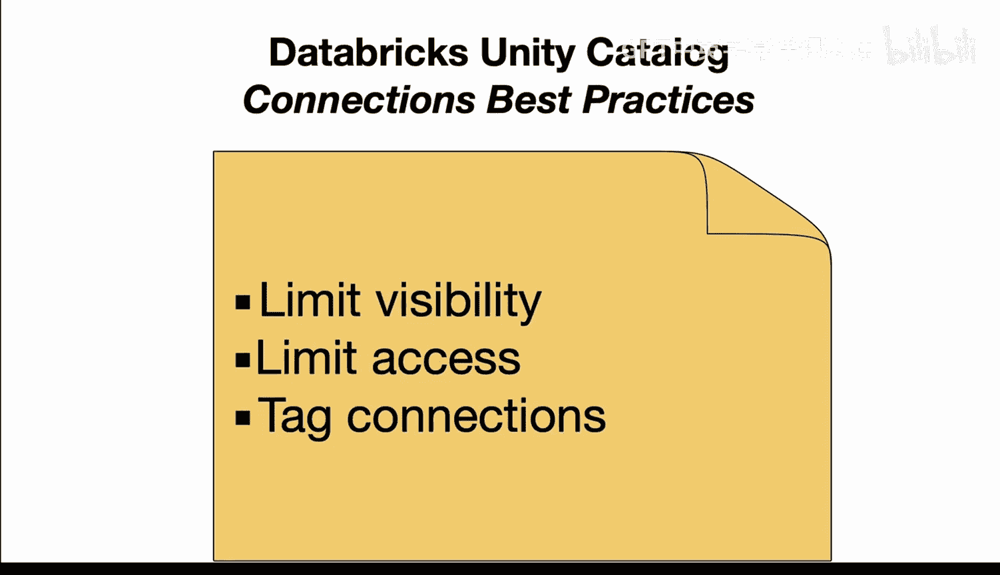

# 大型语言模型实践（高级数据工程、AWS、Databricks和本地LLM）：P148：47_02_07_连接配置最佳实践

在本节课中，我们将学习如何为大型语言模型（LLM）操作中的外部连接配置最佳实践。我们将重点探讨如何通过限制可见性、精细控制访问权限以及有效使用标签来确保连接的安全性和可管理性。

## 限制连接的可见性

上一节我们介绍了连接配置的重要性，本节中我们来看看如何限制连接的可见性。最佳实践的首要原则是限制外部连接的可见性。

这意味着你需要避免将连接密钥等秘密信息暴露给所有用户。你应当仅授予特定用户、组和角色访问权限。在许多场景下，设置最小权限原则，例如只读权限，就足够了。并非每个人都需要访问你所有的外部连接。

## 限制访问权限

在理解了限制可见性之后，接下来我们探讨如何从整体上限制访问权限。核心原则是仅向必要的用户和组提供访问权限。

以下是实现这一点的具体方法：
*   你可以在连接上添加精细的访问控制列表（ACLs）。
*   你可以确保只有预期的团队或作业能够使用那些外部资源。
*   如果某个团队或组不再需要这些资源，你可以撤销他们的访问权限。

因此，密切关注团队的实际需求非常重要，确保不会授予他们不需要的外部资源访问权限。

## 为连接有效添加标签以便于发现

除了访问控制，有效管理连接的另一项关键实践是使用标签。这有助于按用途发现连接，并在整个组织范围内保持一致的可见性。

以下是有效的标签策略：
*   使用诸如来源类别或数据分类等标签。
*   允许按用例发现连接。
*   为获得组织范围内的可见性而保持标签的一致性。

实施这些最佳实践能带来多重好处，包括通过限制暴露范围来增强安全性、防止非预期的数据访问或泄露，以及简化外部连接的发现和管理过程。

本节课中，我们一起学习了连接配置的三项核心最佳实践：限制连接的可见性、实施精细的访问控制，以及为连接有效添加标签。遵循这些原则将有助于你构建一个更安全、更易管理的外部连接环境。