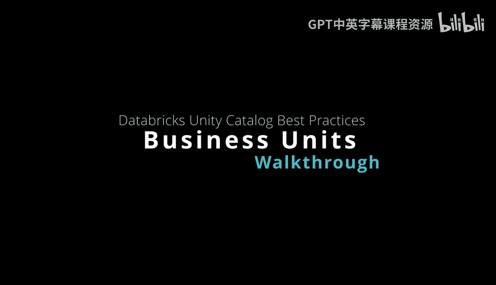
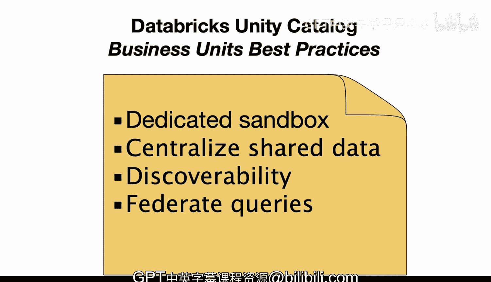

# 大型语言模型实践（高级数据工程、AWS、Databricks和本地LLM）：P149：业务单元最佳实践 🏢

在本节课中，我们将学习Databricks Unity Catalog中关于业务单元的最佳实践。这些实践旨在帮助不同业务部门在保持独立性和安全性的同时，高效地协作和共享数据资源。

---

上一节我们介绍了业务单元管理的总体目标，本节中我们来看看具体的实施策略。

## 为每个业务单元提供专用沙箱 🏖️

首先，应为每个业务单元提供一个专用的沙箱环境。这包括为其分配一个独立的开发环境。此举的目的是允许业务单元在机器学习和数据领域进行安全的实验，同时防止不同工作流之间相互干扰。

以下是实施专用沙箱的几个关键考虑点：

*   **隔离安全参数**：专用沙箱是理想选择，可以避免两个组织间混合不同的安全配置。
*   **适应不同需求**：一个业务单元可能处理高度受限的数据，而另一个可能运行更开放的研究型环境。为每个单元提供独立的沙箱更为合适。

---

在确保了业务单元的独立实验空间后，我们需要考虑如何高效地共享核心数据资产。

## 集中管理可共享数据至生产目录 📂

在此场景下，目标是创建可复用的数据集（如客户和产品数据），并具备集中管理访问权限的能力，而非重复存储数据。因为数据规模可能迅速成为巨大的成本中心。同时，维护单一数据源对于保持一致性至关重要。

以下是集中共享模型的核心优势：

*   **避免数据冗余**：集中管理可以防止因数据重复而导致的成本激增。
*   **确保一致性**：这是集中共享模型的真正价值所在，它能避免关键表格在不同部门中出现多个略有差异的版本。

---

当数据资产被集中管理后，如何让不同部门的用户快速找到并理解它们就变得非常重要。

## 提升数据的可发现性 🔍

可发现性是另一个重要方面。你需要建立有意义的命名规范，例如使用数据术语表。同时，也应遵循元数据管理的最佳实践。

以下是提升数据可发现性的具体措施：

*   **逻辑化结构**：这包括以逻辑方式组织目录、文件夹和资产，构建有意义的层级结构。
*   **促进协作**：建立清晰的架构有助于促进不同单元之间的协作。

---

最后，我们将探讨如何打破数据孤岛，实现跨部门的无缝数据访问与分析。

## 利用联邦查询实现数据统一访问 🔗

通过湖仓一体架构，可以实现联邦查询。这将统一跨越数据孤岛的数据访问，通过合同和权限进行安全治理，并允许通过共享的自助服务访问来丰富本地数据。

联邦查询的一些关键益处包括：

*   **支持单元自治**：通过数据域支持各业务单元的自主性。
*   **提高生产效率**：通过资产复用提高整体生产效率。
*   **保持一致性**：通过协作式治理来维持数据和处理流程的一致性。

---

本节课中我们一起学习了Databricks Unity Catalog中针对业务单元的四项核心最佳实践：为每个单元建立专用沙箱以确保隔离与安全实验；将可共享数据集中管理至生产目录以促进复用并保证一致性；通过有意义的命名和逻辑结构提升数据的可发现性；最后，利用联邦查询和湖仓一体架构打破数据孤岛，实现安全、统一的数据访问与协作治理。这些实践共同构成了一个支持业务单元既独立又协作的高效数据管理框架。