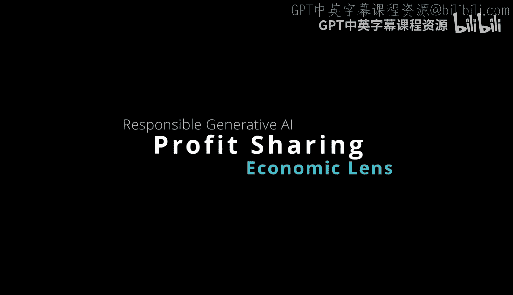
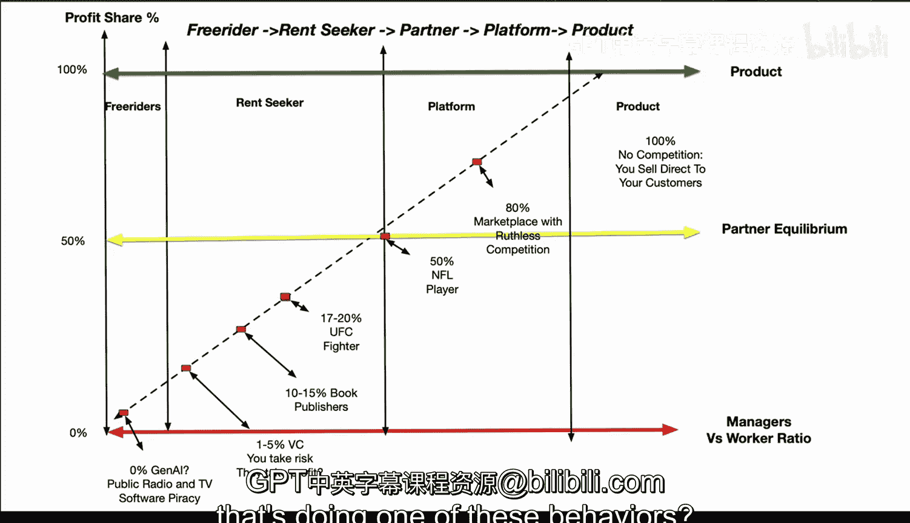

# 大型语言模型实践（高级数据工程、AWS、Databricks和本地LLM）：P150：利润分享概念解析 💰

在本节课中，我们将从社会和经济学的角度，深入探讨利润分享的不同模式及其影响。理解这些概念对于评估新技术（如生成式AI）的商业和社会影响至关重要。

## 利润分享的四种模式

从微观经济学的框架来看，利润分享主要可以分为四种模式。每种模式都有其优缺点，对消费者和公司的影响也各不相同。

以下是四种主要的利润分享模式：

*   **搭便车者**：指那些享受产品或服务带来的好处，却无需支付任何费用的个体或群体。
*   **寻租者**：指试图通过最小化自身努力，同时获取租金或支付的行为者。
*   **平台**：作为连接供需双方的中间方，通过收取交易费用等方式获取利润。
*   **产品**：指生产者直接将产品销售给最终客户，从而获得全部利润的理想模式。

## 搭便车者模式分析

上一节我们概述了四种模式，本节中我们首先来看看“搭便车者”模式。一个典型的例子是公共广播和电视。许多人每天收听公共广播，但从不支付订阅费，他们就是“搭便车者”——在不支付任何费用的情况下获得了收益。

如果足够多的人不为公共广播付费，公共广播将无法维持。软件盗版也是如此。如果一个软件包可以被免费下载，当足够多的人成为“搭便车者”时，软件将无利可图，开发者也就失去了继续开发的动力。

这种情况也可能发生在生成式AI领域。如果从报纸、电影到书籍和软件的所有内容都被免费消费，且没有利润分享机制，那么最终，无论是公共领域还是受版权保护的内容，其创作动机都可能降至零，导致所有创造性产出归零。当然，如果“搭便车者”只是少数，或许影响不大，但这仍然是一个需要警惕的问题。

## 寻租者模式分析

接下来，我们探讨“寻租者”模式。寻租行为并非绝对，而是一个梯度概念，其核心是希望以尽可能少的工作量，获取某种租金或报酬。

风险投资就是一个很好的例子。在某些情况下，一家风险投资公司可能投资100家公司，他们知道其中可能有95家会破产。那95家公司及其员工承担了巨大的风险，他们本可以在成熟公司获得更高的薪水和奖金，但实际获得的**期望价值**却更低。

> **期望价值公式**：`期望价值 = 利润 × 事件发生概率`

在这个案例中，成功概率可能只有5%。员工承担了大部分风险，而风险资本家则因为以一种对冲所有风险的方式进行投资而获取了利润。图书出版商在某些情况下也是如此，他们可能为作者做了很多，也可能做得很少，但在许多情况下却能获得图书收入的10%到15%，这也可以被视为一种寻租形式。

在这些场景中，通常伴随着高度的管理，因为资金掌握在他们手中。他们获取了大部分利润，并可能将其再投资回组织。至于这是否真正为社会或产品增加了价值，则需要具体情况具体分析。

## 平台与产品模式分析

在了解了寻租行为后，我们来看看更成熟的利润分享模式——平台与产品。以职业体育为例，UFC（终极格斗冠军赛）的利润分享比例较低，选手大约获得17%到20%的收益分成。而在更成熟的组织如NFL（美国国家橄榄球联盟）中，则达到了合伙人级别的分成，约50%的收入会返还给球员。篮球和棒球等联盟也有类似的利润分享机制。

这体现了一种**合伙人均衡**，其中的权衡开始对劳动者和所有者双方都有意义，这可能是一个值得考虑的“甜蜜点”。

至于平台模式，也存在一些好处。如果你能获得80%的利润，那对你非常有利。但如果存在无情的竞争，情况就不妙了。经济学中有一个表述：在完全竞争下，所有利润最终趋于零。这意味着，如果平台无法限制参与者加入，甚至无法区分优秀者与普通者，这确实可能导致利润被消除。当然，平台本身可能因为拥有大量竞争者并通过收取交易费而赚取很多钱。

最后的“产品”模式，对所有者而言近乎完美场景。例如，一个农民在路边直接向顾客销售水果，他获得了100%的利润，没有交易费，也没有中间商参与。当你直接将产品销售给客户时，就是这种情况。

## 总结与思考

本节课中，我们一起学习了利润分享的四种核心模式：搭便车者、寻租者、平台和产品。重要的是，每当你听到一个新的机会、新技术或思考新事物时，都要考虑到每种模式都存在权衡。搭便车者有得有失，寻租者、平台和产品模式也是如此。

以开放的眼光进入任何场景至关重要，同时也要从伦理角度思考：当你与采取其中某种行为的公司互动时，会对社会产生何种影响。