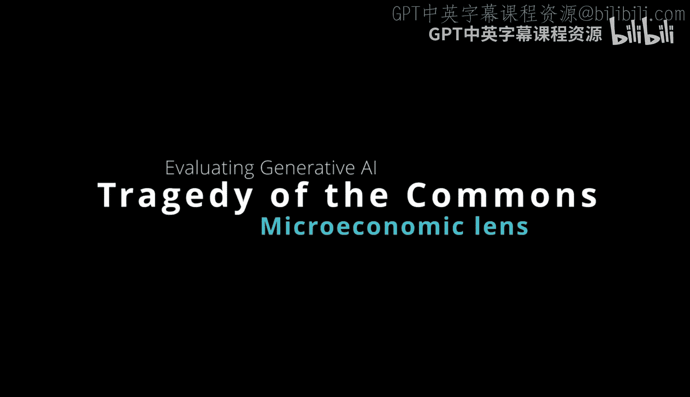
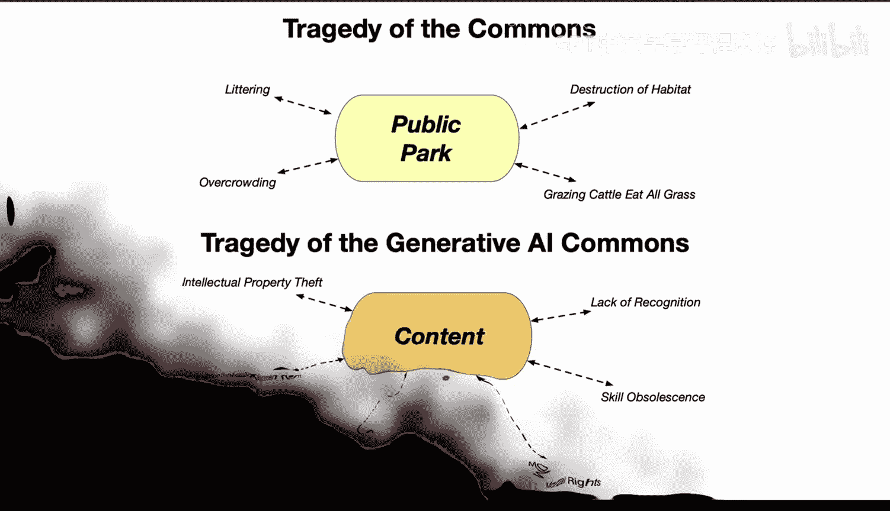

# 大型语言模型实践：P151：生成式AI的公共资源悲剧 🏞️

在本节课中，我们将探讨一个经典的经济学概念——“公共资源悲剧”，并分析其在生成式人工智能（AI）领域的体现。我们将理解当一项资源被无限制地共享时可能出现的问题，以及这些问题如何映射到生成式AI的开发与应用中。

## 公共资源悲剧概述

公共资源悲剧是一个经典案例，描述了当一项免费资源被几乎无限数量的人共享时可能发生的种种情况。

由于缺乏监管，不同的问题可能出现。例如，假设有一个公共公园，人们可能到处乱扔垃圾，仅凭乱扔垃圾这一项行为就足以破坏公园。公园也可能因为过度拥挤而被破坏。

再次假设没有监管，并且确实有大量人群不断涌入，最终公园会变得异常拥挤，导致你甚至无法参观公园。另一个例子是栖息地的破坏。

例如，如果你去一个国家公园，并开始破坏公园的某些特色景观或部分山体等，那么它将不再像以前那样美丽。或者，经典的例子是拥有不同牛群的公司。

一些牧场主会进入并相互竞争，看谁能消耗最多的草料，因为他们担心对方会比他们更快地消耗掉草料。

这本质上是一种“竞次”行为。然后，在你意识到之前，草料已被消耗殆尽，整个资源都被破坏了。这就是公共资源悲剧的经典案例。

事实上，根据各地的监管情况不同，你可以在世界各地的某些公共公园看到这种现象，包括在美国。

## 生成式AI的公共资源悲剧

生成式AI的公共资源悲剧具有一些类似的特征。

以下是生成式AI领域可能出现的具体问题：

*   **知识产权盗窃**：生成式AI模型可能在未经授权的情况下，在受版权保护的作品上进行训练。涉及的作者或公司并未给予同意。这可能贬低原作品的价值，甚至削弱创作新内容的动力。如果你的财产将被窃取，你为何要创作更多？
*   **工作岗位替代**：在生成式AI的案例中，存在人类创作者不再被需要的风险，这可能导致工作岗位被替代，并产生相关的负面外部效应。如果这些人无法再获得工作，社会就必须承担这种岗位替代的负担。
*   **质量控制问题**：在输出作品方面，生成的作品可能因为质量低劣而贬低艺术家的价值，但这实际上是生成式AI在模仿艺术家。这可能导致整体的质量控制问题。
*   **缺乏认可或归属**：创作者的作品可能在被窃取且未获补偿的情况下使用，他们甚至没有被认可为原作的真正创作者。这可能令人沮丧、不公平，并可能对该艺术家未来能否获得工作产生重大影响。
*   **伦理或道德权利担忧**：作者可能不希望自己的形象与吸烟、饮酒或其他不良嗜好相关联，而你在使用其形象时并未征得其许可。

上一节我们概述了生成式AI可能引发的具体伦理问题，本节中我们来看看它与传统公共资源悲剧的关联。在生成式AI领域，传统的公共资源悲剧场景并非神奇地不存在，这些问题同样存在。

因此，我们需要同时审视其益处和负面影响。生成式AI有其强大的益处，例如总结、概述或协同创作。但也需要审视其负面外部效应：对社会的影响是什么？社会是否并未从某些方面受益？

例如，如果是一个商业模型，社会并未获得那份报酬，却必须承担成本。这再次类似于在公园乱扔垃圾、过度拥挤或破坏公园：你必须为他人滥用资源的行为付出代价。

## 总结

本节课中，我们一起学习了“公共资源悲剧”的概念及其在生成式AI伦理中的体现。我们认识到，在思考生成式AI的伦理时，考虑公共资源悲剧非常重要。这要求我们在享受技术红利的同时，也必须关注并设法解决其可能带来的知识产权、就业市场、作品质量和社会公平等挑战。