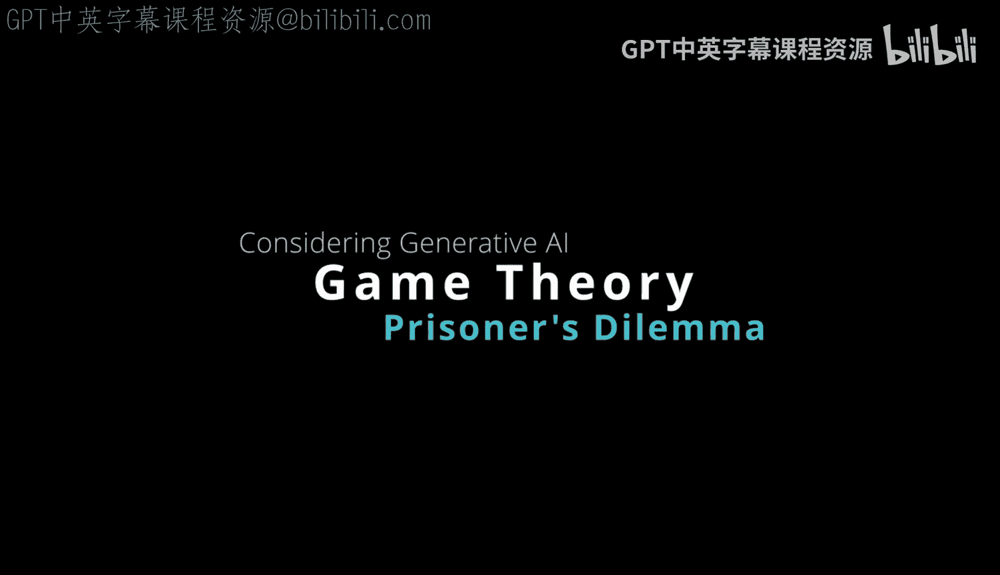
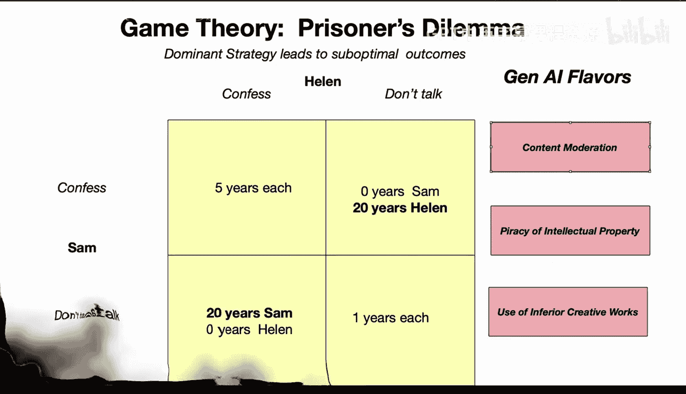

# 大型语言模型实践（高级数据工程、AWS、Databricks和本地LLM）：P152：生成式AI博弈论 🎲

在本节课中，我们将要学习博弈论的基本概念，并探讨它如何应用于生成式人工智能领域，帮助我们理解在技术竞争中可能出现的“囚徒困境”与“逐底竞争”现象。

## 博弈论简介

博弈论是一个数学框架，用于研究具有玩家、策略和收益的互动游戏，旨在找出最优策略或导致次优结果的主导策略。

在经典的“囚徒困境”问题中，自私的主导策略将导致对所有人都不利的次优结果。

## 囚徒困境案例

想象你是一名检察官，你逮捕了涉嫌犯罪的Sam和Helen，但缺乏定罪两人的证据。唯一获取所需证据的方法是让他们互相揭发。

以下是他们面临的收益矩阵：

*   **两人都保持沉默**：每人仅被判入狱1年。
*   **一人坦白，另一人沉默**：坦白者获释（0年），沉默者入狱20年。
*   **两人都坦白**：每人入狱5年。

检察官通过分别向两人提供激励（“如果你坦白，你将获释，而你的同伙将入狱20年”），促使每个人都选择坦白。尽管如果两人能沟通合作，最优策略是都保持沉默（各判1年），但由于彼此不信任，最终导致了主导策略：两人都坦白，各判5年，刑期是合作情况下的五倍。

这是思考系统如何导致所有人皆输的经典方式，我们也可以从博弈论视角来看待生成式AI。

## 生成式AI中的博弈论应用

上一节我们介绍了经典的囚徒困境，本节中我们来看看博弈论在生成式AI领域的具体体现。

### 内容审核的“逐底竞争”

假设我们进入一个所有内容审核都由某个AI系统完成的世界。公司有强烈的动机确保其内容具有吸引力，因为如果参与度不足，公司将亏损。

因此，尽管平台上充斥着大量低质量的生成式AI内容，公司实际上会**减少审核力度**，因为这会影响公司的利润底线。一旦竞争对手意识到他们也开始亏损，他们也会改变内容审核策略。

以下是可能发生的连锁反应：

1.  各平台不断降低审核标准。
2.  平台上的审核越来越不严格。
3.  最终，平台可能完全充斥着质量低劣、甚至包含有害内容的生成式AI内容。

这个过程可被称为 **“逐底竞争”**。

### 知识产权盗用的困境

在生成式AI领域，你可能陷入另一种困境：假设你认为竞争对手或另一个国家/政府会盗用知识产权，因此你觉得也必须盗用相同的知识产权。

结果如下：

1.  所有人都不再尊重知识产权。
2.  每个人都开始盗用。
3.  最终，知识产权的概念将不复存在。

这同样是一种 **“逐底竞争”**，因为你预判了对方会做坏事而采取了行动。

### 劣质创意作品的困境

这种情况直接映射了囚徒困境。如果你觉得竞争对手可能会开始使用通过简单提示生成的劣质AI作品，那么你也会做同样的事情。

其发展路径是：

1.  双方都开始生产越来越差的艺术作品。
2.  最终，你们生产的所有艺术品质量都很低劣。
3.  结果是所有人皆输：客户输了，创作艺术的人也不再被雇佣。
4.  从此再也没有真正优秀的艺术出现。

## 总结与启示

本节课中我们一起学习了博弈论的核心思想及其在生成式AI中的应用。可以看到，如果只从追求主导策略的角度思考问题，并且不进行迭代合作，只考虑单次博弈，就可能导致对游戏中所有玩家都不利的主导策略（次优结果）。

因此，在考虑像生成式AI这样的新技术时，一个非常重要的问题是：**它的影响是什么？以及我们如何能创建一个迭代的合作策略，以避免陷入“逐底竞争”？** 这需要行业参与者之间建立信任与协作机制，共同维护健康的发展生态。