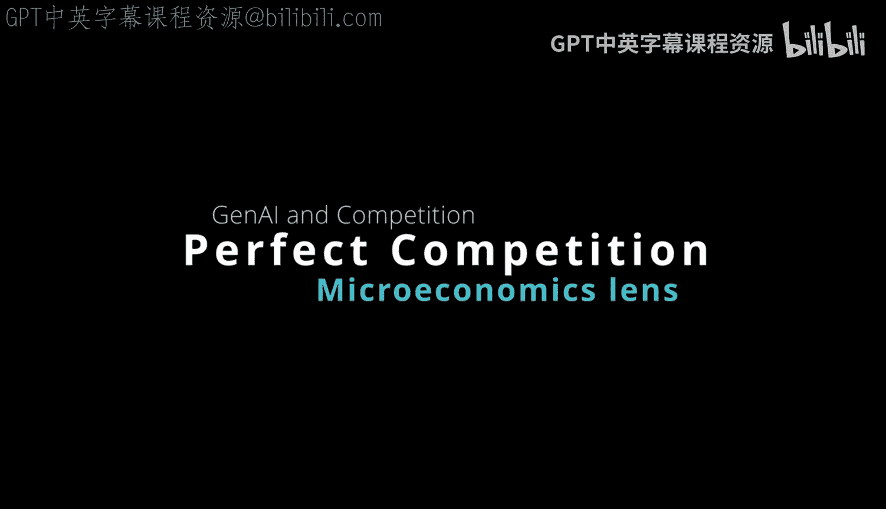
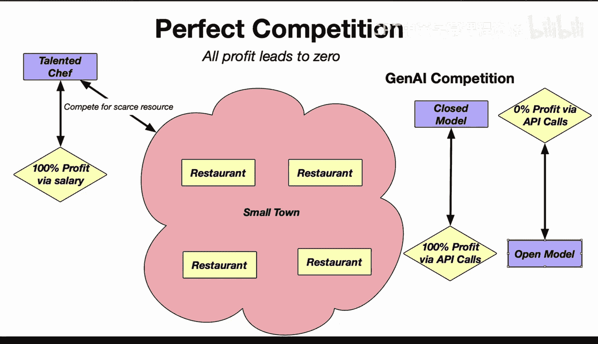
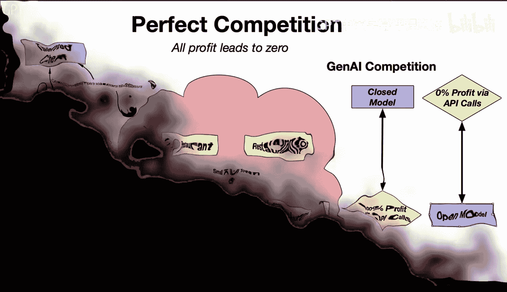

# 大型语言模型实践（高级数据工程、AWS、Databricks和本地LLM）：P153：完全竞争市场

在本节课程中，我们将探讨经济学中的“完全竞争市场”概念，并将其类比到人工智能领域，特别是大型语言模型的商业模式。我们将分析在完全竞争条件下，利润如何趋于零，并思考这对企业AI战略的启示。

## 完全竞争市场的核心概念

在完全竞争市场中，所有经济利润最终会趋向于零。这具体意味着什么？

我们可以通过一个小镇餐馆的例子来理解。假设镇上有四家餐馆。起初，它们之间没有显著的竞争差异，直到一位才华横溢的厨师来到镇上。

现在，所有餐馆都必须竞争这位稀缺的厨师资源，因为他的才华能为餐馆吸引所有顾客。

餐馆们的行为是：它们不断相互竞价，支付越来越高的薪水，直到最终这位厨师拿走了所有的利润，因为厨师是一种有限或稀缺的资源。

这位厨师拥有稀有且需求旺盛的技能。许多餐馆竞相购买他的服务。最终，厨师将谈判获得极高的薪水，并攫取所有的经济利润。

## 经济利润的定义

那么，什么是经济利润？它指的是**总收益减去总经济成本**。这超出了正常的利润边际。

*   **正常利润**是吸引投资所需的成本。
*   **经济利润**是超出正常利润的部分。

本质上，这种完全竞争可能导致最终的破产，因为实际雇佣厨师的餐馆必须将所有利润都给厨师，并且无法通过其他方式竞争。

## 类比AI领域的竞争

同样，我们可以看一个可能发生类似情况的AI例子。

假设存在一个闭源模型，因其卓越的性能，所有人都必须使用它。那么，就像那位厨师一样，现在没有任何竞争优势了，因为每个人都必须使用同一个闭源模型。这些公司的所有利润都将流向API调用费用，就像餐馆例子中的厨师薪水一样。

另一方面，我们可能看到另一种情景：如果所有模型都是开源的，那么也无法盈利，因为你可以平等地使用任何模型。因此，训练模型的公司最终将倒闭，因为无法赚钱。

## 对AI战略的启示

这是一个假设性的情景，但在评估你的AI战略时，从经济学角度思考这一点非常重要。

*   你认为全力投入闭源模型会给你带来竞争优势吗？
*   还是认为，未来如果模型数量本质上无限，模型最终会变得像Linux一样，成为一种免费的商品，而你必须在其他形式的技术上进行竞争？

本节课中，我们一起学习了完全竞争市场的概念及其在AI领域的类比。我们了解到，当资源（如顶尖人才或核心技术）高度稀缺或完全普及时，市场竞争可能导致利润归零。这提醒我们，在制定AI战略时，需要深入思考技术路线的稀缺性、可替代性以及长期的竞争优势所在。

