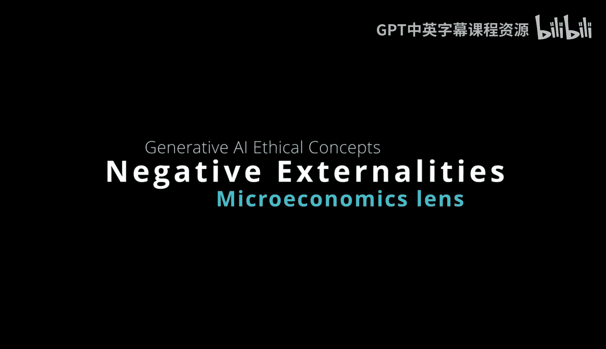
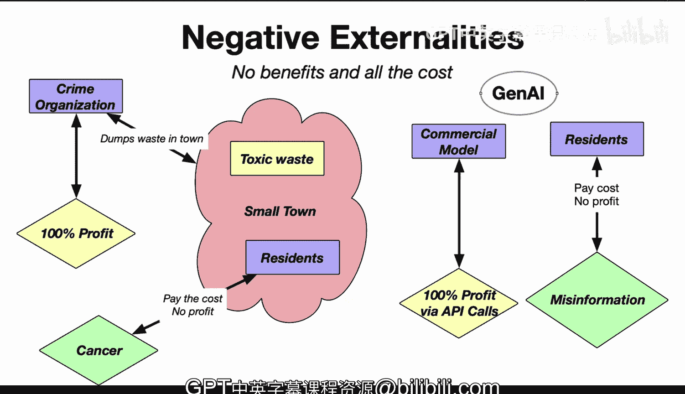

# 大型语言模型实践（高级数据工程、AWS、Databricks和本地LLM）：P154：53_03_06_负外部性

在本节课程中，我们将学习一个重要的经济学概念——**负外部性**，并探讨其在生成式人工智能技术部署中的现实意义。我们将理解负外部性的定义，分析其产生的原因，并思考如何在技术方案中负责任地评估和应对潜在的负外部性。

## 什么是负外部性？🤔

负外部性是指某些行为或产品在产生效益的同时，给未直接参与交易或活动的第三方带来了**未获补偿的成本或损害**。简单来说，就是“有人获利，却由他人买单”。

一个经典的公式化理解是：
**社会总成本 = 私人成本 + 外部成本（负外部性）**

当存在负外部性时，私人决策者（如公司）并未承担其行为的全部社会成本，这可能导致市场失灵，即从社会整体角度看，该行为被过度提供了。

## 一个极端的现实案例 🏭

为了更好地理解这个概念，让我们看一个基于真实事件的极端例子。

假设一个犯罪组织受某公司雇佣，将有毒废物（例如核废料或农药）非法倾倒入一个小镇。以下是该事件中各方的得失分析：

*   **犯罪组织**：获得了100%的利润（雇佣金）。
*   **雇佣公司**：以较低成本处理了废物，间接获利。
*   **小镇居民**：未从倾倒行为中获得任何利润，却承担了全部代价。这些代价可能包括：
    *   居民健康受损，如罹患癌症或其他疾病。
    *   当地环境被污染，农业生产能力下降。
    *   财产价值贬损。

在这个案例中，倾倒有毒废物的行为产生了巨大的**负外部性**，全部由无辜的小镇居民承担，而犯罪组织和雇佣公司则获得了全部利益。

## 生成式AI中的潜在负外部性 🤖

上一节我们通过一个极端案例理解了负外部性的基本形态。现在，让我们将这一框架应用于生成式人工智能领域。

考虑一个商业公司通过API提供其生成式AI模型服务，并因此获得100%的利润。这看起来是成功的商业模式。然而，我们需要追问：是否存在潜在的负外部性？那些没有获得利润的人，是否会为AI生成的内容付出代价？

以下是生成式AI可能引发的一些负外部性场景：

*   **制造与传播虚假信息**：AI生成的、看似真实的虚假内容（如模仿知名政治人物的语音）可能干扰选举结果。
*   **损害个人或组织声誉**：针对特定个人或公司的AI生成不实信息，可能对其声誉或业务造成严重伤害。
*   **引发公共健康危机**：关于医疗健康的AI生成错误建议，可能导致人们采取有害的行动。

在这些场景中，商业公司通过API调用获得了利润，但社会大众——即未直接参与交易的第三方——却可能承受谣言、社会信任度下降、健康风险等**负外部性**成本。

## 如何负责任地思考与应对 🛡️

认识到负外部性的存在，是负责任地开发和部署AI解决方案的第一步。这并不意味着所有技术都会产生极端的负面影响，但主动评估是不可或缺的。

在提出任何技术解决方案时，我们不仅要关注**利润**，还必须系统性地审视**负外部性**。你需要思考以下问题：

*   你的技术可能对用户、社区或环境产生哪些意料之外的影响？
*   即使这些影响是无意的，其实际后果是什么？
*   如何设计机制来预防、减轻或补偿这些外部成本？

这种全面的评估框架，是将伦理和社会责任嵌入技术开发流程的**负责任**的做法。

## 总结 📚

本节课我们一起学习了**负外部性**这一核心概念。我们了解到，负外部性是指行为方获得收益，却由未参与的第三方承担成本的现象。我们通过非法倾倒有毒废物的案例加深了理解，并重点探讨了生成式AI技术可能带来的潜在负外部性，如制造虚假信息和损害公共利益。最后，我们强调，在部署AI解决方案时，采用包含负外部性评估的负责任框架至关重要，这要求我们在追求利润的同时，必须审视并尽力减少技术对社会的无意伤害。

