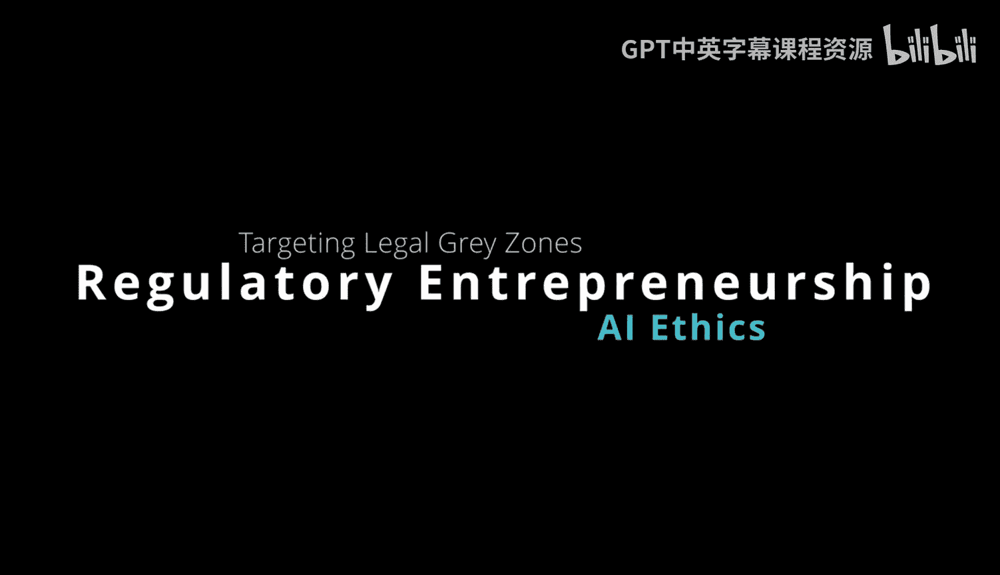
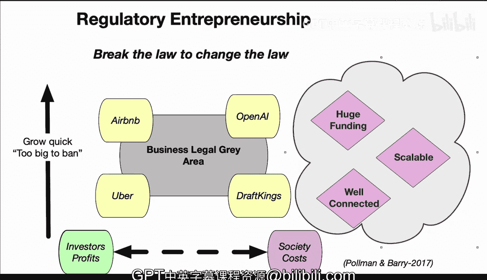

# 大型语言模型实践（高级数据工程、AWS、Databricks和本地LLM）：P155：54_03_07_监管创业 🏛️

在本节课中，我们将要学习“监管创业”这一概念。这个概念由Paulllman和Barry在2017年提出，它描述了初创公司如何通过游走在法律灰色地带、快速扩张，最终反过来影响和改变法律法规的现象。我们将分析其核心策略、促成因素、社会影响，并探讨其在生成式AI等新兴领域的应用。

## 核心概念与定义

监管创业的本质是：**通过违法或在法律灰色地带创建公司，随后再改变法律**。

这个策略的核心在于利用法律滞后于技术发展的特点，快速建立市场地位，形成“大到无法禁止”的局面，从而获得与监管机构谈判、甚至重塑规则的能力。

## 关键策略与促成因素

上一节我们介绍了监管创业的定义，本节中我们来看看实现这一目标通常采用哪些策略，以及哪些因素使其成为可能。

以下是监管创业公司常用的关键策略：

*   **识别法律灰色地带**：寻找现有法律法规尚未明确覆盖或存在解释空间的商业领域。
*   **快速扩张**：以极快的速度增长用户和市场规模，达到“大到无法禁止”的规模。
*   **动员用户获取政治支持**：利用社交媒体和社区，将用户转化为政治游说力量，为自己的商业模式辩护。

以下是促成监管创业成功的主要因素：

*   **资金充足**：获得大量风险投资，为快速扩张和应对潜在法律挑战提供资金。
*   **业务可扩展**：商业模式具备高度的可扩展性，能迅速占领市场。
*   **公众吸引力**：提供的服务或产品深受公众欢迎，容易获得舆论支持。
*   **瞄准地方性法规**：优先挑战州或地方层面的法律，而非国家法律，因为前者阻力通常更小。
*   **诉讼的政治化**：将法律诉讼视为一种政治和公关手段，而不仅仅是法律争端。

## 案例分析与社会影响

了解了策略和因素后，我们来看看几个典型案例，并分析其带来的社会影响。

以下是Airbnb、Uber、Draftkings和OpenAI的监管创业模式分析：

*   **Airbnb**：该公司获得了巨额利润和估值，为创始人和投资者带来了回报。但社会需要承担其带来的**负外部性**，即全球范围内可负担租赁住房单元的减少。
*   **Uber**：公司估值高达数百亿美元，风险投资者获得了回报。然而，社会，特别是像旧金山这样的城市，需要承担交通拥堵加剧和尾气排放增加带来的成本。这些污染和拥堵是强加给社会的负外部性，无人为此获得补偿。
*   **Draftkings**：它催生了一个价值数十亿美元的梦幻体育产业。但同时也导致了更多人赌博成瘾和个人破产案例增加。社会需要为此承担后果，例如，当一个人因赌博无法支付房贷导致家庭流离失所时，社会需要承担救助成本。
*   **OpenAI与生成式AI**：生成式AI带来了巨大的技术进步和商业利润。但同时也存在潜在损失：AI可能被用于破坏性用途；艺术家的版权作品在未经明确许可的情况下被用于模型训练，引发了版权争议。使用受版权保护的数据进行训练的成本，构成了社会需要承担的潜在损失。

## 总结与展望

本节课中我们一起学习了监管创业的概念、策略、案例及其社会影响。

监管创业现象已存在相当长的时间，在风险投资支持的科技公司中尤为常见。其典型模式包括：快速成长至巨大规模、要求巨额资金、业务高度可扩展，以及由能够游说国会的人士领导。

未来会如何发展？是出现更多监管，还是更少？这仍有待观察。但可以肯定的是，理解监管创业的模式，对于分析新兴技术公司（如生成式AI领域的企业）的发展路径、评估其创新价值与社会成本之间的平衡至关重要。