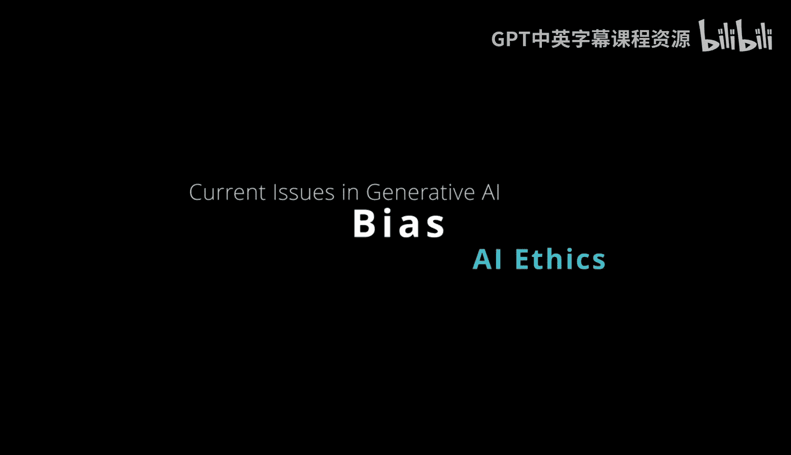
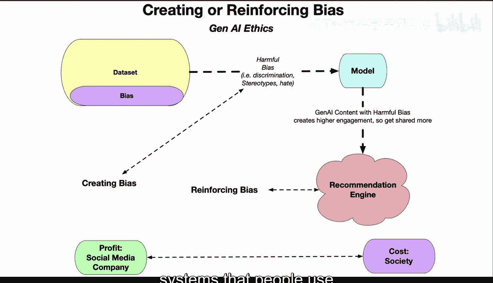

# 大型语言模型实践：P156：创建或强化偏见

## 概述
在本节课中，我们将要学习生成式人工智能中一个关键的伦理问题：偏见是如何被创建或强化的。我们将探讨偏见数据如何影响模型训练、推荐系统如何放大有害内容，以及这对社会造成的长期成本。

---

## 偏见问题的本质
生成式人工智能中的偏见创建或强化是一个必须解决的伦理问题。

这里有一个数据集，其中包含了一些固有的偏见。这些偏见可能涉及刻板印象、歧视，甚至仇恨言论。如果我们在训练模型时不处理这些信息，就会将其置入一个能够生成更多偏见的系统中，从而强化了偏见。

## 偏见强化的恶性循环
上一节我们介绍了偏见问题的本质，本节中我们来看看一个具体的恶性循环案例。

一个典型的例子是，生成式AI产生的内容被放入推荐引擎后，带有有害偏见的内容可能获得更高的参与度。这意味着，一个基于偏见数据训练的模型实际上能带来利润。这种利润甚至会被其传播的有害刻板印象和错误信息进一步放大，因为推荐引擎只以参与度这一指标为食。

因此，结果不仅是您最初创建了偏见，而且通过将其推荐给数百万甚至数十亿人，您还强化了这种偏见。这是一个现实问题，因为一方面社交媒体公司可以赚取这些利润，但另一方面，社会将为此付出代价。

以下是偏见强化可能带来的社会影响：
*   可能导致进一步的歧视。
*   可能引发仇恨犯罪。
*   可能对社会产生各种负面影响。

## 偏见系统的运作机制
认识到偏见的危害后，我们需要理解它是如何运作的。让我们从源头开始分析。

假设您收集了一个与过去用户参与度相关的偏见数据集。这可能是由一些曾经发生过的有害行为导致的。接着，您优化模型以追求点击、分享和引发愤怒（这可能再次涉及有害内容）。这将创造一个“信息茧房”和有毒的个性化推荐，导致人们被吸引到这些有毒内容中。

这为公司带来了大量收入。因此，公司的利润通过煽动愤怒、传播错误信息和提升整体参与度而增长。用户在该网站上花费的时间越多，您就能展示更多广告，并可能卖出更高的价格（至少在短期内）。

## 短期收益与长期成本
上一节我们看到了偏见系统如何为公司带来短期收益，本节中我们来审视其长期的社会成本。

短期内，增长和利润的上升会让人觉得一切都在朝着正确的方向发展。但正如我们之前提到的，被传播数据带来的歧视和对边缘群体的刻板印象，这些成本必须由社会来承担。它可能进一步固化分歧，甚至削弱人们对复杂议题的理解。

长期来看，这可能导致极端主义、暴力和不稳定的加剧。简而言之，这不是一个理论问题，而是一个必须与生成式AI系统一起处理的现实问题。

## 解决方案与伦理考量
面对偏见带来的挑战，我们必须思考解决方案。您必须考虑对优化参与度算法进行监督，甚至改变要求以纳入伦理考量，同时进行政策改革以应对这些有毒的商业模式。

仅仅因为公司正在盈利，并不意味着这总是好事。利润的背后可能是有害的刻板印象。因此，社会必须处理其后果。

以下是几种可能的应对措施：
*   **税收**：可以通过税收来解决这个问题。
*   **立法**：可以通过立法来解决这个问题。
*   **伦理培训**：可以通过伦理培训来解决这个问题。

事实上，所有这些措施结合起来，可能是我们开始认真思考的起点：超越单纯的利润，全面考虑构建人们使用的系统意味着什么，以及这些系统对社会产生的影响。

---

## 总结
本节课中我们一起学习了生成式AI中偏见创建与强化的全过程。我们了解到，基于偏见数据训练的模型会通过推荐系统放大有害内容，为公司带来短期利润，却让社会承担歧视、分裂和不稳定的长期成本。解决这一问题需要算法监督、伦理考量、政策改革等多方面的共同努力，以确保技术的发展服务于更广泛的社会福祉，而不仅仅是商业利益。