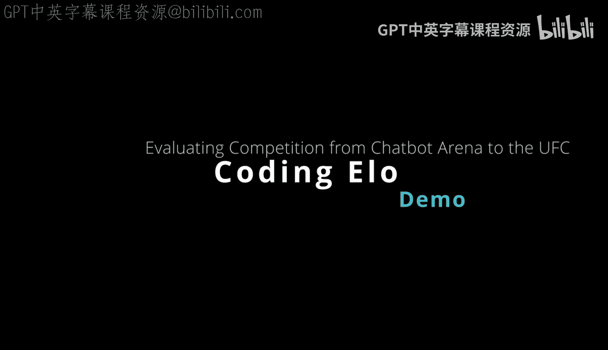
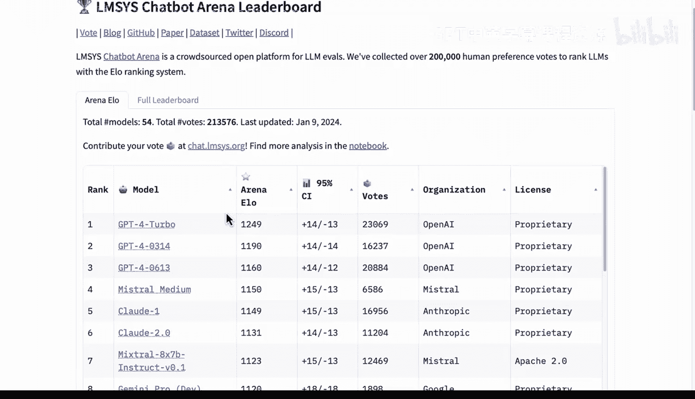
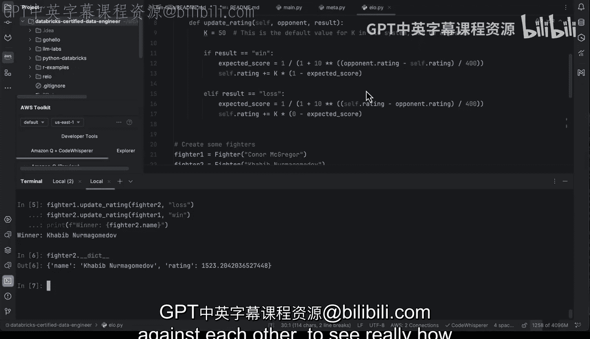

# 大型语言模型实践（高级数据工程、AWS、Databricks和本地LLM）：P157：56_03_02_Python实现ELO算法




在本节课中，我们将要学习ELO算法的原理及其在评估大型语言模型中的应用。我们将通过Python代码实现一个简单的ELO评分系统，并理解它如何超越简单的胜负记录，提供更准确的实力评估。

## 概述：ELO算法与模型评估

许多人关注聊天机器人竞技场，因为它是进行大型语言模型一对一测试的好方法。我们可以比较商业模型、开源模型和专有模型。其真正酷炫之处在于，我们可以从数值角度深入分析哪个模型更优。

我们能够进行这种分析的原因是ELO算法。ELO是一种“赛程强度”指标。它真正评分的是你相对于对手的表现，而不仅仅是你的得分。例如，如果你取得了20胜0负的战绩，但所有对手都是业余选手，这就不如一个可能有一些失利，但对手实力强劲的选手有说服力。ELO算法告诉我们的正是这种赛程强度。

## Python实现ELO算法

上一节我们介绍了ELO算法的核心概念，本节中我们来看看如何用Python代码实现它。

以下是一个简单的“拳手”类实现，用于模拟ELO评分更新：

```python
class Fighter:
    def __init__(self, name, rating=1500):
        self.name = name
        self.rating = rating

    def update_rating(self, opponent_rating, result, K=32):
        """
        根据比赛结果更新ELO评分。
        result: 1表示胜利，0表示失败。
        """
        expected_score = 1 / (1 + 10 ** ((opponent_rating - self.rating) / 400))
        self.rating += K * (result - expected_score)
```

在这个实现中，K值设为32。K是调整因子，我们可以根据比赛数量进行调整。例如，国际象棋比赛场次多，K=32是一个常用值；而UFC比赛场次少，K值可能需要设得更大一些。具体数值需要根据数据集的经验进行调整。



简而言之，该算法表示：如果你获胜，你的得分将取决于对手的评分作为权重的一部分；如果你失败，同样会考虑对手的评分作为计算组件。

## 模拟比赛与评分更新

以下是使用我们定义的`Fighter`类进行一场比赛模拟的步骤：

首先，我们创建两名拳手并打印赛前评分。

```python
# 创建拳手
connor = Fighter("Connor McGregor", 1500)
khabib = Fighter("Khabib Nurmagomedov", 1500)

# 打印赛前评分
print(f"赛前评分: {connor.name}: {connor.rating}, {khabib.name}: {khabib.rating}")
```

接着，我们模拟比赛结果并更新他们的评分。假设Khabib获胜。

```python
# 模拟Khabib获胜，result=1
khabib.update_rating(connor.rating, result=1)
# Connor失败，result=0
connor.update_rating(khabib.rating, result=0)

# 打印赛后评分
print(f"赛后评分: {connor.name}: {connor.rating}, {khabib.name}: {khabib.rating}")
```

运行这段代码，我们可以看到Connor的评分从1500下降到约1475，而Khabib的评分上升到约1525。通过多次迭代，我们可以得到一系列指标，这些指标基于对手的实力来展示谁是最佳的，而不仅仅是基于他们是否获胜。

## 交互式探索与总结

ELO算法的强大之处在于它是衡量竞争水平的绝佳方式。我们甚至可以在IPython等交互式环境中进一步探索。

例如，我们可以导入`Fighter`类，创建实例并进行实验。使用`__dict__`方法可以查看对象的内部状态，我们会发现它只是一个包含姓名和评分的字典。这说明ELO并非神秘的指标，自己编写代码实现相当简单。




本节课中我们一起学习了ELO评分算法的基本原理和Python实现。ELO是一个直观的评分系统，是判断大型语言模型（无论是开源还是专有模型）在真实场景中竞争表现的优秀指标。通过考虑对手强度而非单纯胜负，它能更公平地评估模型的真实能力。