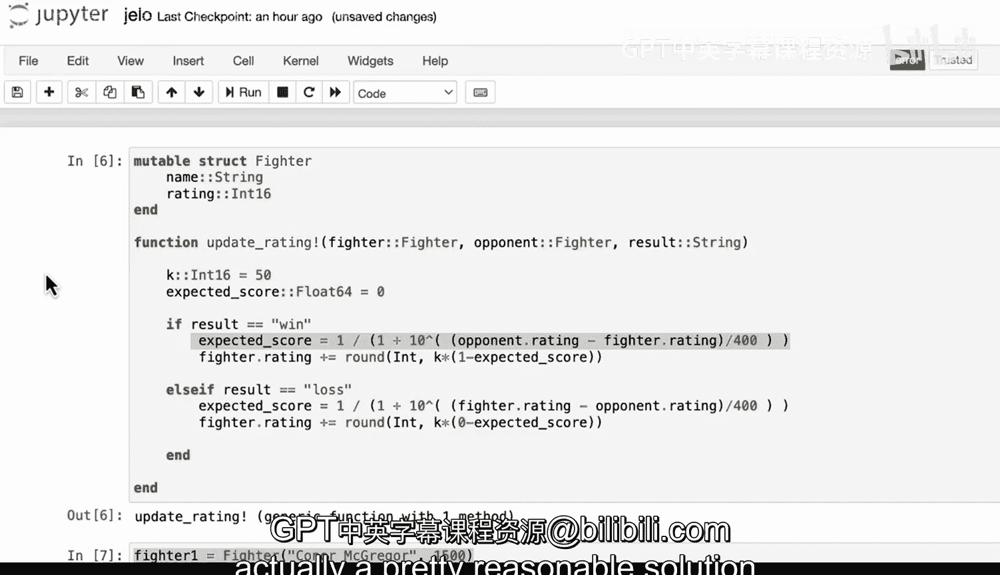

# 大型语言模型实践（高级数据工程、AWS、Databricks和本地LLM）：P160：59_03_05_Julia实现ELO算法


在本节课程中，我们将学习如何使用Julia编程语言来实现ELO评分算法，并模拟两位UFC（终极格斗冠军赛）选手的赛程强度计算。我们将通过具体的代码示例，理解Julia语言在数据科学应用中的一些高级特性。

## 概述

ELO算法是一种用于评估选手相对技能水平的评分系统，广泛应用于国际象棋、电子竞技和体育赛事中。本节我们将使用Julia语言构建一个简单的模拟程序，计算两位UFC选手比赛后的ELO评分变化。我们将重点关注Julia语言的结构体定义、函数编写以及其类型系统和可变性控制等特性。

## 定义选手结构体

首先，我们需要定义一个数据结构来表示选手。在Julia中，我们使用`struct`来创建自定义类型。

以下是定义选手结构体的代码：

```julia
mutable struct Fighter
    name::String
    rating::Float64
end
```

我们定义了一个名为`Fighter`的可变结构体。它包含两个字段：`name`（选手姓名，字符串类型）和`rating`（ELO评分，浮点数类型）。`mutable`关键字允许我们在后续程序中更新这个结构体的字段值（例如更新评分）。这是Julia语言一个精妙的安全特性，也是许多现代编程语言共有的特点。它默认情况下数据是不可变的，这提供了内置的安全机制，即使Julia是一种脚本语言，也具备这种能力。

## 实现评分更新函数

定义了数据结构后，我们需要一个函数来根据比赛结果更新选手的ELO评分。

上一节我们定义了选手的结构体，本节中我们来看看如何实现更新评分的逻辑。

以下是实现`update_rating`函数的代码：

```julia
function update_rating(fighter::Fighter, opponent::Fighter, result::String)::String
    k = 50
    expected_score = 1 / (1 + 10^((opponent.rating - fighter.rating) / 400))
    fighter.rating = fighter.rating + k * (parse(Int, result) - expected_score)
    return "Rating updated for $(fighter.name)"
end
```

这个函数名为`update_rating`。它接收三个参数：`fighter`（待更新评分的选手）、`opponent`（对手选手）和`result`（比赛结果，例如“1”代表胜利，“0”代表失败）。函数末尾的`::String`指明了函数的返回类型是字符串。

函数内部，我们首先定义了一个常数`k`（通常称为K因子），这里设为50，它决定了评分调整的幅度。接着，我们计算了`expected_score`（期望得分），这是ELO算法的核心公式之一，用于预测选手获胜的概率。最后，我们根据实际结果和期望得分的差值，使用ELO公式更新了`fighter`的评分。`parse(Int, result)`将字符串形式的结果转换为整数进行计算。

这个`update_rating`方法会改变（mutate）传入的`fighter`对象的评分值。让我们运行一下看看效果。

## 模拟比赛与评分更新

现在，我们有了结构体和更新函数，可以创建选手实例并模拟一场比赛了。

以下是初始化选手并进行评分计算的示例：

```julia
# 创建两位选手，初始评分相同
fighter1 = Fighter("Conor McGregor", 1500.0)
fighter2 = Fighter("Khabib Nurmagomedov", 1500.0)

println("赛前评分：")
println("$(fighter1.name): $(fighter1.rating)")
println("$(fighter2.name): $(fighter2.rating)")

# 假设fighter1（Conor McGregor）输掉了比赛（result = “0”）
update_result = update_rating(fighter1, fighter2, "0")

println("\n$(update_result)")
println("\n赛后评分：")
println("$(fighter1.name): $(fighter1.rating)")
println("$(fighter2.name): $(fighter2.rating)")
```

在比赛开始前，我们为每位选手分配了一个默认的ELO评分（例如1500分）。这样，我们可以基于这次初始交锋来衡量胜利或失败的权重。

运行代码后，我们可以看到，在比赛前，康纳·麦格雷戈和哈比布·努尔马戈梅多夫的评分是相等的。但当我们应用ELO计算后（该计算基于对手的竞争水平来衡量选手能力），情况发生了变化。比赛后，输掉比赛的选手康纳·麦格雷戈的ELO评分降低了，而他的对手哈比布·努尔马戈梅多夫的评分则升高了。

## Julia语言特性总结

通过这个简单的例子，我们可以看到Julia语言作为数据科学语言实际上非常精妙。

以下是一些值得注意的Julia语言特性：

1.  **可变与不可变结构体**：通过`mutable`关键字控制，默认不可变，增强了代码安全性。
2.  **类型系统**：函数和结构体可以指定参数和字段的类型，使代码意图更清晰，并能在编译期捕获一些错误。
3.  **简洁的语法**：代码可读性高，例如上面的函数定义清晰明了，很容易理解发生了什么。
4.  **适合交互式开发**：在Jupyter笔记本中使用Julia构建解决方案是一种非常合理的选择，便于快速原型设计和数据分析。

## 总结

本节课中我们一起学习了如何使用Julia语言实现ELO评分算法。我们从定义表示选手的可变结构体`Fighter`开始，然后实现了包含ELO核心公式的`update_rating`函数，最后模拟了一场UFC比赛并观察了评分的变化。通过这个实践，我们不仅理解了ELO算法的基本原理，也领略了Julia语言在类型安全、代码清晰度和交互式数据科学工作流方面的优势。在构建数据科学和机器学习解决方案时，Julia是一个强大而现代的工具。



