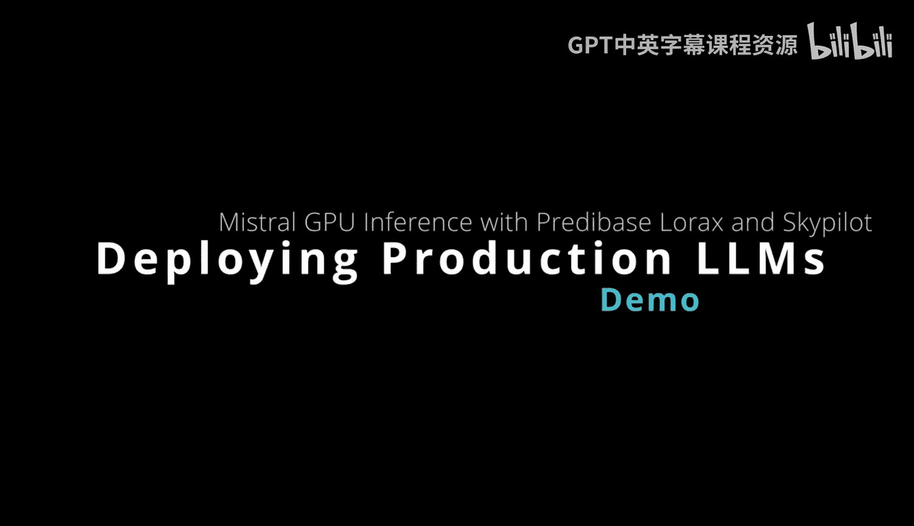
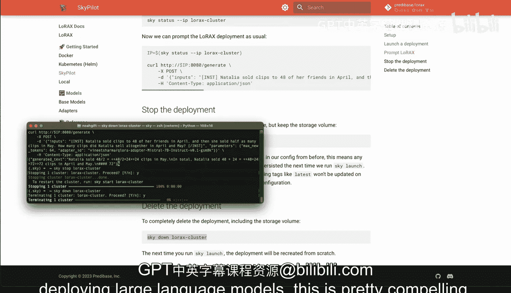

# 大型语言模型实践（高级数据工程、AWS、Databricks和本地LLM）：P161：60_03_02_Lorax与SkyPilot入门指南




## 概述

在本节课中，我们将要学习如何部署大型语言模型。我们将重点介绍两个工具：**Lorax**（一个高性能推理服务器）和**SkyPilot**（一个云部署框架）。通过结合使用它们，你可以轻松地在云端部署开源大语言模型，并在不需要时停止服务以节省成本。

---

## Lorax：一个简单高效的LLM部署方案

处理大型语言模型时，你面临的一个主要问题是如何部署它们。Lorax是解决这个问题的方案之一。

如果我们查看Perbase提供的文档，会发现它实际上非常简单。你可以运行一个包含基础大语言模型的容器，例如我们将要使用的`mistral`模型，然后选择GPU。这样，你就准备就绪了。文档中还提供了一些如何提示模型的示例。

这非常吸引人。Lorax的另一个优点是它使用Rust构建，具有出色的推理性能。

---

## 使用SkyPilot进行云端部署

我认为部署Lorax的一个更简单的方法是使用基于云的GPU。为此，我们可以使用SkyPilot。

我们访问SkyPilot，点击它，需要做的就是执行`pip install`安装，并确保环境准备就绪。接下来的步骤非常简单，因为你只需要粘贴一个YAML配置文件。

以下是Perbase团队提供的一个YAML配置示例，它展示了SkyPilot的强大之处：

```yaml
resources:
  cloud: aws
  accelerators: A10G:1
  disk_size: 1024
  ports: 8000
setup: |
  pip install lorax
run: |
  lorax serve --model-id mistralai/Mistral-7B-Instruct-v0.1 --port 8000
```

我喜欢Perbase的一点是，他们在YAML文件方面做了大量出色的工作。例如，微调也可以使用YAML文件。但看看这个部署配置，它非常清晰：你可以看到AWS云服务、加速器类型、端口等设置，以及要加载的模型。

在我看来，这已经非常完善了。如果你已经设置好了AWS密钥，接下来需要做的就是启动Lorax任务。

---

## 实战演示：部署与查询

我将切换到我的已配置环境中进行演示。一旦服务启动，你可以看到服务器正在运行并输出日志，我们甚至能看到HTTP请求。

接下来，让我们按照官方文档来查询这个服务。首先，我们需要获取服务的状态和IP地址。我们可以在另一个窗口执行以下命令：

```bash
sky status --ip lorax-cluster
```

执行后，我们可以看到集群的IP地址。接下来，我们看看如何发送提示。这很简单，实际上就是执行一个`curl`命令。我们将把获取到的IP地址填入命令中。

我们可以并排运行这两个过程：在一边观察服务器输出，在另一边运行查询代码。我只需要复制文档中的`curl`命令示例，然后粘贴执行。

```bash
curl -X POST http://<YOUR_IP>:8000/generate \
  -H "Content-Type: application/json" \
  -d '{"inputs": "请用Python写一个快速排序函数", "parameters": {"max_new_tokens": 100}}'
```

执行后，我们可以看到服务器收到了查询请求，并使用`mistral`模型生成了代码示例。

---

## 核心优势与成本控制

这个方案真正强大之处在于：我们获得了一个使用开源模型的高性能推理服务器。我们只需要一个基于YAML的配置就能完成部署。

更酷的是，当我们完成工作后，可以运行停止命令来关闭部署，这样就不会产生额外的费用。我们可以执行：

```bash
sky stop lorax-cluster
```

系统会询问是否确认，选择“是”即可。

---

## 总结

本节课中我们一起学习了如何部署大型语言模型。我认为，**Lorax** 结合 **SkyPilot** 是目前最引人注目的解决方案之一，尤其适用于部署开源大型语言模型。

我们看到了整个工作流程：从简单的YAML配置，到在云端一键启动高性能推理服务，再到方便地停止服务以控制成本。这对于考虑在生产环境中部署大语言模型的公司CTO或工程师来说，是一个非常具有吸引力的方案。在此，要向Perbase及其团队致敬，他们打造了一个令人印象深刻的工作流。



