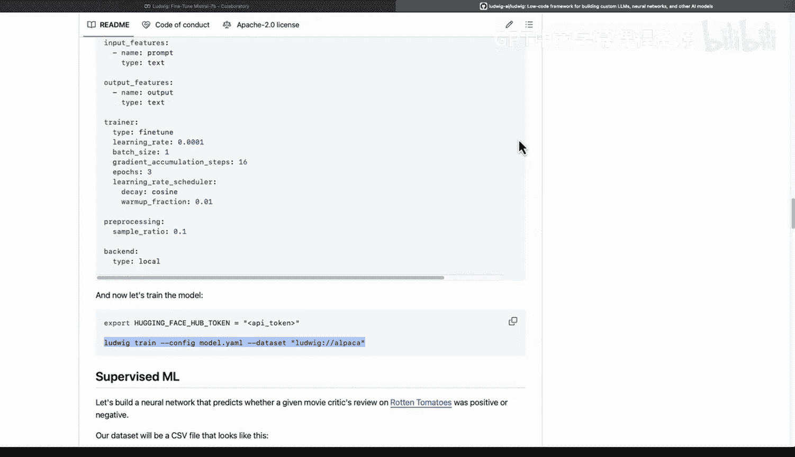
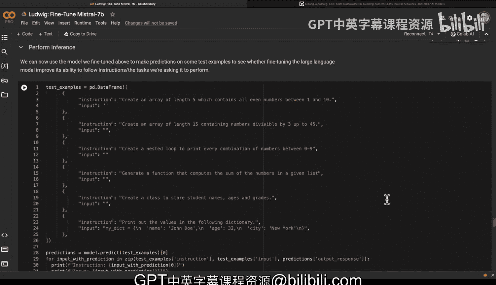

# 大型语言模型实践：P162：使用Ludwig微调Mistral-7B模型 🚀

在本节课中，我们将要学习如何使用Ludwig这一低代码框架来微调Mistral-7B大型语言模型。我们将了解其基于YAML配置文件的简洁工作流程，并演示如何在Colab Pro环境中执行微调任务。

---

Ludwig是一个用于大型语言模型的微调工具，它以低代码和配置驱动为特点，简化了模型训练过程。许多人对于训练大型语言模型并深入了解其生态系统非常感兴趣，而Ludwig是一个很好的选择。

上一节我们介绍了Ludwig的基本概念，本节中我们来看看它的具体特性和工作方式。

首先，Ludwig使用配置文件来定义训练任务，这是一个非常吸引人的特性。它提供了入门指南，例如针对当前热门的开源大模型Mistral进行微调的教程。其基于YAML的方法使得流程非常清晰，并且支持通过命令行直接进行训练。这使其具备了一些类似于DevOps工作流的特性，能够通过YAML文件简化操作。

---

现在，让我们看看如何在Colab Pro环境中使用Ludwig。Colab Pro是一个进行微调的不错选择，因为它提供了GPU访问。

以下是设置和运行环境的关键步骤：

1.  **选择运行时**：在Colab Pro中，可以访问包含充足RAM和磁盘空间的环境。
2.  **配置GPU**：通过运行时设置，可以切换不同类型的GPU。对于此类任务，一个性能良好的GPU就足够了，但也可以根据需要选择更高规格的GPU。

---

这个特定笔记本的目标是使用大型语言模型进行代码生成。数据集中包含英语指令和对应的代码。

以下是微调流程的核心步骤：

1.  **定义配置**：使用一个YAML文件来指定模型的输入、输出以及基础模型。例如，基础模型可以设置为`mistralai/Mistral-7B-v0.1`。
2.  **加载数据**：微调的核心在于使用自定义数据来改进已有模型。需要加载代码生成数据集，该数据集通常包含指令（input）和期望的代码（output）。
3.  **数据预处理**：在微调工作中，对数据进行一些处理是常规操作。
4.  **执行训练**：加载整个项目配置后，微调过程开始。训练过程中会输出进度和指标，并显示所使用的GPU类型。

使用Ludwig可能是执行微调最简单的方式之一。它提供的示例笔记本使得整个过程非常直观。对于想要尝试微调最新大型语言模型的人来说，这或许是最简单的入门途径。

---

本节课中我们一起学习了如何使用Ludwig框架微调Mistral-7B模型。我们了解了其基于YAML配置的低代码优势，并逐步讲解了在Colab Pro中从环境设置、数据准备到执行训练的全过程。Ludwig通过简化的流程，降低了大型语言模型微调的技术门槛。