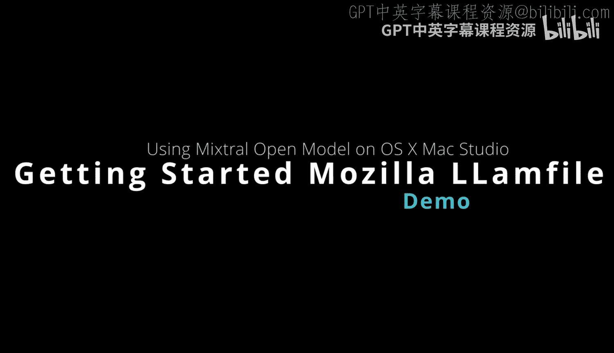
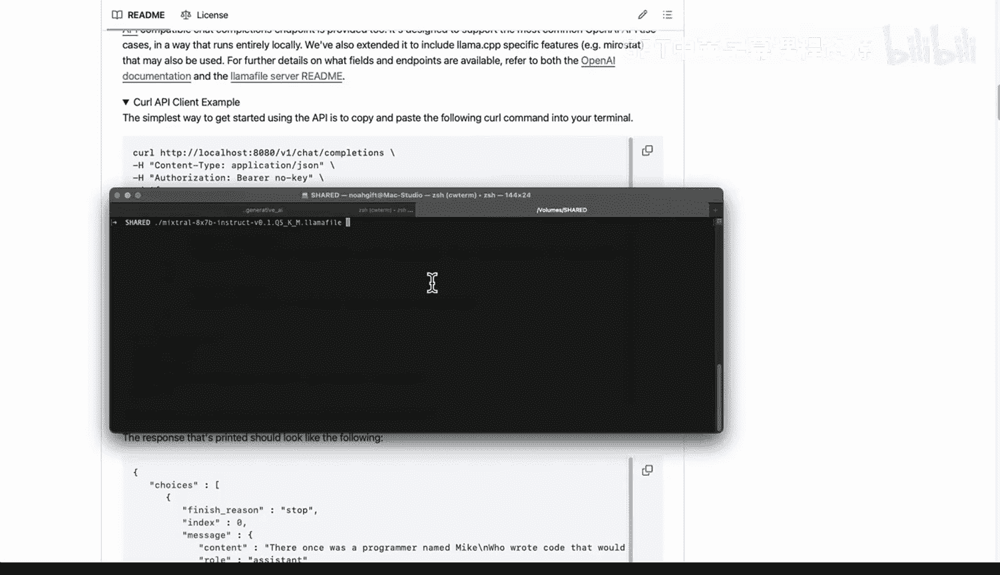
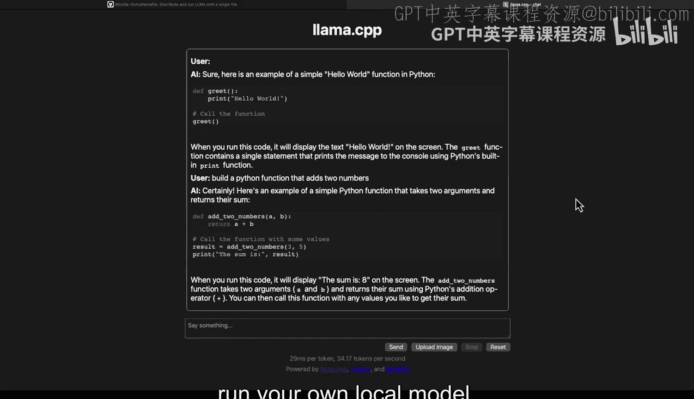
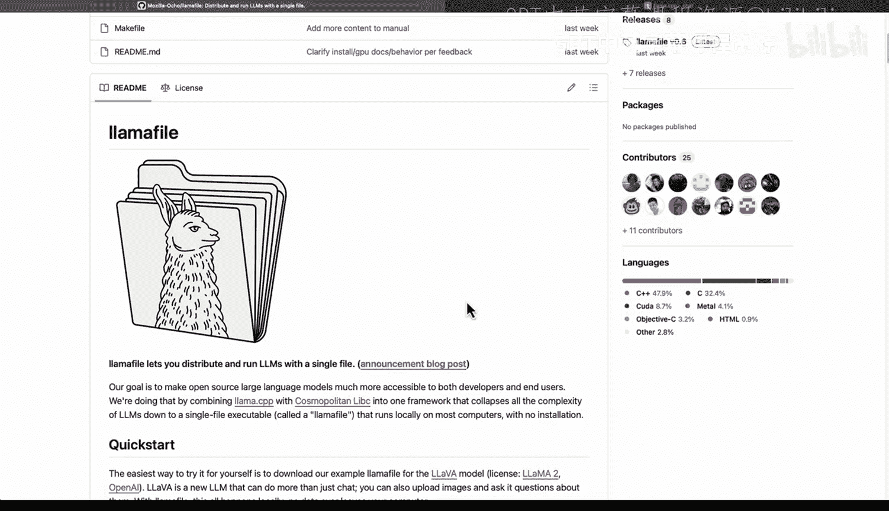

# 大型语言模型实践：P163：Llamafile入门教程 🚀



在本节课中，我们将学习如何使用Llamafile项目在本地运行大型语言模型。Llamafile由Mozilla开发，它可能是运行本地大语言模型最简单的方式。我们将了解其核心概念、优势以及具体的操作步骤。

---

## 项目概述与优势

许多人希望在本地运行大型语言模型，主要出于隐私考虑，并且如果使用自己的机器，它是免费的。Llamafile项目让你能够通过单个文件分发和运行LLM。

其核心在于使用了**Cosmopolitan Libc**库，能够将所有内容打包成一个名为`llamafile`的单一可执行文件。有趣的是，尽管名为Llamafile，但它并不绑定于任何特定的大语言模型。

本地运行模型主要有三大优势：
1.  **隐私性**：你的数据不会被发送到你不了解其数据政策的公司。
2.  **性能**：由于减少了网络延迟，性能通常优于调用外部API。
3.  **免费**：使用自己的硬件资源，无需支付API调用费用。

---

## 获取与运行模型

上一节我们介绍了Llamafile项目的优势，本节中我们来看看如何具体获取和运行一个模型。

Llamafile支持多种模型。其中一个比较有趣的模型是**Mistral**。它是一个性能较好的开源模型，采用Apache 2.0许可证。模型文件大约为30GB，虽然下载体积较大，但运行起来非常简单。

以下是运行模型的基本步骤：
1.  下载你选择的模型文件（例如Mistral的llamafile）。
2.  在终端中，进入文件所在目录。
3.  通过命令行执行该文件。

运行命令非常简单，只需在终端中输入：
```bash
./llamafile文件名
```
执行后，本地服务就会启动。你可以看到类似`llama.cpp`正在本地运行的提示。

---

## 使用方式：Web界面与API

模型运行起来后，我们可以通过多种方式与它交互。Llamafile提供了便捷的Web界面，同时也提供了兼容OpenAI的API。



启动服务后，通常可以在浏览器中访问一个本地地址（如 `http://localhost:8080`）来打开Web聊天界面。在界面中，你可以直接与模型对话。

例如，你可以输入以下指令：
```
请用Python写一个“Hello, World”函数。
```
模型会利用你本地的GPU资源（如果可用）快速生成响应代码。

更强大的是，Llamafile提供了一个**Python API**，它模仿了OpenAI的API格式。这意味着你可以轻松地将使用商业闭源模型（如GPT）的代码，迁移到使用这个本地开源模型上，只需更改API的端点地址即可。

---

## 实践示例与总结

让我们通过一个具体例子来巩固所学。假设我们已经在本地运行了Mistral模型的Llamafile。

首先，我们通过Web界面重置对话状态，然后将助手名称设置为“AI”。接着，我们可以要求它编写一个Python函数。





例如，输入请求：
```
构建一个将两个数字相加的Python函数。
```
模型会生成相应的代码。你可以继续提出更多请求，比如让它解释代码或进行修改。


本节课中我们一起学习了Llamafile的核心用法。总结来说，Llamafile使得在本地运行大语言模型变得非常直接。它的主要优点在于保护隐私、提升响应速度以及节省成本。这是一个非常值得尝试的项目，建议你亲自下载体验，探索其更多功能。