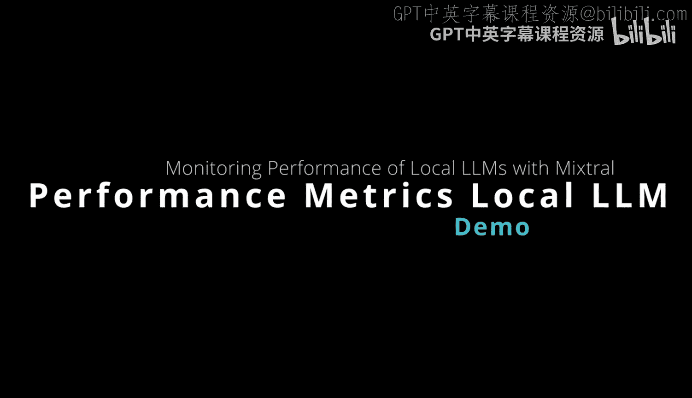
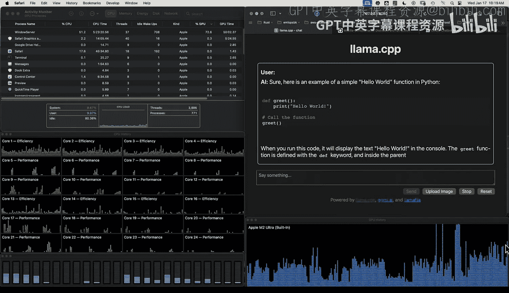

# 大型语言模型实践：P164：使用Llamafile监控本地系统指标 🖥️📊

在本节课中，我们将学习如何使用Llamafile工具来监控本地运行大型语言模型时的系统指标，特别是GPU的使用情况。通过观察这些指标，我们可以评估本地模型的性能表现。

## 监控系统指标的意义

上一节我们介绍了Llamafile的基本概念，本节中我们来看看如何利用它来监控系统性能。首先，我们可以从模型的Elo评分来了解其实际表现。这个评分反映了用户对模型能力的感知。

从评分可以看出，一些混合模型的表现与商业模型相差无几。这表明，只要本地模型的性能足够好，就会有大量用户有兴趣在本地运行它。那么，本地模型的性能究竟如何呢？让我们通过Llamafile项目来一探究竟。

## 观察Llamafile的运行状态

目前，我已在网页浏览器窗口中运行了Llamafile，并且可以在这里看到所有的监控指标。这些指标让我们能够清晰地了解系统正在发生什么。

以下是需要关注的关键指标：
*   **GPU时间**：这是首要关注的指标之一。
*   **所有核心**：观察所有处理核心的利用率。
*   **M2 Ultra GPU**：以我使用的配备60个GPU核心的M2 Ultra为例，得益于Llamafile和Llama.cpp开发者的出色工作，它能够在Mac操作系统上充分利用所有这些GPU核心。

接下来，让我们具体查看一下。如果我向下滚动，可以看到一个Python函数的示例，我们将观察在此期间GPU的活动情况。

## 实际性能测试与分析

我们会看到GPU使用率在这里出现峰值，同时也能观察到GPU确实被`dot a1.9`这个进程所调用。

实际上，我们可以看到它再次运行。我们可以进行另一个测试，例如，要求模型“给我一个Python中递归函数的例子”。然后观察它的表现。

模型给出了一个Python递归函数的例子，同时我们也能看到，它确实使用了GPU。由此可见，其性能实际上非常出色。从历史GPU数据来看，它能够有效地利用硬件资源。

对于正在使用商业模型的用户来说，商业模型固然有其价值，但这无疑引发了一个长期问题：如果你可以下载一个性能足够好、表现惊人且完全免费的模型，那么长期来看，为什么还要使用商业模型呢？

因此，在你尝试使用Llamafile这类本地工具，或者考虑为大型语言模型签订商业协议之前，首先应该审视一下本地模型的真实性能。仔细观察各项系统指标，你会发现它的表现令人印象深刻。

## 课程总结

本节课中我们一起学习了如何使用Llamafile监控本地运行LLM时的系统指标。我们观察了GPU利用率等关键数据，并通过实际测试验证了本地模型能够有效利用硬件资源（如M2 Ultra的60个GPU核心），展现出足以媲美商业模型的性能。这为我们评估是否选择本地部署提供了重要的实践依据。