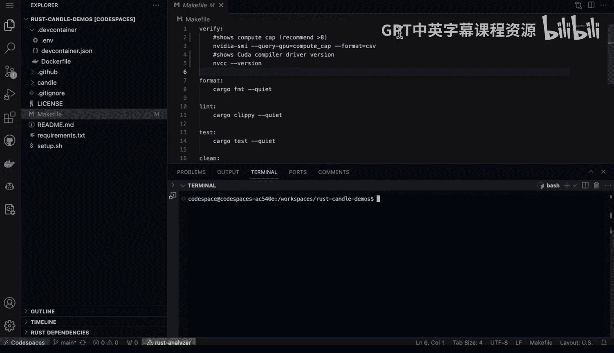
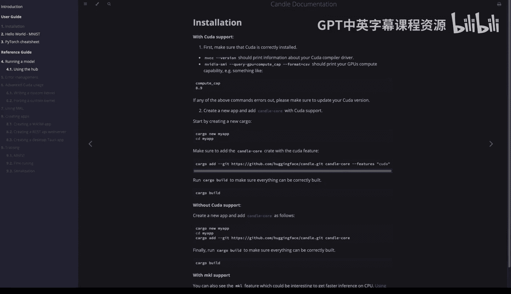
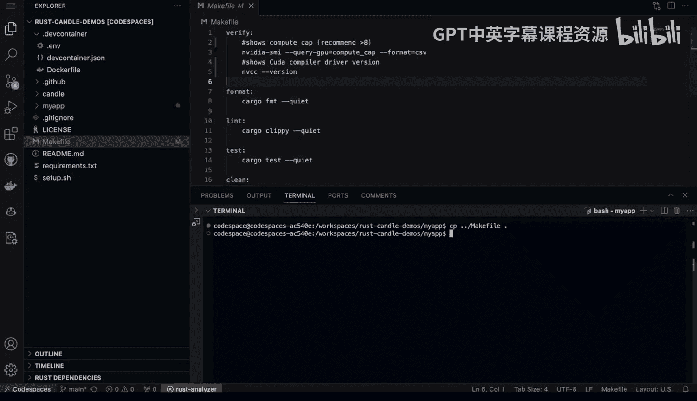
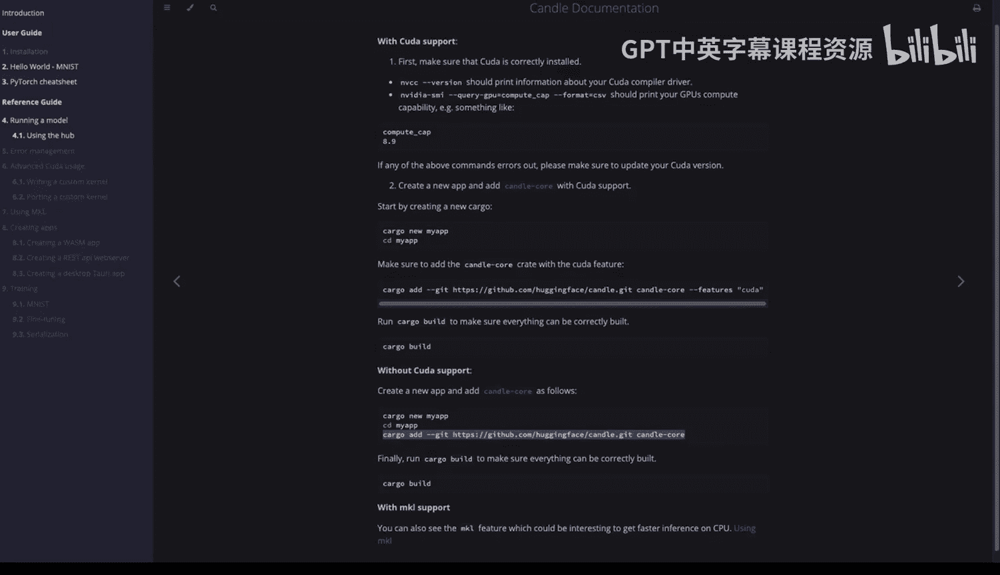
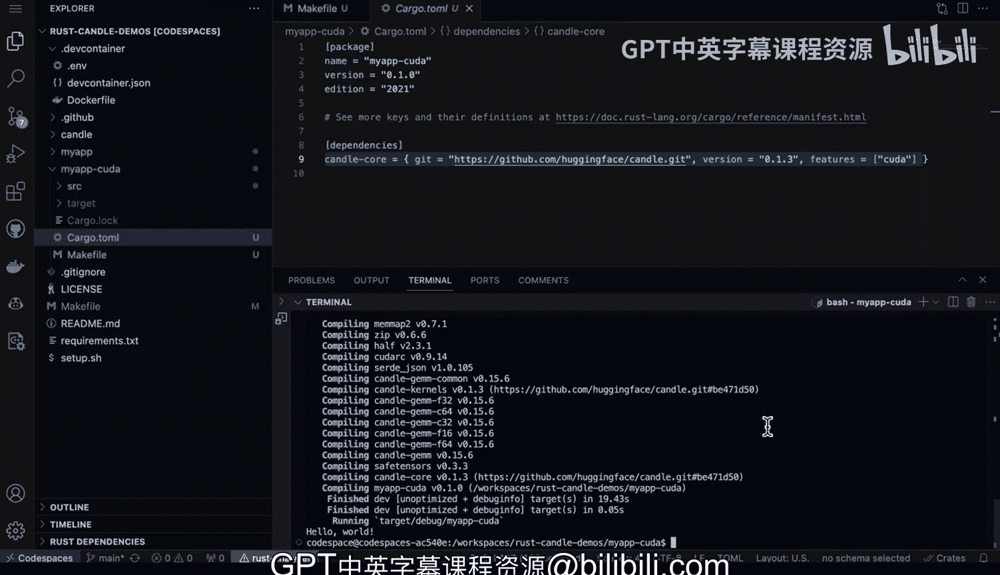

# 大型语言模型实践（高级数据工程、AWS、Databricks和本地LLM）：P165：64_04_04_Candle框架Hello World示例 🚀

在本节课中，我们将学习如何使用Rust的Candle框架创建一个简单的“Hello World”项目。我们将涵盖从环境设置到项目构建的完整流程，包括如何添加GPU（CUDA）支持。

## 概述

我们将分步演示如何在配置好的开发环境中，使用Cargo工具初始化一个Rust项目，并集成Candle框架。课程将展示如何构建一个基础版本的项目，以及如何通过添加CUDA功能来启用GPU加速。

## 环境准备与验证

首先，我们有一个已配置好GPU开发和Rust环境的Github Codespace。

我们可以输入 `rustc --version` 来验证Rust是否已安装。

我们也可以输入 `make verify` 命令。这个命令会显示计算能力，并确认CUDA编译器驱动已就位。

## 创建基础Rust项目

接下来，我将按照Hugging Face Rust Candle的文档进行操作。首先，使用 `cargo new my_app` 命令创建一个新的Rust项目。

创建完成后，我们进入项目目录 `my_app`。

我喜欢将我自己的Makefile复制到项目中。这样我就可以使用所有预设的命令和快捷方式。

此时，我们可以直接运行 `cargo build` 来构建项目，使其准备就绪。

## 构建无GPU支持的项目

首先，让我们构建一个不支持GPU的版本。我们直接运行 `cargo` 命令。

我们只需要输入 `cargo add candle-core`，它就会为我们添加Candle接口。

添加完成后，如果我们查看源代码，会看到一个 `main.rs` 文件。

文件内容很简单，只是打印“Hello, world!”。这主要是为了验证安装是否成功。

然后，我们可以输入 `make build` 来构建项目，因为我需要将这个命令整合到Makefile中。

我们运行 `make build`，它实际上会执行 `cargo build`。

构建成功后，我们还可以运行 `make run` 来验证一切是否正常工作。

至此，基础安装已成功完成。

## 创建支持CUDA的项目

现在，让我们再创建一个项目。这次我们将添加CUDA支持。

我们输入 `cargo new my_cuda_app` 创建一个新项目。

然后进入 `my_cuda_app` 目录，并再次复制Makefile，为项目提供一个便捷的脚手架。

唯一的区别是，我们需要添加CUDA功能。这操作起来非常直接。

我们输入命令添加该功能。

现在，我已经成功添加了名为 `cuda` 的特性。

如果我们查看这个项目的源代码，并检查 `Cargo.toml` 文件，会看到 `candle-core` 依赖项后面带有 `features = [“cuda”]` 的标记。

为了快速验证，我可以直接运行 `cargo build`，甚至可以直接运行 `cargo run` 来一次性完成构建和运行。这将实际验证CUDA是否正常工作。

至此，所有设置均已完成。

## 总结

本节课中，我们一起学习了Candle框架的入门实践。我们首先验证了开发环境，然后创建了一个基础的Rust项目并集成了Candle框架。接着，我们构建并运行了项目以验证安装。最后，我们创建了另一个项目，并通过在 `Cargo.toml` 中添加 `features = [“cuda”]` 为其启用了GPU加速支持。整个过程展示了使用Candle进行本地LLM开发的基本设置流程。