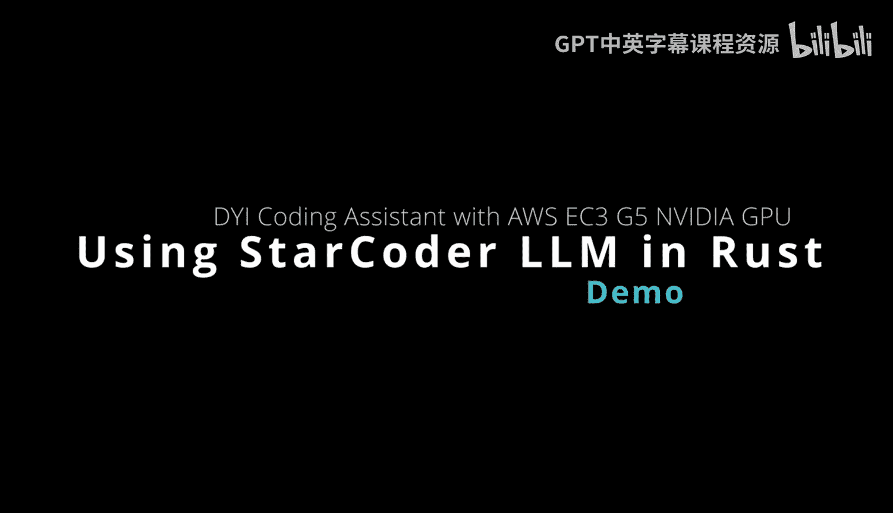
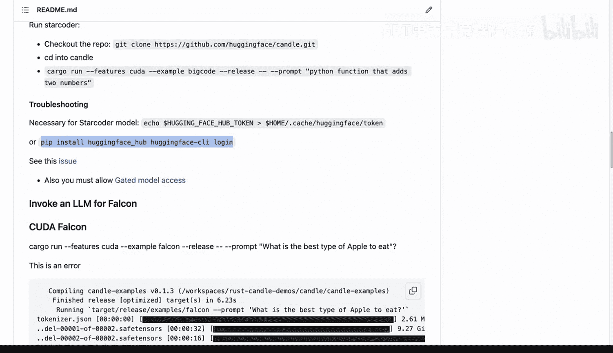
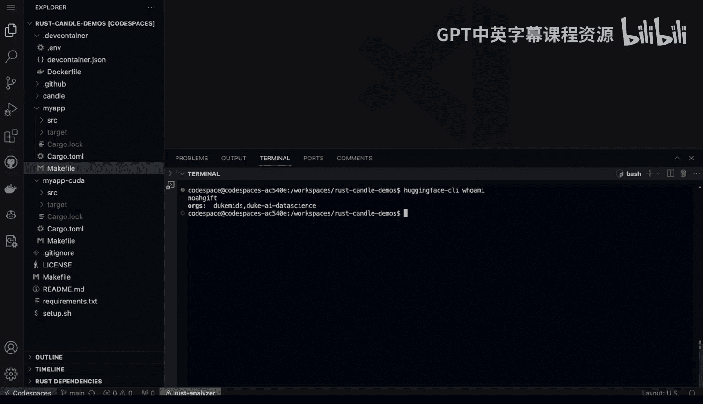
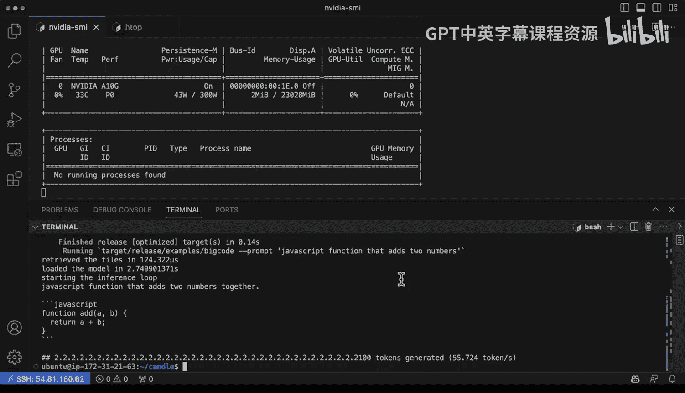

# 大型语言模型实践（高级数据工程、AWS、Databricks和本地LLM）：P166：探索StarCoder-Rust实现 🚀



在本节课中，我们将要学习如何探索和运行一个名为StarCoder的开源代码生成模型，并了解如何利用Rust语言和Hugging Face生态系统在本地环境中高效地使用它。

## 概述

StarCoder是一个开源的大型语言模型，专门用于代码生成。它拥有155亿参数，并在涵盖80种编程语言的“The Stack”数据集上进行训练。与Copilot等模型类似，但StarCoder是完全开源的，旨在促进生成式AI的民主化，而非仅由风险投资家掌控。

## StarCoder模型简介

上一节我们介绍了StarCoder的基本定位，本节中我们来看看它的具体特点。



StarCoder是一个专注于代码生成的专用LLM。它由Hugging Face社区通过开放科学协作开发，旨在向研究人员和开发者发布数据、模型和实验成果。其核心优势在于开源和可访问性。

以下是该模型的一些关键参数：
*   **参数量**：**155亿**。
*   **训练数据**：基于包含80种编程语言的“The Stack”数据集。
*   **性质**：完全开源。



## 环境准备与身份验证

了解了模型的基本信息后，我们需要准备运行环境。我们将使用一个基于Rust的极简机器学习推理项目——Hugging Face Candle来运行StarCoder。

首先，需要安装必要的工具并进行身份验证。

以下是设置步骤：
1.  安装Hugging Face Hub工具包：`pip install huggingface-hub`。
2.  在终端中登录Hugging Face账户：执行 `huggingface-cli login` 命令。
3.  验证登录状态：运行 `huggingface-cli whoami`，若显示用户名则表示认证成功。

为了获得最佳性能，本教程将在一个配备了AWS G5新一代GPU的远程Visual Studio Code环境中进行操作。在该环境中，我们可以使用 `nvidia-smi -l 1` 命令循环监控GPU的使用情况。

## 运行StarCoder模型进行代码生成

环境准备就绪后，现在我们来实际运行StarCoder模型并生成代码。

我们将通过一个Rust项目来执行模型。关键命令是 `cargo run`，但需要启用CUDA特性以利用GPU加速，从而获得优化性能。命令结构如下：
```bash
cargo run --features cuda --example bigcode --prompt “编写一个[Rust/Python/Ruby]函数，实现两个数字相加”
```
执行此命令的过程是：首先检索并加载模型（这大约需要2秒，是主要的耗时环节），然后启动推理循环。在推理过程中，可以观察到GPU使用率显著上升。

模型能够根据不同的编程语言提示，生成相应的代码建议。例如：
*   对于“Rust函数”，它会生成Rust代码。
*   对于“Python函数”，它会生成Python代码。
*   对于“Ruby函数”，它会生成Ruby代码。

生成速度很快，文件检索在微秒级完成，推理本身也非常迅速。这展示了利用Rust和Hugging Face生态系统构建开源编码助手的巨大潜力。

## 总结



本节课中我们一起学习了如何探索和运行开源的StarCoder代码生成模型。我们了解了它的开源特性和技术参数，完成了Hugging Face环境设置与身份验证，并最终在支持CUDA的GPU环境中，使用Rust项目成功调用了模型，生成了不同编程语言的代码片段。这个过程证明了基于开源工具和模型构建个人编码辅助工具的可行性与高效性。