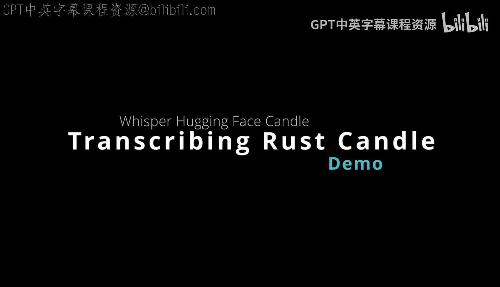
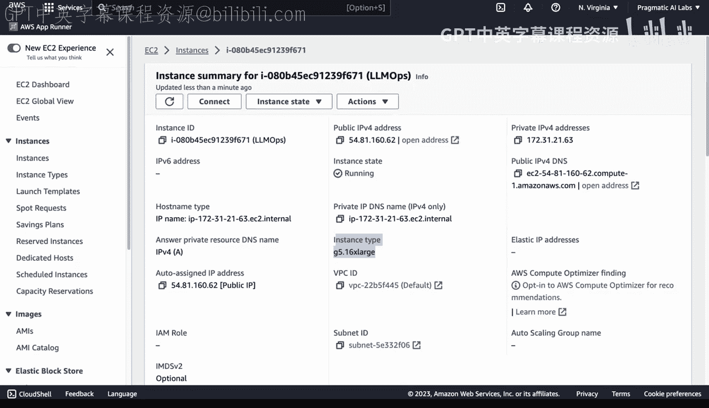
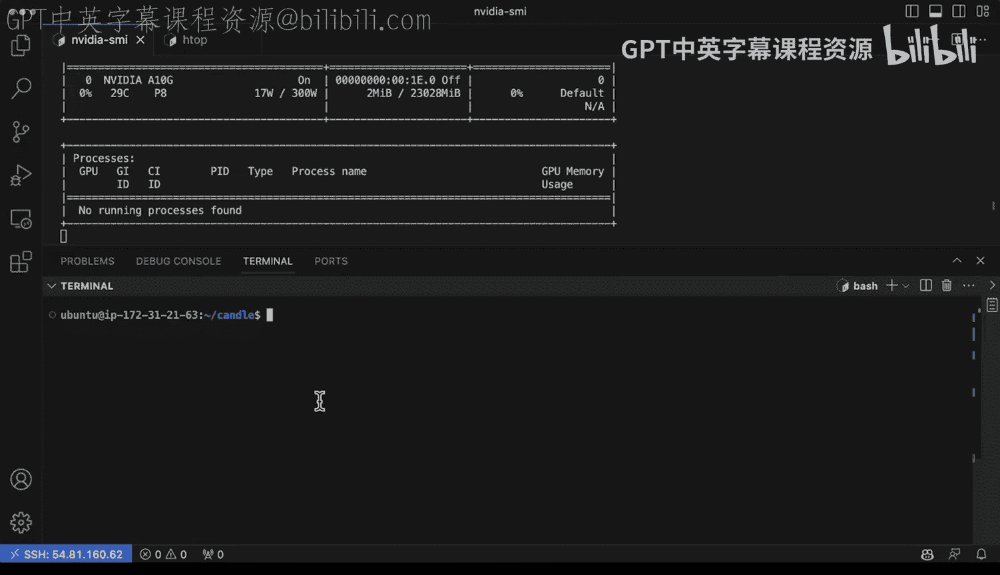
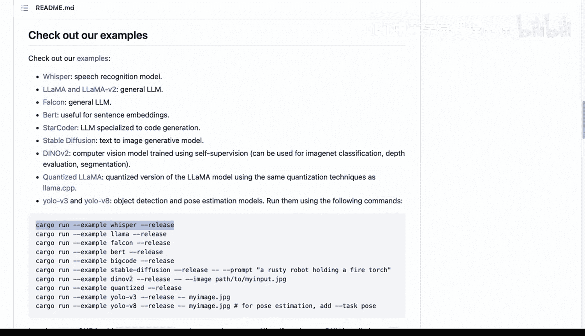
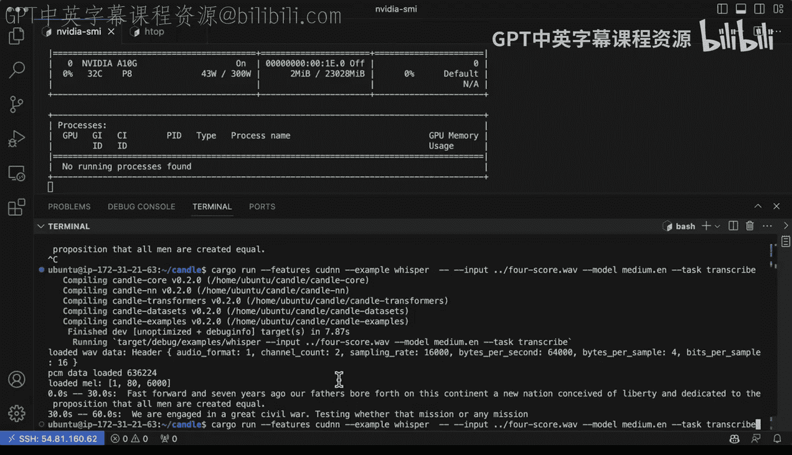

# 大型语言模型实践（高级数据工程、AWS、Databricks和本地LLM）：P167：使用Whisper-Candle进行语音转录 🎤



在本节课中，我们将要学习如何使用Whisper模型和Candle框架进行自动语音识别。我们将从基本概念开始，逐步深入到如何在实际环境中配置和运行一个语音转录任务。

自动语音识别领域的一个新兴方向是使用预训练模型。Whisper是一个无需微调即可使用的优秀示例。你可以查看其不同规模的参数配置，例如中等模型可能包含7.69亿个参数，而大型模型参数更多。使用此类工具时，关键问题是如何运行它。

## 环境与框架介绍 🛠️

上一节我们介绍了Whisper模型，本节中我们来看看运行它的框架。幸运的是，Hugging Face的Candle框架提供了一个极简且高性能的解决方案，它包含GPU支持。框架中甚至提供了使用Whisper的示例代码。

为了理解其工作原理，让我们深入查看一下源代码。查看`main.rs`文件，会发现它使用了`clap`命令行工具解析器。我们可以查看其中定义的常量参数和可传入的参数。通过研究代码，我们可以开始探索这个新兴工具。

## 配置运行环境 💻



了解了框架后，我们需要一个合适的运行环境。建议使用配备G5实例类型的EC2实例，这些实例搭载了较新的NVIDIA GPU。例如，一个拥有64个核心和高速GPU的强大实例。接下来，我们将通过Visual Studio Code Remote进入这个环境进行操作。

以下是检查环境是否就绪的步骤：
*   在终端中运行 `nvidia-smi` 命令，可以查看GPU状态，确认环境准备完成。

## 运行示例与性能优化 ⚡





环境就绪后，我们首先通过一个示例来测试Candle与Whisper的接口。框架中提供了一个示例，我们可以使用以下命令运行：

```bash
cargo run --example whisper
```

首次运行可能会提示在CPU上运行，速度仍然很快，并且会下载一个示例音频文件。这没有问题。

但我们可以做得更好，通过启用GPU特性来加速计算。以下是优化步骤：

1.  **启用CUDA支持**：在命令中添加 `--features cuda` 参数，允许程序使用GPU进行计算。编译时可以看到GPU利用率（例如达到48%），这显著提升了性能。
2.  **启用cuDNN优化**：进一步添加 `--features cudnn` 参数。cuDNN是针对神经网络操作的CUDA加速库，能进行更深度的优化，使推理速度更快、效率更高。

## 处理自定义音频文件 🎵

运行基础示例后，我们来看看如何处理自定义格式和文件。假设在上一级目录中有一些音频文件（如WAV格式），我们可以通过传递自定义参数来运行转录任务。

以下是一个完整的命令示例，它结合了性能优化和自定义输入：

```bash
cargo run --profile release --features cuda,cudnn --example whisper -- --input ../four_score.wav --model medium --language en --task transcribe
```

这个命令会：
*   以发布模式编译，优化性能。
*   启用CUDA和cuDNN特性以利用GPU。
*   指定输入音频文件路径（`../four_score.wav`）。
*   指定使用中等规模的英文模型（`medium`）。
*   指定任务为转录（`transcribe`）。

首次编译和运行可能需要一些时间。如果在CPU上运行感觉较慢，我们可以在强大的GPU机器上启用所有优化特性（包括移除调试信息）再次运行。此时观察GPU利用率，可能会达到70%左右，实现非常快速的推理。

## 实际应用场景 🌐



这种高效能的转录流程非常适合实际生产场景。例如，你可以使用AWS Batch服务启动一个计算集群，然后利用此方法转录海量音频数据，为其他数据处理系统提供输入。

本节课中我们一起学习了如何利用Whisper模型和Candle框架构建高效的自动语音识别流程。我们从环境配置开始，经历了运行示例、启用GPU加速、优化性能，最终实现了对自定义音频文件的转录。这套方法为处理大规模语音数据提供了强大的本地化解决方案。