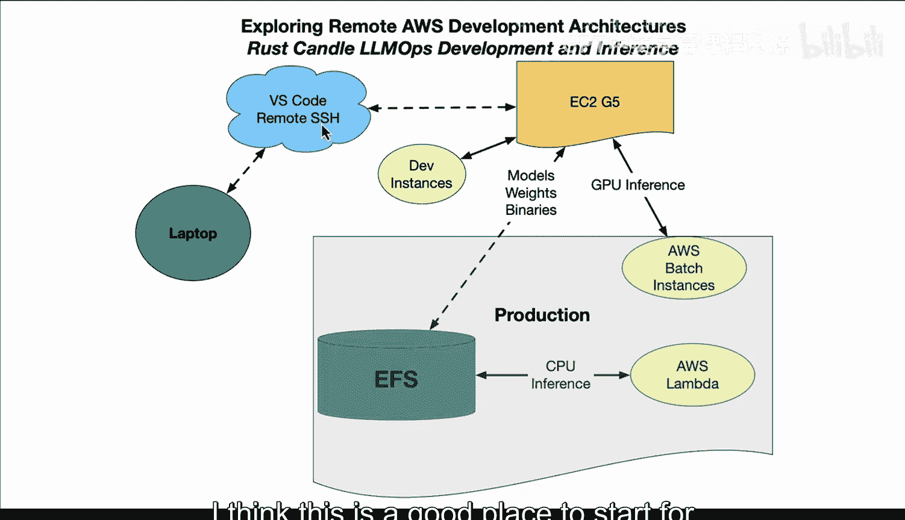

# 大型语言模型实践（高级数据工程、AWS、Databricks和本地LLM）：P168：67_04_07：探索AWS远程开发环境 🚀

在本节课中，我们将学习如何利用AWS构建一个基于Rust和Hugging Face Candle库的异步开发与生产工作流。我们将重点探讨如何通过远程开发环境高效、低成本地进行大型语言模型的开发与部署。

## 开发环境配置 💻

上一节我们介绍了课程背景，本节中我们来看看如何配置一个强大的云端开发环境。

首先，你可以使用一个EC2 G5实例。这个实例的优势在于它具备执行现代GPU推理任务的能力。此外，你还可以使用Spot实例来节省成本。在开发阶段，你可以随时停止和启动这个实例。

你可以通过Visual Studio Code Remote连接到这个实例，这是一种非常高效的开发方式。你只需要安装相应的插件，你的笔记本电脑就可以访问这个强大的云端环境。这意味着你可以将代码开发工作转移到基于云的强大环境中，并按使用量付费，而无需购买昂贵的硬件，例如一台价值4万美元的GPU。

## 生产环境部署与数据管理 ⚙️

了解了开发环境后，我们来看看如何将其与生产环境优雅地结合。

以下是实现开发与生产协同的关键点：

*   **共享存储**：你可以使用EFS进行协同开发。EFS的挂载点可以连接到你的开发机器，同时，这个相同的挂载点也可以用于生产环境。
*   **模型与权重管理**：你可以将庞大的模型和权重文件（数据量可能达到数十GB）下载到EFS中。这个位置可以作为将数据准备并推送到生产环境的暂存区。
*   **高效部署**：当你向AWS Batch部署任务时，它可以自动配置EC2 G5实例。这样，你就可以以一种非常高效、优雅且低成本的方式，在这些强大的GPU上执行基于Rust的现代推理任务。你不需要依赖Notebook，也不需要Python，可以纯粹使用Rust来完成。

## 架构扩展与成本优化 💡

现在，让我们思考一下这个架构的更多可能性。

另一个需要考虑的方面是，如果你将代码编译成同时兼容CPU的目标。那么你的AWS Lambda函数可以直接从EFS读取这个二进制文件，并同样将其作为生产实例提供服务。因此，我认为对于LLM Ops和MLOps而言，这是一个非常令人兴奋的、新兴的Rust技术栈故事。

这真正意味着你可以尝试新事物、新想法，并不断追求效率。对于许多希望部署LLM服务的公司来说，这种特定的架构是一个很好的起点。

## 总结 📝

本节课中我们一起学习了如何利用AWS EC2 G5实例和EFS构建一个远程开发工作流。我们探讨了如何通过VS Code Remote进行高效开发，如何利用EFS在开发与生产环境间共享数据和模型，以及如何通过AWS Batch和Lambda实现低成本、高效率的Rust推理服务部署。这套架构为追求效率与创新的LLM运维提供了强大的实践基础。