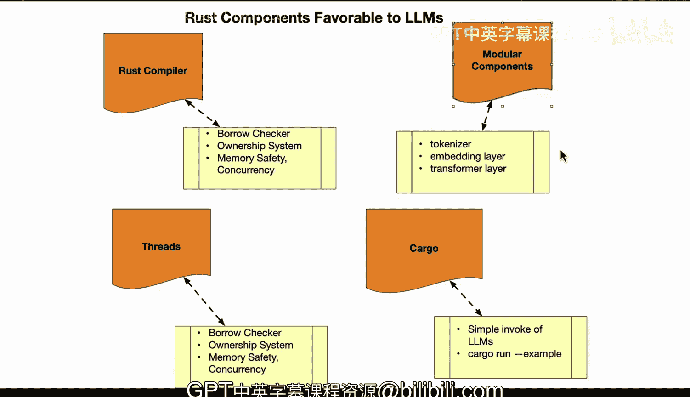

# 大型语言模型实践（高级数据工程、AWS、Databricks和本地LLM）：P169：68_04_01：LLM开发中的Rust应用


在本节课中，我们将要学习Rust编程语言在大型语言模型开发中的应用。我们将探讨Rust如何通过其独特的内存安全特性、模块化设计以及强大的工具链，为构建高性能、可靠的LLM组件提供支持。

## Rust组件在LLM中的优势 🛡️

Rust组件非常适合用于大型语言模型。让我们逐步讨论这些特定的组件。

## 编译器与内存安全 🔒

在Rust编译器中，借用检查器可以防止数据竞争和不安全的内存访问错误。其所有权系统能够在对象离开作用域时自动释放内存，因此无需手动管理内存。编译时检查会在代码部署前发现错误，确保您在模块化组件方面拥有一个非常健壮的大型语言模型部署。

## 模块化组件设计 🧩

接下来，我们来看看LLM中的核心处理组件。以下是这些组件的功能：

*   **分词器**：将文本转换为用于词嵌入的数值ID。
*   **嵌入层**：将单词映射到高维密集向量。
*   **变换层**：使用神经网络模型处理文本。

这种模块化设计允许Rust的特性来混合和匹配特定的组件。

## 并发与并行处理 ⚡

上一节我们介绍了核心处理组件，本节中我们来看看Rust如何利用现代多核CPU进行高效计算。轻量级的Rust线程允许并发和并行执行。通道可以安全地在线程之间传递数据，而没有数据竞争的风险。这使得能够利用多核CPU来实现性能和可扩展性。

## Cargo包管理器 📦

在性能之外，项目的依赖管理和代码共享同样重要。Cargo是Rust内置的包管理器，它将管理应用程序的依赖关系。庞大的包生态系统允许您扩展功能，例如命令行工具或Web框架。您还可以轻松地在项目和团队之间共享代码，并且它强制执行语义化版本控制以确保稳定性。因此，这是调用大型语言模型的一种非常简便的方法，我们在Rust Candle中可以看到这一点。

您只需要运行以下命令：
```bash
cargo run --example
```


## 总结 📝



本节课中我们一起学习了Rust在大型语言模型开发中的关键应用。我们探讨了Rust编译器如何通过借用检查器和所有权系统确保内存安全与代码健壮性，了解了分词器、嵌入层和变换层等模块化组件的协作方式，认识了Rust轻量级线程和通道如何实现安全高效的并发处理，最后介绍了Cargo包管理器在依赖管理、生态扩展和团队协作中的重要作用。这些特性共同使Rust成为构建高性能、可靠LLM系统的有力工具。