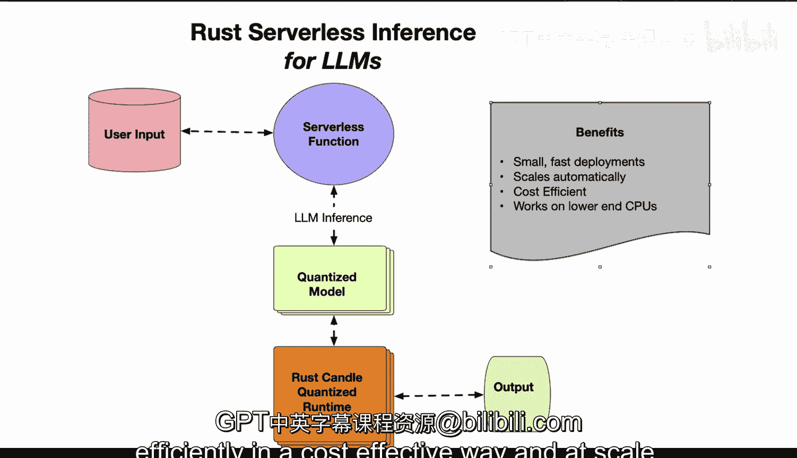

# 大型语言模型实践（高级数据工程、AWS、Databricks和本地LLM）：P170：69_04_02_无服务器推理 🚀

在本节课中，我们将要学习如何为大型语言模型构建基于Rust的无服务器推理架构。我们将探讨其核心优势、工作原理以及如何实现成本效益和高可扩展性。

基于Rust的大型语言模型无服务器推理是一个令人兴奋的新兴领域，它展现出许多值得关注的新特性。

观察上图所示的架构图，我们可以发现，部署机器学习模型以实现可扩展性和成本效益，并利用无服务器架构进行推理是可行的。

## 架构概述与工作流程

上一节我们介绍了无服务器推理的基本概念，本节中我们来看看其具体的工作流程。

用户输入可以包含文本、图像或其他类型的数据，这些数据将被传递到例如AWS Lambda这样的无服务器函数中。

该函数内部将包含模型本身，以及用于运行量化模型的Rust Candle运行时。

## 模型量化：缩小尺寸与提升速度

接下来，我们来深入了解模型量化的概念。模型本身将被量化，这意味着它将使用降低精度的整数数据类型，而不是32位浮点数。

量化操作可以用以下公式表示：
**量化值 = 四舍五入(浮点值 / 缩放因子) + 零点偏移**

这可以使模型大小缩小多达四倍。同时，Candle运行时提供了类似Llama.cpp的优化操作，能够高效地运行量化模型。

## 无服务器函数的优势

了解了模型的处理方式后，我们来看看无服务器函数带来的核心优势。

无服务器函数能够自动扩展以处理任意数量的请求流量，确保快速的响应时间。

函数也可以缩容至零。因此，您只需为实际使用的资源付费。模型体积小且没有闲置资源，这使得该方案极具成本效益。

无服务器计费基于调用次数，而非持续运行的高昂GPU。量化后的整数模型运行速度更快，甚至在低端和移动CPU上也能良好运行，这真正开启了新的应用场景。

对于许多模型而言，不再需要那些昂贵的GPU。输出结果也能非常快速地返回给用户，自动扩缩容机制将延迟降至最低。

## 总结

本节课中我们一起学习了基于Rust和量化技术的大型语言模型无服务器推理架构。该架构使您能够高效、经济且大规模地将先进的机器学习模型部署到生产环境中，通过自动扩缩容、按需付费和优化的量化运行时，实现了高性能与低成本的结合。

