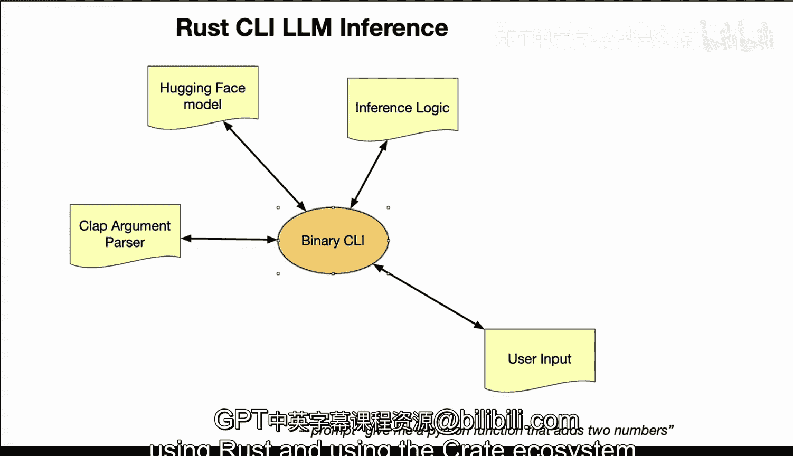

# 大型语言模型实践：P171：使用Rust CLI实现推理

## 概述
在本节课中，我们将学习如何使用Rust编程语言构建一个命令行界面（CLI）工具，该工具能够加载Hugging Face上的预训练Transformer模型，并对用户输入的文本执行推理任务。我们将了解从模型下载到最终结果输出的完整流程。

## 构建与运行Rust CLI推理工具的流程

上一节我们概述了本课程的目标，本节中我们来看看构建一个Rust CLI推理工具的具体步骤。下图展示了从开始到结束的完整工作流。

以下是构建流程的详细步骤：

1.  **从Hugging Face Hub下载模型**
    流程始于从Hugging Face Hub下载预训练的Transformer模型。你可以选择使用像BERT或GPT-2这样的模型。

2.  **在Rust中加载模型**
    下载模型后，需要在Rust代码中加载它。这可以通过`rust-bert`或`transformers` crate实现，它们为Hugging Face模型提供了Rust绑定。另一个选择是使用`rust-candle`接口。这一步使得模型能够在Rust代码中用于推理。

3.  **构建命令行界面（CLI）**
    接下来是构建CLI。你可以使用`clap` crate来轻松解析命令行参数。这允许用户向CLI提供灵活的输入，你甚至可以定制提示词。例如，如果你想为每个提示词添加一个固定的前言以获得更好的结果，你可以将此逻辑加入代码中。

4.  **实现推理逻辑**
    CLI构建完成后，需要实现推理逻辑。这部分代码负责接收用户输入，将其传递给之前加载的Hugging Face模型，并返回推理结果。`rust-bert` crate将通过处理数据转换和推理过程来简化这一步骤。

5.  **运行CLI执行推理**
    最后，用户运行CLI并提供文本输入。该输入通过CLI传递给Hugging Face模型，推理过程在Rust中执行，最终结果将打印输出给用户。

## 总结
本节课中我们一起学习了使用Rust实现LLM推理的完整流程。简而言之，这个过程包括：从Hugging Face下载模型；使用模型相关的crate在Rust中加载模型；使用`clap`构建CLI；实现推理逻辑并将其与模型集成；最后运行CLI对用户输入执行推理。在许多方面，利用Rust及其丰富的crate生态系统是执行大型语言模型推理最高效的方式之一。

